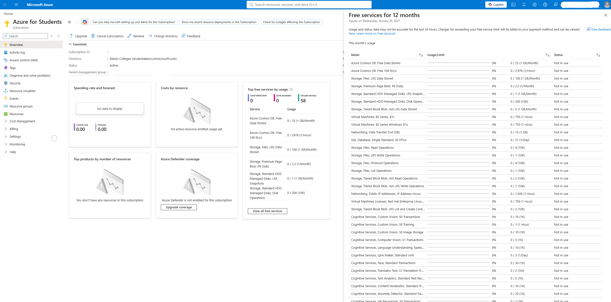
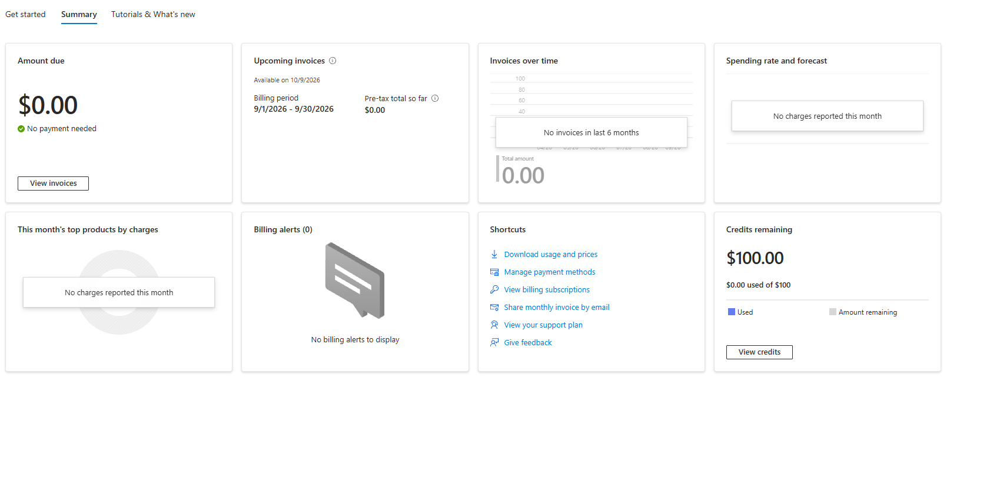
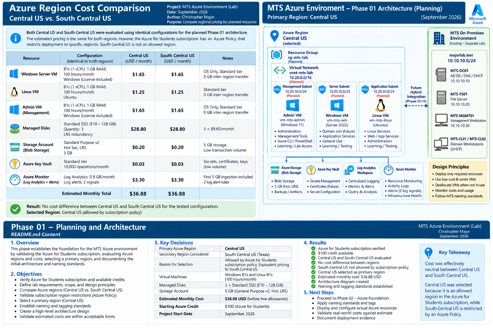
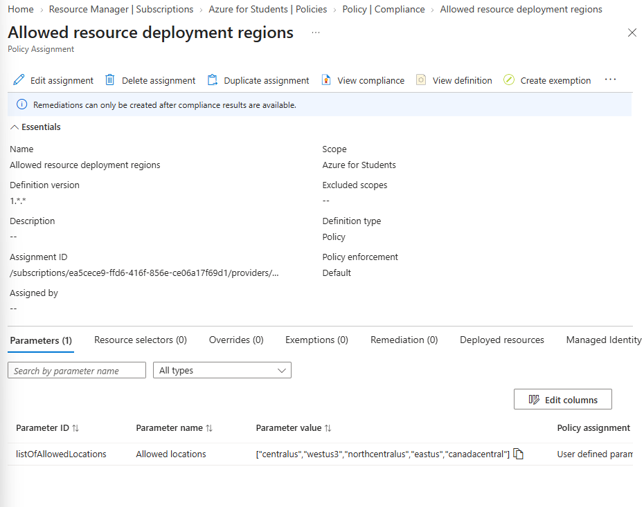
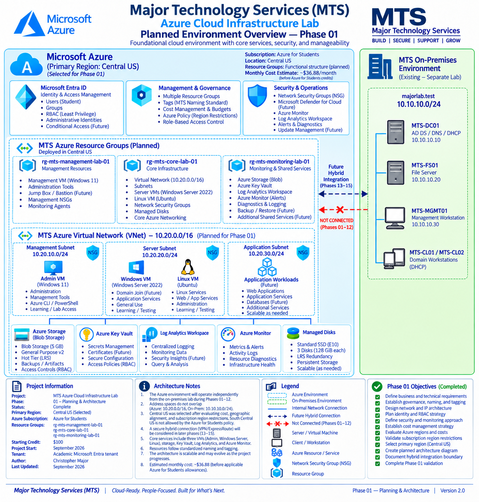

# Phase 1 — Planning & Architecture

## Overview

Phase 1 establishes the initial design for the Major Technology Services (MTS) Azure Cloud Infrastructure Lab.

The purpose of this phase is to define the Azure environment before deployment begins. Planning includes subscription requirements, regional availability, cost estimates, resource organization, network segmentation, naming and tagging standards, identity management, security, and monitoring.

The lab uses an Azure for Students subscription, with Central US selected as the primary deployment region.

No Azure infrastructure is deployed as part of this phase. Implementation begins in Phase 2.

---

## Lab Scope

The lab represents a fictional organization:

**Major Technology Services (MTS)**

The project is designed to demonstrate practical Azure infrastructure administration across the following areas:

- Azure resource deployment and governance
- Virtual networking and Network Security Groups (NSGs)
- Windows and Linux virtual machines
- Microsoft Entra ID, Azure RBAC, and managed identities
- Azure Storage and Key Vault
- Monitoring, logging, and alerts
- Infrastructure as Code using Terraform
- PowerShell and Azure CLI administration
- Cloud troubleshooting and operational validation

The Azure environment will be implemented independently of the existing MTS Windows Server and Active Directory lab.

Hybrid connectivity and cross-environment identity integration are reserved for a separate future project.

---

## Azure Subscription

The project uses an **Azure for Students** subscription.

The subscription was reviewed before deployment to establish the available environment, identify governance restrictions, and document the initial cost baseline.

### Subscription Baseline



The subscription provides access to Azure services for educational testing, subject to applicable credit, quota, service, and policy restrictions.

### Student Credit Baseline



The available student credit was considered during resource planning. Costs will be monitored throughout implementation to avoid unnecessary consumption.

---

## Regional Analysis

Central US and South Central US were initially evaluated as primary deployment candidates.

South Central US was considered because of its geographic proximity to the Texas-based lab environment.

The Azure Pricing Calculator showed no meaningful difference between the two regions for the evaluated resource configuration.

### Regional Cost Comparison



Subscription governance was then reviewed to verify which Azure regions were permitted.

An Azure Policy assignment named `Allowed resource deployment regions` restricted resource placement.

### Allowed Deployment Regions

The policy permitted the following regions at the time of the Phase 1 review:

| Region | Deployment Allowed |
|---|---|
| Central US | Yes |
| West US 3 | Yes |
| North Central US | Yes |
| East US | Yes |
| Canada Central | Yes |
| South Central US | No |



### Final Region Selection

**Central US**

Central US was selected because it:

- Complied with the subscription's deployment-region policy.
- Supported the planned Azure services.
- Provided comparable estimated pricing for the evaluated configuration.
- Allowed the lab to proceed without violating subscription governance restrictions.

The region-selection process established that subscription policies and service availability must be validated alongside pricing before deploying infrastructure.

---

## Cost Planning

Azure Pricing Calculator estimates were prepared for the planned environment.

The analysis considered:

- Windows and Linux virtual machines
- Managed disks
- Azure Storage
- Azure Key Vault
- Log Analytics and Azure Monitor
- Network services

The initial architecture estimate was approximately **$36.88 per month before applicable Azure for Students credits and allowances**.

This figure represents the planning configuration, not actual Azure consumption. Costs may change based on selected VM sizes, runtime, disk allocation, storage usage, monitoring ingestion, and network traffic.

### Cost-Control Strategy

The following practices will be used during implementation:

- Deploy resources only when required for the current phase.
- Select appropriately sized virtual machines.
- Configure automatic VM shutdown where supported.
- Deallocate virtual machines when they are not needed.
- Establish a subscription budget and cost alerts.
- Monitor consumption through Azure Cost Management.
- Review storage and Log Analytics usage.
- Remove unused resources when appropriate.

Deallocating a VM stops its compute charges but does not eliminate charges for retained managed disks or other billable resources.

Cost controls will be implemented before significant compute workloads are introduced.

---

## Planned Network Architecture

The Azure environment will use a dedicated virtual network:

```text
vnet-mts-lab-01
10.20.0.0/16
```

The network will be divided into three functional subnets.

| Subnet | Address Space | Purpose |
|---|---|---|
| `snet-mts-management-01` | `10.20.10.0/24` | Administrative and management resources |
| `snet-mts-server-01` | `10.20.20.0/24` | Windows and Linux server workloads |
| `snet-mts-application-01` | `10.20.30.0/24` | Application and future service workloads |

Each subnet will have a dedicated Network Security Group to support workload separation and controlled traffic access.

### Network Addressing

The Azure address space was selected to avoid overlap with the existing MTS on-premises lab.

```text
Azure VNet:         10.20.0.0/16
Management Subnet:  10.20.10.0/24
Server Subnet:      10.20.20.0/24
Application Subnet: 10.20.30.0/24

On-Premises Lab:    10.10.10.0/24
```

The two environments will remain independent during this project.

The nonoverlapping address spaces preserve the option for future hybrid connectivity without requiring the existing network design to be replaced.

---

## Architecture Diagram

The Phase 1 architecture diagram documents the original planned Azure environment, including resource groups, network segmentation, virtual machines, identity services, security controls, storage, and monitoring.



The diagram represents the **initial planning architecture**, not the final deployed environment.

Several original assumptions were revised during implementation, including VM operating systems, resource placement, and service configurations.

The diagram also references an earlier proposal for hybrid integration in Phases 13–15. That work is not part of the finalized 12-phase Azure project and is reserved for a separate future lab.

Actual deployed configurations and validation results are documented in their respective implementation phases.

---

## Planned Azure Infrastructure

### Resource Organization

Resources will be organized using workload-based Azure Resource Groups.

| Resource Group | Planned Purpose |
|---|---|
| `rg-mts-core-lab-01` | Core networking and shared infrastructure |
| `rg-mts-management-lab-01` | Management and administrative resources |
| `rg-mts-monitoring-lab-01` | Monitoring and operational services |

Additional resource groups may be introduced when later phases require separate workload management.

### Compute

Three virtual machine roles are included in the initial design.

| Role | Purpose |
|---|---|
| Management VM | Administrative access and Azure management tools |
| Windows Server VM | Windows infrastructure and administration |
| Linux VM | Linux administration and workload testing |

Virtual machines will be deployed incrementally to manage subscription consumption.

VM sizes, operating systems, and storage configurations will be finalized during the relevant deployment phases based on availability, subscription limits, and cost.

### Identity and Access Management

Microsoft Entra ID and Azure RBAC will support cloud identity and resource authorization.

The planned identity model includes:

- Administrative identities
- User and group management where permitted
- Azure role assignments
- Least-privilege access
- Managed identity evaluation
- Resource-scoped authorization

Access to institutional Microsoft Entra administration may be restricted by the subscription's tenant permissions. These boundaries will be evaluated during the identity phase.

### Storage

Azure Storage will support:

- Blob storage
- Administrative and project artifacts
- Storage access-control testing
- Diagnostic and monitoring activities

Managed disks will provide persistent storage for virtual machines.

Storage security and access configurations will be validated during implementation.

### Security

The planned security architecture includes:

- Network Security Groups
- Azure RBAC
- Least-privilege administration
- Controlled administrative access
- Azure Key Vault
- Resource governance
- Diagnostic logging

Security controls will be implemented and tested during the corresponding project phases.

### Monitoring

The monitoring design includes:

- Azure Monitor
- Log Analytics Workspace
- Azure Activity Logs
- Resource metrics
- Diagnostic settings
- Metric alerts
- Action groups
- Cost monitoring

Monitoring will be introduced incrementally to support operational visibility without unnecessary resource consumption.

---

## Naming Standard

Resources will follow a consistent MTS naming convention.

General format:

```text
<resource-type>-mts-<function>-<instance>
```

Examples:

| Resource | Planned Name |
|---|---|
| Core Resource Group | `rg-mts-core-lab-01` |
| Management Resource Group | `rg-mts-management-lab-01` |
| Monitoring Resource Group | `rg-mts-monitoring-lab-01` |
| Virtual Network | `vnet-mts-lab-01` |
| Management Subnet | `snet-mts-management-01` |
| Server Subnet | `snet-mts-server-01` |
| Application Subnet | `snet-mts-application-01` |
| Management NSG | `nsg-mts-management-01` |
| Server NSG | `nsg-mts-server-01` |
| Application NSG | `nsg-mts-application-01` |

Some Azure resources have additional naming requirements, including globally unique names, character restrictions, or length limits.

Resource-specific naming requirements will be applied during deployment.

---

## Tagging Standard

Resources will use standardized tags wherever supported.

| Tag | Planned Value |
|---|---|
| `Environment` | `Lab` |
| `Project` | `MTS-Azure-Lab` |
| `Owner` | `Christopher-Major` |
| `ManagedBy` | `Manual` |
| `Workload` | Resource-specific workload |

The `Workload` value will identify the resource's primary function, such as management, networking, compute, storage, monitoring, or security.

Tagging will support:

- Resource identification
- Cost analysis
- Ownership tracking
- Governance
- Workload classification

Tag compliance will be reviewed during later implementation and validation phases.

---

## Administration and Security Principles

The environment will follow several core operating principles.

**Security:** Apply least privilege, network segmentation, and appropriate administrative access controls.

**Cost Management:** Deploy only required resources and avoid unnecessary VM runtime.

**Governance:** Maintain consistent naming, tagging, and resource organization.

**Manageability:** Use Azure CLI, PowerShell, and documented procedures to support repeatable administration.

**Monitoring:** Establish visibility into resource activity, health, and configuration.

**Validation:** Verify deployed resources and document results before proceeding to dependent infrastructure.

These principles will guide the implementation, troubleshooting, and final validation phases.

---

## Implementation Roadmap

The Azure Cloud Infrastructure Lab is organized into 12 phases.

| Phase | Scope |
|---|---|
| 1 | Planning & Architecture |
| 2 | Azure Foundation |
| 3 | Management Compute |
| 4 | Compute |
| 5 | Identity & RBAC |
| 6 | Storage |
| 7 | Security |
| 8 | Monitoring & Logging |
| 9 | Infrastructure as Code |
| 10 | Administration & Automation |
| 11 | Cloud Troubleshooting |
| 12 | Azure Environment Validation |

The phases progress from initial planning and infrastructure deployment through identity, security, monitoring, automation, troubleshooting, and final operational validation.

Hybrid integration is not included in this roadmap.

---

## Repository Organization

Project documentation is separated by phase and purpose.

```text
MTS-Azure-Cloud-Infrastructure-Lab/
│
├── README.md
├── Architecture/
│   └── 01-Planning-Architecture/
│       └── MTS-Azure-Planned-Architecture.PNG
│
├── Documents/
│   ├── 01-Planning-Architecture/
│   ├── 02-Azure-Foundation/
│   ├── ...
│   └── 12-Azure-Environment-Validation/
│
├── Screenshots/
│   ├── 01-Planning-Architecture/
│   ├── 02-Azure-Foundation/
│   ├── ...
│   └── 12-Azure-Environment-Validation/
│
└── Troubleshooting/
```

Phase documentation is maintained under `Documents/`, with supporting screenshots stored under the corresponding `Screenshots/` directories.

Terraform files, administrative scripts, and incident reports are maintained within their relevant phase directories.

Screenshots are used as evidence for meaningful configuration decisions, deployments, and validation rather than documenting every individual portal interaction.

Credentials, access keys, secrets, and Terraform state files will not be published.

---

## Phase 1 Verification

Phase 1 established the requirements and planning baseline needed to begin implementation:

- Project scope and technical objectives
- Azure for Students subscription review
- Student credit baseline
- Regional pricing comparison
- Subscription deployment restrictions
- Central US region selection
- Cost-management strategy
- Virtual network and subnet design
- Planned Azure services and VM roles
- Resource group organization
- Naming and tagging standards
- Identity and security approach
- Monitoring architecture
- Planned architecture diagram
- Twelve-phase implementation roadmap

The planning artifacts provide the design baseline for subsequent phases.

No later-phase infrastructure deployment is represented as completed during Phase 1.

**Phase 1 Status: Complete**

---

## Next Phase

**Phase 2 — Azure Foundation**

Phase 2 begins implementation by creating the Azure resource groups, applying governance tags, configuring budget and cost-management controls, deploying the virtual network and subnets, and establishing Network Security Groups.

The deployed resources will be validated against the Phase 1 design.
