# Phase 2 — Azure Foundation

## Overview

Phase 2 establishes the foundational Azure infrastructure for the Major Technology Services (MTS) Azure Cloud Infrastructure Lab.

This phase implements the resource organization, governance, cost controls, and network architecture designed during Phase 1.

The work includes creating resource groups, applying standardized tags, configuring a subscription budget and notifications, deploying the virtual network, and associating Network Security Groups (NSGs) with the management, server, and application subnets.

No virtual machines or application workloads are deployed during this phase. Compute deployment begins in Phase 3.

---

## Azure Subscription Baseline

The Azure for Students subscription was reviewed before deploying infrastructure.

The initial environment showed:

| Setting | Value |
|---|---|
| Subscription | Azure for Students |
| Status | Active |
| Primary Region | Central US |
| Reported Cost | $0.00 |
| Phase 2 Infrastructure | Not yet deployed |

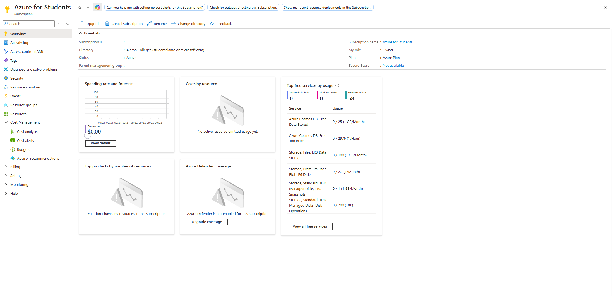

This established a starting point for comparing resource consumption after deployment.

---

## Resource Group Organization

Three resource groups were created to separate infrastructure by function.

| Resource Group | Purpose |
|---|---|
| `rg-mts-core-lab-01` | Core networking and shared infrastructure |
| `rg-mts-management-lab-01` | Management and administrative resources |
| `rg-mts-monitoring-lab-01` | Monitoring and alerting services |

The resource groups were deployed in Central US, consistent with the region selected during Phase 1.

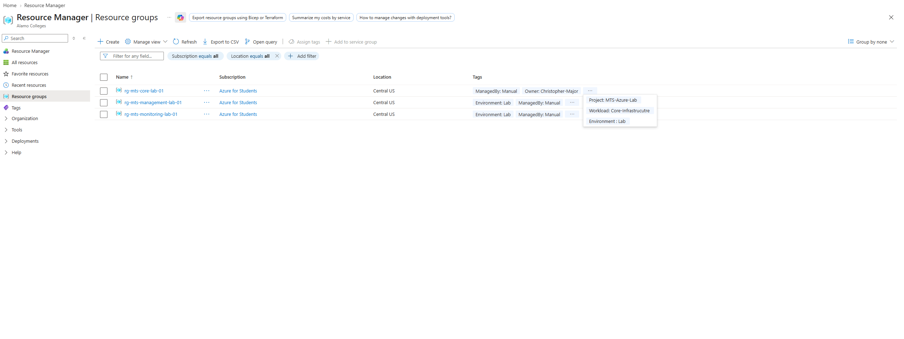

The core resource group will contain the initial virtual network and NSGs. The management and monitoring resource groups will support workloads introduced during subsequent phases.

---

## Resource Tagging

The MTS tagging standard was applied to the foundational resources.

| Tag | Value |
|---|---|
| `Environment` | `Lab` |
| `Project` | `MTS-Azure-Lab` |
| `Owner` | `Christopher-Major` |
| `ManagedBy` | `Manual` |
| `Workload` | `Core-Infrastructure` |

The `Workload` value identifies the resource's function and may differ for management, monitoring, or other workloads.

Tags provide a consistent method for identifying resources, reviewing costs, and organizing the environment.

Tag retention was verified again after network deployment.

---

## Azure Resource Provider

The `Microsoft.Insights` resource provider was reviewed before configuring monitoring-related resources.

Its registration status was confirmed as:

```text
Microsoft.Insights
Status: Registered
```

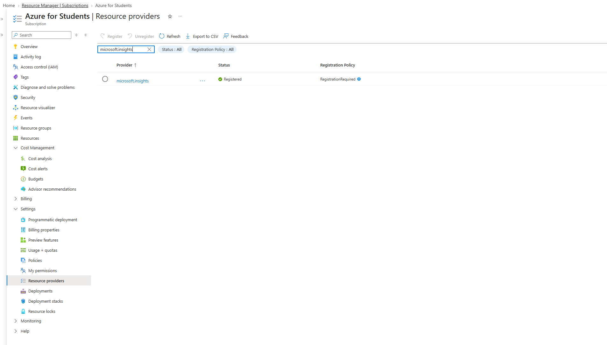

This established the required provider registration for Azure Monitor functionality used during the lab.

---

## Cost Management

A subscription-level monthly budget was created before deploying compute resources.

### Budget Configuration

| Setting | Configuration |
|---|---|
| Budget Name | `budget-mts-azure-lab-01` |
| Scope | Azure for Students subscription |
| Budget Amount | $25 USD |
| Reset Period | Monthly |

The budget provides visibility into spending as additional Azure resources are deployed.

A budget does not automatically prevent charges or stop running resources when its threshold is reached.

### Azure Monitor Action Group

An Action Group was created for notification delivery.

| Setting | Configuration |
|---|---|
| Action Group | `ag-mts-cost-alerts-lab-01` |
| Resource Group | `rg-mts-monitoring-lab-01` |
| Notification Method | Email |
| Recipient | Configured and verified in Azure |

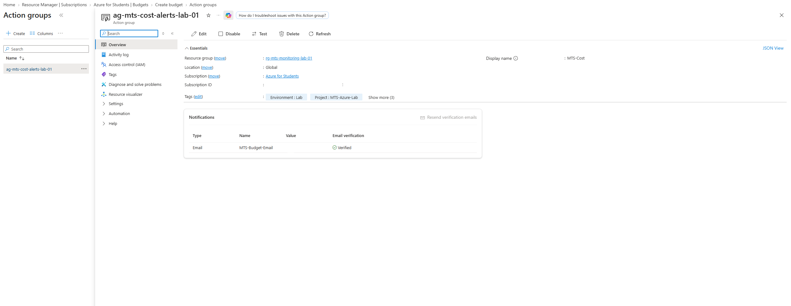

### Budget Alert Thresholds

Four cost conditions were configured.

| Alert Type | Threshold | Amount |
|---|---:|---:|
| Actual Cost | 50% | $12.50 |
| Actual Cost | 80% | $20.00 |
| Actual Cost | 100% | $25.00 |
| Forecasted Cost | 100% | $25.00 |

The configured budget notifications reference the MTS cost-alert Action Group.

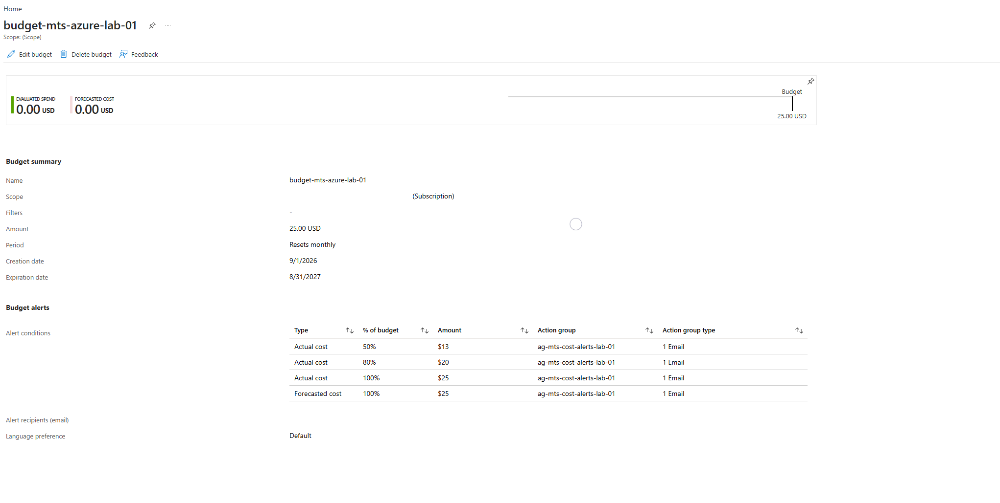

The budget and notification configuration was verified in the Azure portal.

A successful manual Action Group test notification was not captured during this phase. Notification delivery should therefore not be represented as independently tested.

---

## Azure Virtual Network

The primary virtual network was deployed into the core infrastructure resource group.

| Setting | Configuration |
|---|---|
| Virtual Network | `vnet-mts-lab-01` |
| Resource Group | `rg-mts-core-lab-01` |
| Region | Central US |
| Address Space | `10.20.0.0/16` |

The network uses the address space established during Phase 1.

```text
Azure VNet:      10.20.0.0/16
On-Premises Lab: 10.10.10.0/24
```

The address spaces do not overlap. No connectivity between the two environments is configured during this phase.

### Deployment Validation

Azure Resource Manager validation was completed before the virtual network was deployed.

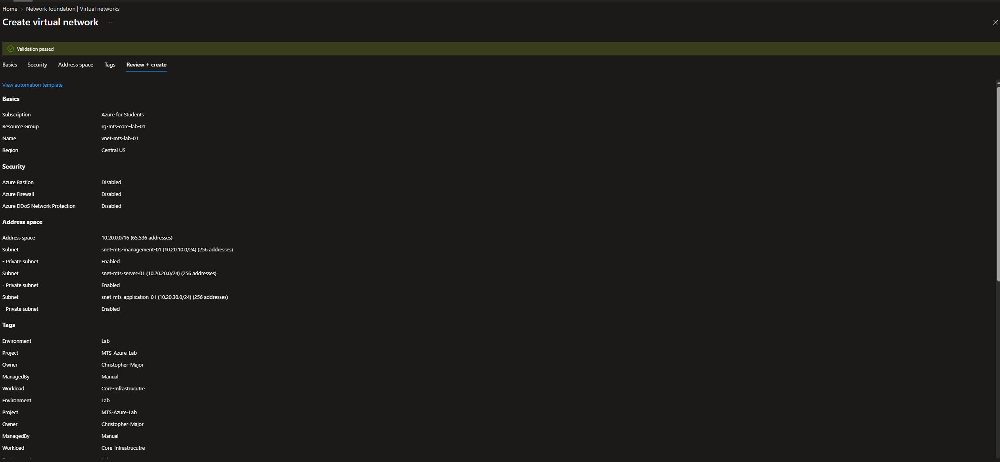

The deployment proceeded after the configuration passed validation.

---

## Network Segmentation

The virtual network was divided into three subnets.

| Subnet | Address Space | Purpose |
|---|---|---|
| `snet-mts-management-01` | `10.20.10.0/24` | Management and administration |
| `snet-mts-server-01` | `10.20.20.0/24` | Windows and Linux server workloads |
| `snet-mts-application-01` | `10.20.30.0/24` | Application and service workloads |

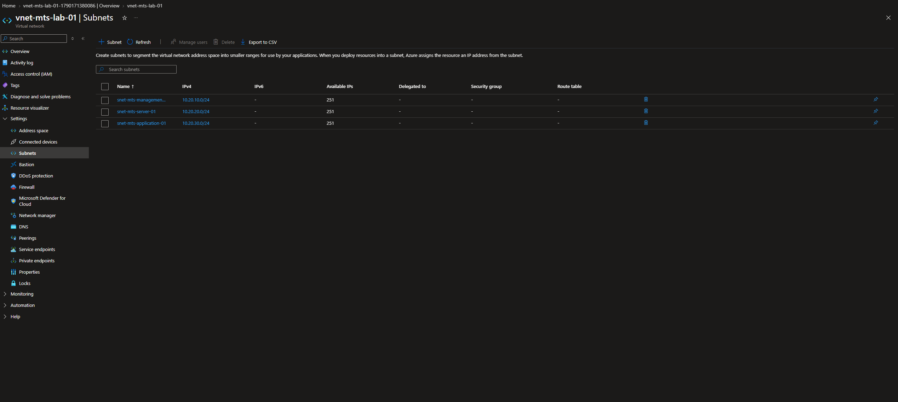

The subnets establish separate network segments for the workloads deployed during later phases.

---

## Network Security Groups

Three NSGs were deployed into `rg-mts-core-lab-01`.

| Network Security Group | Network Segment |
|---|---|
| `nsg-mts-management-01` | Management |
| `nsg-mts-server-01` | Server |
| `nsg-mts-application-01` | Application |

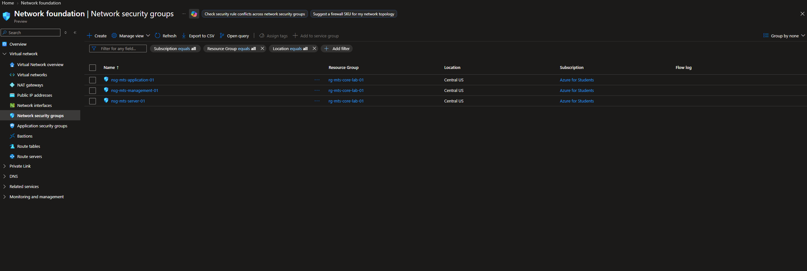

Each NSG was associated with its corresponding subnet.

| Subnet | Associated NSG |
|---|---|
| `snet-mts-management-01` | `nsg-mts-management-01` |
| `snet-mts-server-01` | `nsg-mts-server-01` |
| `snet-mts-application-01` | `nsg-mts-application-01` |

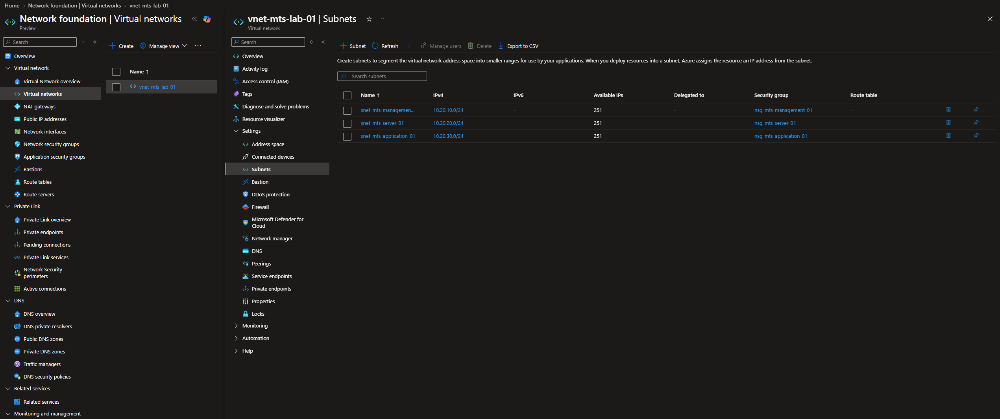

### Network Security Structure

```text
vnet-mts-lab-01
│
├── snet-mts-management-01
│   └── nsg-mts-management-01
│
├── snet-mts-server-01
│   └── nsg-mts-server-01
│
└── snet-mts-application-01
    └── nsg-mts-application-01
```

Phase 2 establishes the subnet-level NSG associations.

Workload-specific security rules will be configured and tested as the corresponding virtual machines and services are introduced.

An NSG association does not, by itself, establish complete isolation between subnets. Traffic remains subject to the NSG's effective security rules, including Azure's default rules.

---

## Core Infrastructure Validation

The core resource group was reviewed after deployment.

The following resources were confirmed:

```text
rg-mts-core-lab-01
│
├── vnet-mts-lab-01
├── nsg-mts-management-01
├── nsg-mts-server-01
└── nsg-mts-application-01
```

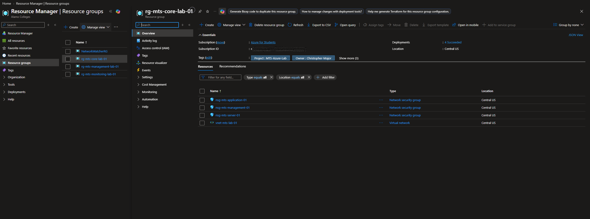

The VNet contains the three planned subnets, each associated with its corresponding NSG.

### Resource Tag Validation

The deployed virtual network was reviewed to confirm that the standardized tags were retained.

```text
Environment : Lab
Project     : MTS-Azure-Lab
Owner       : Christopher-Major
ManagedBy   : Manual
Workload    : Core-Infrastructure
```

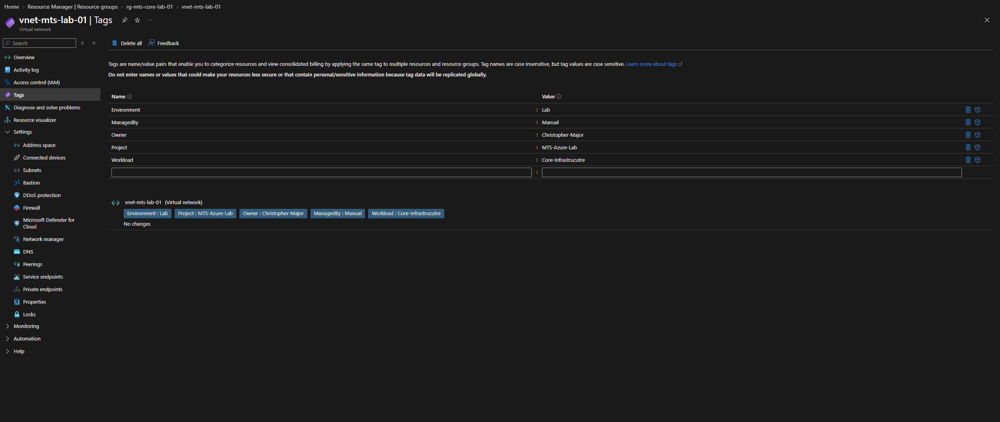

This verified the tagging configuration on the deployed VNet. It does not establish that every future resource will automatically inherit these tags.

---

## Post-Deployment Cost Validation

Azure Cost Management was reviewed after the foundational resources were deployed.

At the time of validation:

| Item | Result |
|---|---|
| Reported Actual Cost | $0.00 |
| Monthly Budget | $25 |
| Virtual Machines Deployed | 0 |
| Running Compute Workloads | 0 |

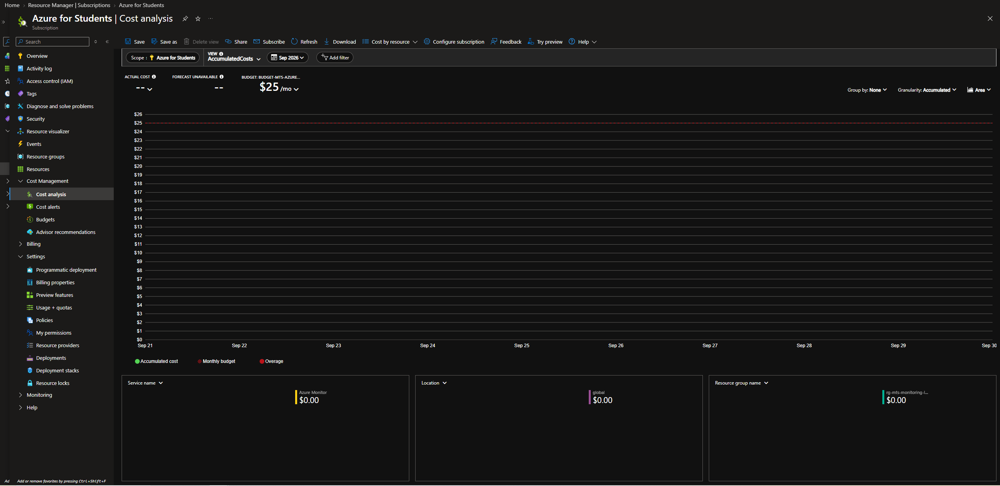

The reported cost remained at $0.00 during the review period.

This is a point-in-time billing observation, not a guarantee that all deployed resources are free or that charges cannot appear after reporting delays.

---

## Phase 2 Verification

Phase 2 established and validated the initial Azure foundation:

- Azure for Students subscription reviewed
- Three workload-based resource groups created
- Standardized resource tags applied
- `Microsoft.Insights` registration verified
- $25 monthly subscription budget configured
- Actual-cost and forecasted-cost alert conditions configured
- Azure Monitor Action Group created
- Central US virtual network deployed
- Management, server, and application subnets created
- Three Network Security Groups deployed
- Each NSG associated with its intended subnet
- Core infrastructure resource inventory reviewed
- VNet resource tags validated
- Post-deployment cost baseline documented

The budget and Action Group configurations were verified, but a successful manual notification test was not evidenced.

No virtual machines or application workloads were deployed during this phase.

**Phase 2 Status: Complete**

---

## Next Phase

**Phase 3 — Management Compute**

Phase 3 introduces the first Azure virtual machine into the management subnet.

The next phase will deploy and configure an Ubuntu management VM, establish SSH-based administrative access, install and validate the Azure CLI, and implement VM cost controls.

The deployment will build on the existing resource groups, network segmentation, and NSG configuration.
