# Phase 3 — Management Compute

## Overview

Phase 3 introduces the first virtual machine into the Major Technology Services (MTS) Azure Cloud Infrastructure Lab.

An Ubuntu Server management VM was deployed into the dedicated management subnet established during Phase 2. The system provides a Linux-based administrative environment for Azure CLI operations, network validation, and infrastructure management.

The VM was initially deployed without a public IP address. A controlled public IP and source-restricted SSH rule were subsequently configured to provide administrative access.

This phase also covers operating-system maintenance, Azure CLI authentication, resource validation, automatic shutdown, and VM deallocation.

---

## Existing Infrastructure

The deployment uses the resource groups and network architecture established during Phase 2.

| Resource | Configuration |
|---|---|
| Subscription | Azure for Students |
| Region | Central US |
| Management Resource Group | `rg-mts-management-lab-01` |
| Core Resource Group | `rg-mts-core-lab-01` |
| Virtual Network | `vnet-mts-lab-01` |
| VNet Address Space | `10.20.0.0/16` |
| Management Subnet | `snet-mts-management-01` |
| Management Subnet Range | `10.20.10.0/24` |
| Management NSG | `nsg-mts-management-01` |

### Management Resource Group

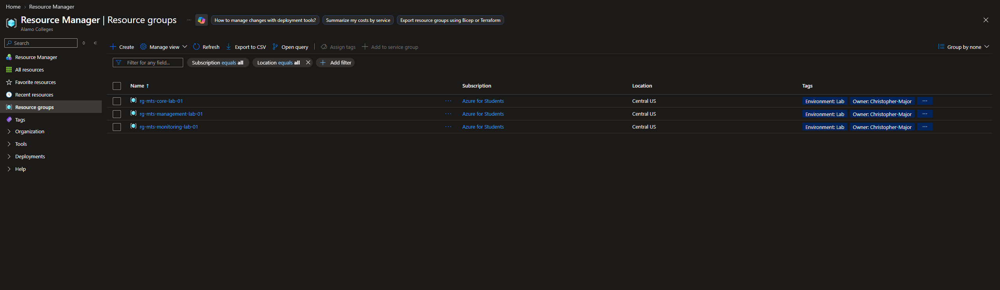

The management resource group separates administrative compute resources from shared networking infrastructure.

### Management Subnet

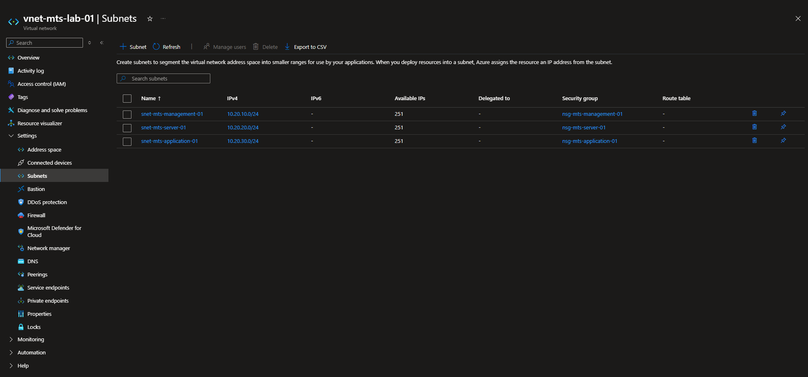

The VM will use the existing management subnet and its associated Network Security Group.

---

## VM Size Selection

The original design called for a low-cost B-series virtual machine.

During deployment, the preferred B1/B2 sizes were unavailable for the selected configuration under the Azure for Students subscription.

Available alternatives were reviewed before deployment.

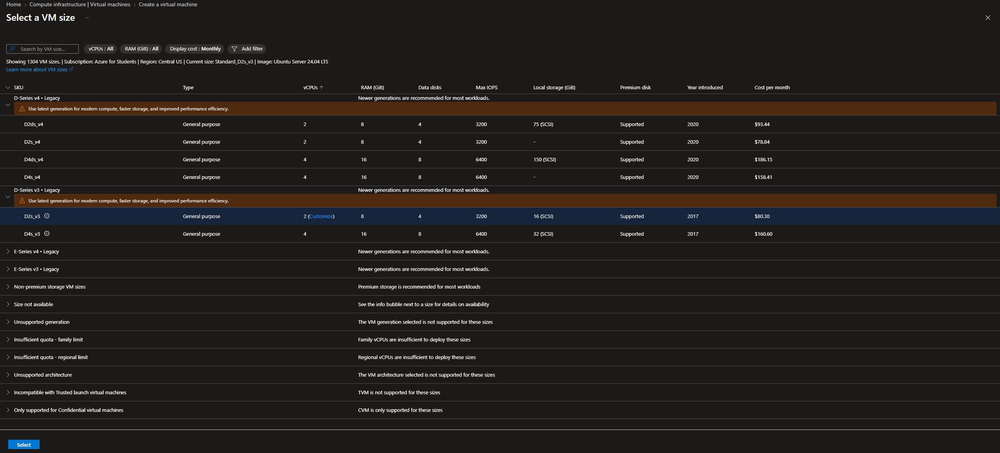

The selected configuration was:

| Component | Selection |
|---|---|
| Operating System | Ubuntu Server 24.04 LTS |
| VM Size | `Standard_D2s_v4` |
| vCPUs | 2 |
| Memory | 8 GiB |
| Architecture | x64 |

Ubuntu Server was selected over the more expensive available Windows configuration while still supporting the phase's administrative requirements.

The D-series VM was paired with automatic shutdown and manual deallocation to reduce unnecessary compute costs.

A separate troubleshooting record documents the VM-size availability and cost decision.

---

## Management VM Deployment

The management VM was configured with the following settings.

| Setting | Configuration |
|---|---|
| VM Name | `vm-mts-admin-01` |
| Resource Group | `rg-mts-management-lab-01` |
| Region | Central US |
| Operating System | Ubuntu Server 24.04 LTS |
| VM Size | `Standard_D2s_v4` |
| Administrator | `azureadmin` |
| Authentication | SSH public key |
| Azure Spot | Disabled |
| Initial Public IP | None |
| Initial Public Inbound Ports | None |

### VM Configuration

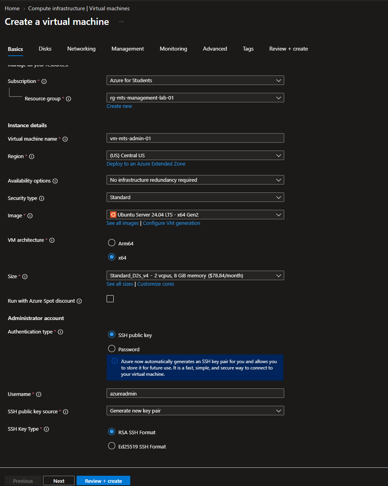

SSH public-key authentication was selected instead of password-based authentication.

### Disk Configuration

The operating-system disk was configured as follows.

| Setting | Configuration |
|---|---|
| Disk Type | Standard SSD |
| Disk Size | Image default |
| Encryption Key Management | Platform-managed |
| Delete with VM | Enabled |
| Additional Data Disks | None |

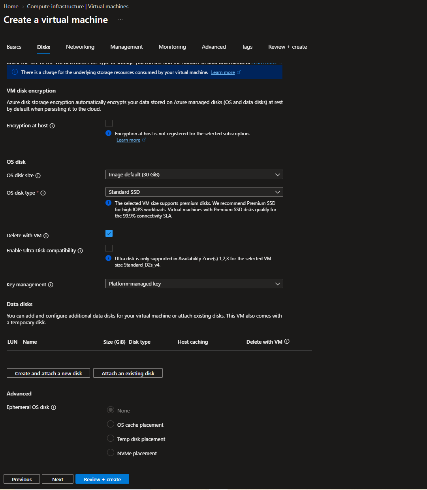

Standard SSD storage was sufficient for the administrative workload. The disk was configured for deletion with the VM to reduce the risk of retaining unused storage if the VM is removed.

### Initial Network Configuration

The VM was initially deployed using private networking.

```text
Virtual Network: vnet-mts-lab-01
Subnet:          snet-mts-management-01
Public IP:       None
NIC-Level NSG:   None
Subnet NSG:      nsg-mts-management-01
```

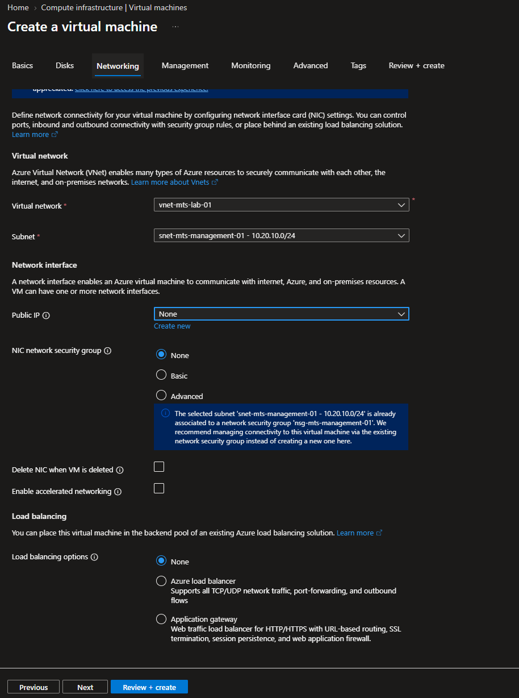

The existing subnet-level NSG was used instead of creating a duplicate NIC-level NSG.

### Resource Tags

The standard MTS tags were applied.

| Tag | Value |
|---|---|
| `Environment` | `Lab` |
| `Project` | `MTS-Azure-Lab` |
| `Owner` | `Christopher-Major` |
| `ManagedBy` | `Manual` |
| `Workload` | `Management-Compute` |

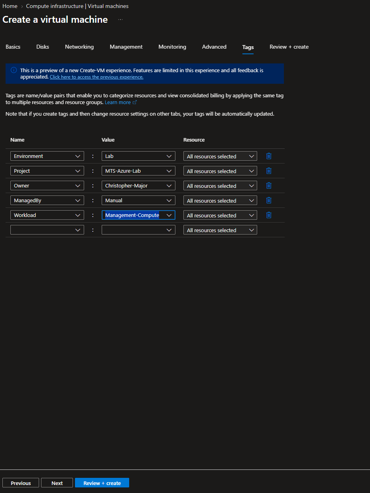

### Deployment Validation

The VM configuration was reviewed before deployment, including the subscription, region, resource group, operating system, VM size, storage, networking, authentication, and tags.

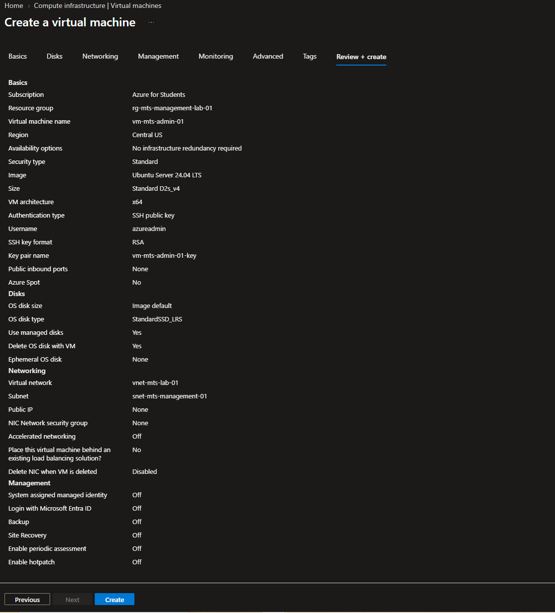

The deployment completed successfully.

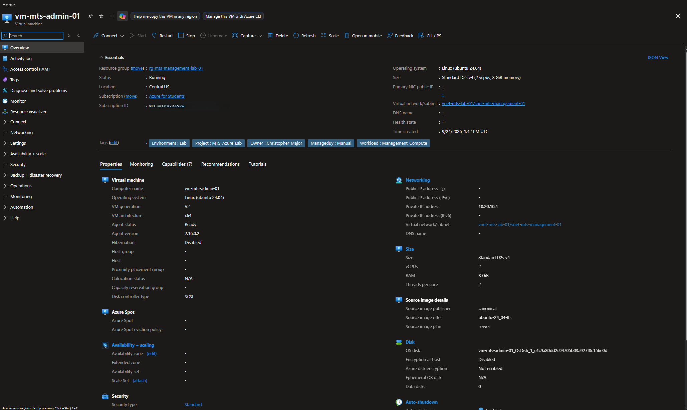

---

## Private Network Validation

After deployment, the VM was assigned the following private address:

```text
VM:         vm-mts-admin-01
Private IP: 10.20.10.4
Subnet:     snet-mts-management-01
VNet:       vnet-mts-lab-01
```

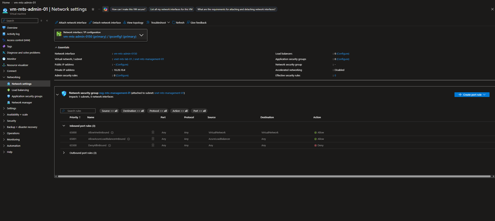

This confirmed that the VM was deployed into the intended management network.

### Management NSG Baseline

The management NSG was reviewed before enabling remote administrative access.

At this stage, the NSG contained the Azure default security rules, with no custom unrestricted SSH rule.

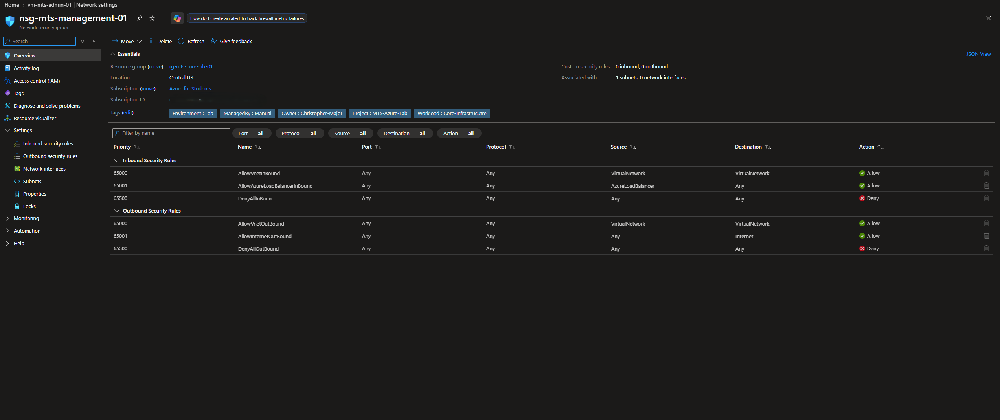

The initial deployment established the private network configuration before public administrative connectivity was introduced.

---

## Automatic Shutdown

Azure VM auto-shutdown was enabled to reduce unnecessary compute runtime.

| Setting | Configuration |
|---|---|
| Auto-shutdown | Enabled |
| Scheduled Time | 3:00 PM |
| Time Zone | Central Time |
| Notification | Enabled |

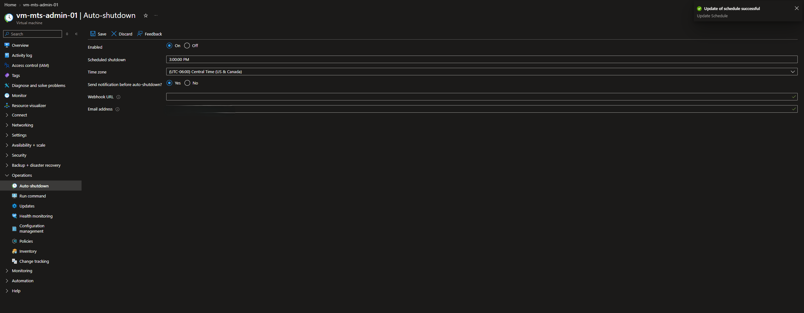

The schedule provides a safeguard against leaving the management VM running after lab work is completed.

Manual deallocation is also used when the VM is no longer required.

---

## Controlled Administrative Access

The VM was originally deployed without a public IP address.

A Standard public IP was subsequently created to support direct SSH administration from an approved source address.

### Public IP Configuration

| Setting | Configuration |
|---|---|
| Resource Name | `pip-mts-admin-01` |
| Resource Group | `rg-mts-management-lab-01` |
| Region | Central US |
| IP Version | IPv4 |
| SKU | Standard |
| Allocation | Static |

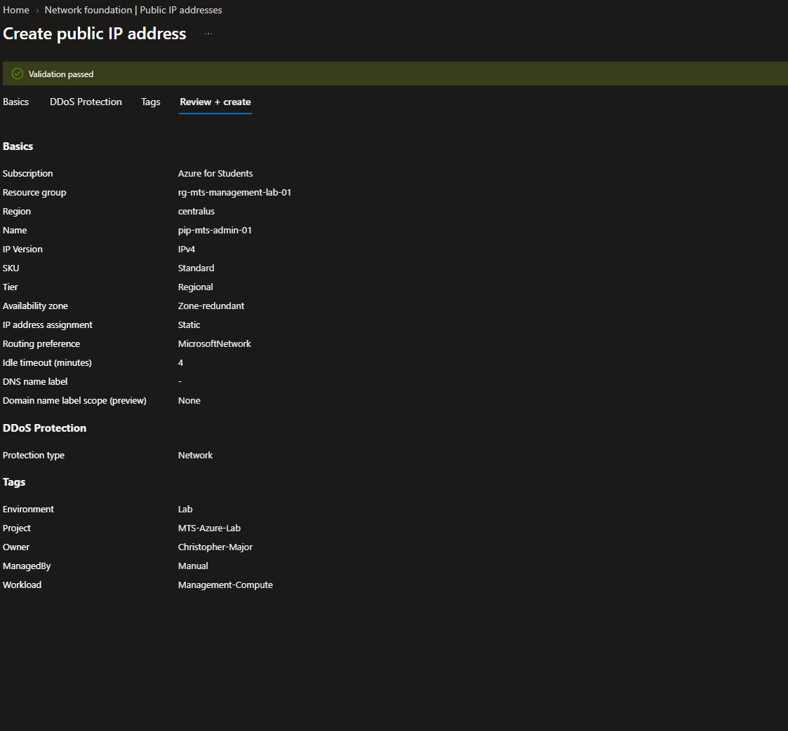

### Restricted SSH Rule

A custom inbound rule was added to the management subnet NSG.

| Setting | Configuration |
|---|---|
| NSG | `nsg-mts-management-01` |
| Rule | `Allow-SSH-Admin` |
| Direction | Inbound |
| Protocol | TCP |
| Destination Port | 22 |
| Source | Approved administrative public IP |
| Action | Allow |
| Priority | 100 |

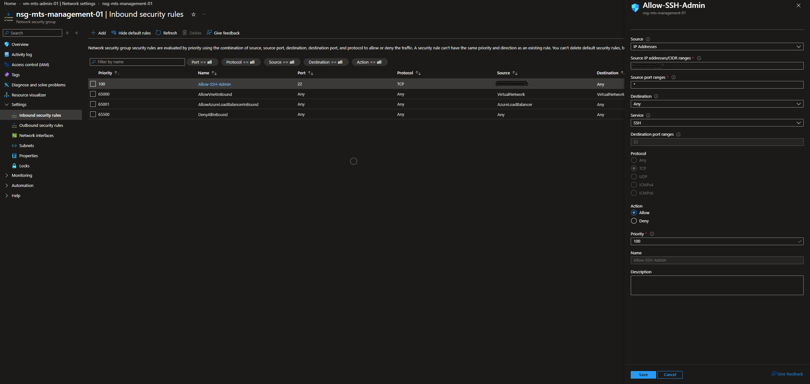

The rule permits SSH only from the approved administrative source address rather than allowing connections from any Internet address.

This reduces the exposure associated with the public IP while retaining the administrative access required for the lab.

---

## SSH Connectivity Validation

SSH connectivity was tested from the administrative workstation using the private key created during VM deployment.

Example command:

```powershell
ssh -i ".\vm-mts-admin-01-key.pem" azureadmin@<public-ip>
```

An initial connection attempt failed while the remote-access configuration was being established.

The public IP association, VM state, NSG rule, source address, SSH username, and private key were reviewed.

After the networking configuration was corrected, SSH authentication succeeded and an interactive Ubuntu shell was established.

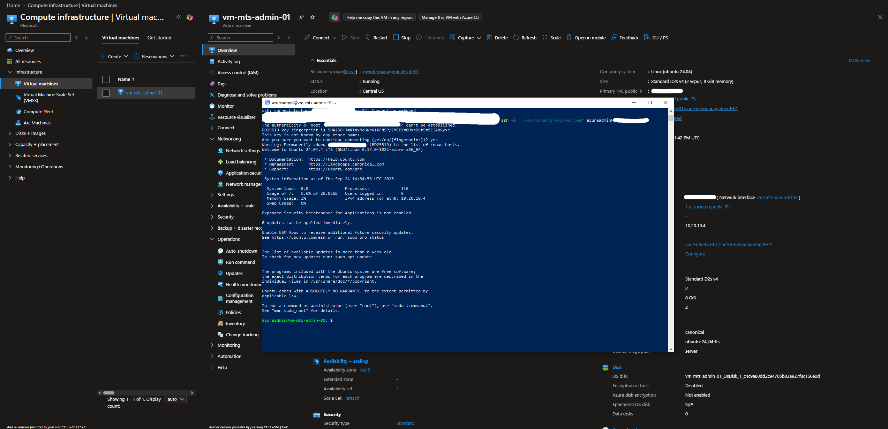

The successful connection validated the administrative access path through the public IP, management NSG, and SSH service.

---

## Ubuntu System Validation

After connecting to the VM, the operating system and network configuration were inspected.

Commands included:

```bash
hostname
cat /etc/os-release
uname -a
ip addr
free -h
```

The results confirmed:

| Component | Result |
|---|---|
| Hostname | `vm-mts-admin-01` |
| Operating System | Ubuntu Server 24.04 LTS |
| Private IP | `10.20.10.4` |
| Memory | Approximately 8 GiB |

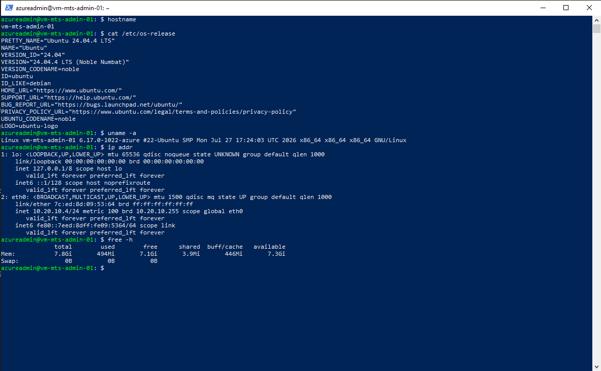

### Operating System Maintenance

Ubuntu package repositories were refreshed and available updates were applied.

During maintenance, the system reported that an updated Azure kernel required a reboot before becoming active.

The VM was rebooted:

```bash
sudo reboot
```

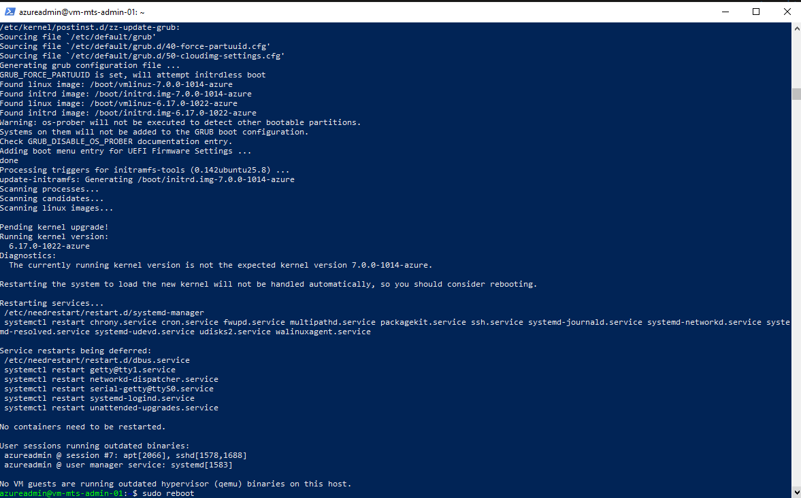

Administrative access was restored after the reboot, confirming that the VM remained operational following maintenance.

---

## Azure CLI Administration

Azure CLI was installed on the Ubuntu management VM to support command-line administration of the Azure subscription.

### CLI Version Validation

The installation was checked using:

```bash
az version
```

The reported Azure CLI version was:

```text
2.90.0
```

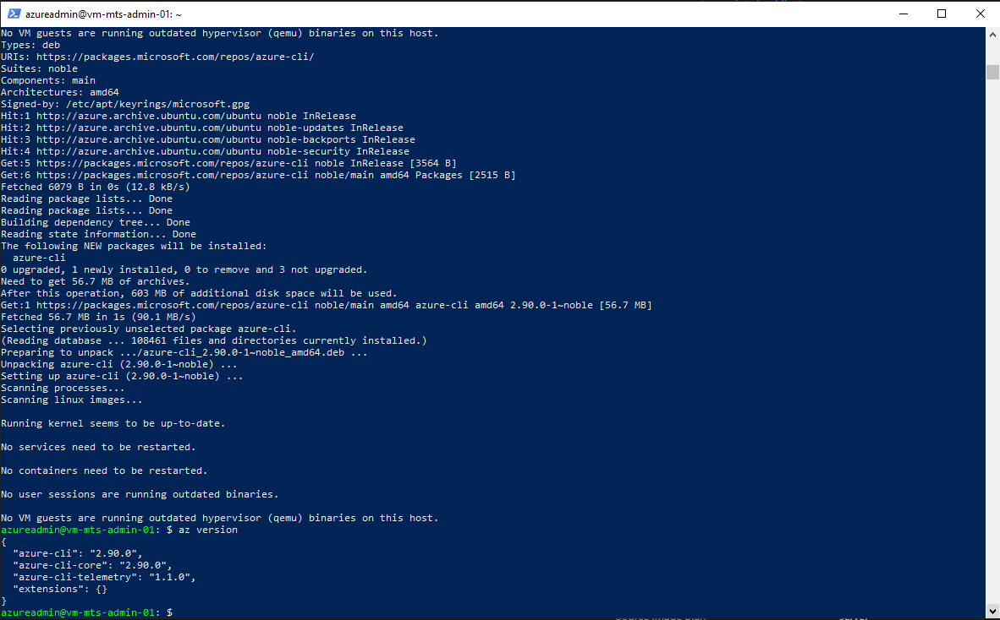

### Azure Authentication

Authentication was performed using:

```bash
az login
```

After signing in, the subscription resource groups were enumerated:

```bash
az group list --output table
```

The command returned the three foundational resource groups:

```text
rg-mts-core-lab-01
rg-mts-management-lab-01
rg-mts-monitoring-lab-01
```

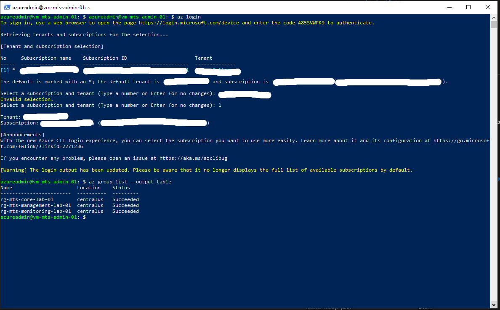

This confirmed that the management VM could authenticate to Azure and query resources in the lab subscription.

---

## Network Connectivity Validation

Linux networking commands were used to inspect the management VM's network configuration.

### Routing and Interface Configuration

```bash
ip route
ip addr
```

These commands confirmed the VM's network interface and default routing configuration.

### DNS Resolution

```bash
nslookup microsoft.com
```

DNS resolution completed successfully.

### Outbound HTTPS

```bash
curl -I https://www.microsoft.com
```

The HTTPS request returned:

```text
HTTP/2 200
```

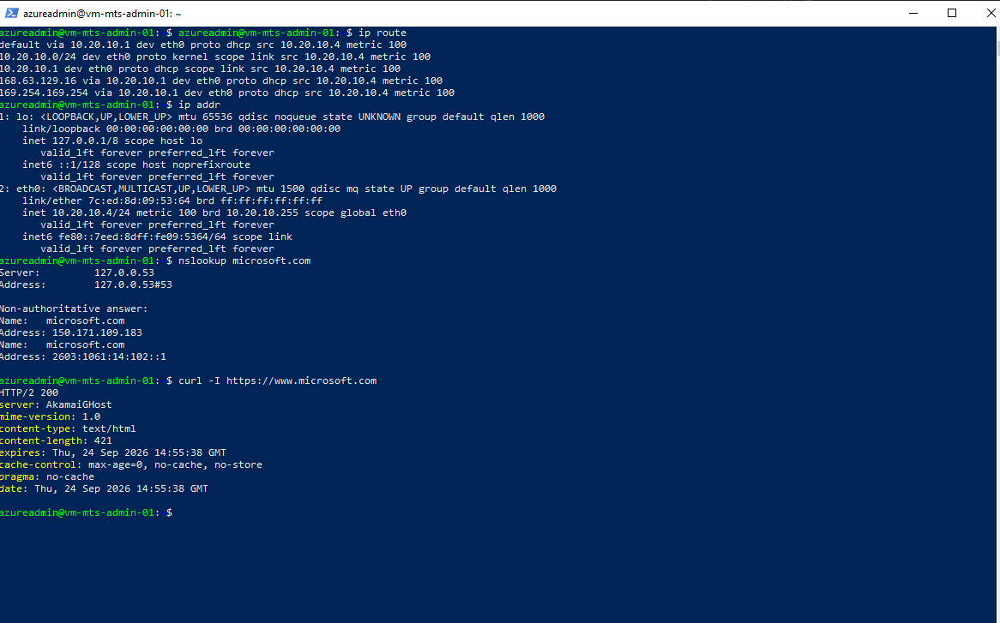

The tests confirmed functional DNS resolution and outbound HTTPS connectivity from the management VM.

---

## Azure Infrastructure Validation

Azure CLI was used to verify the existing network resources from the management VM.

### Virtual Network

```bash
az network vnet list --output table
```

The command confirmed:

```text
Name:           vnet-mts-lab-01
Resource Group: rg-mts-core-lab-01
Region:         centralus
Address Space:  10.20.0.0/16
```

### Subnets

```bash
az network vnet subnet list \
  --resource-group rg-mts-core-lab-01 \
  --vnet-name vnet-mts-lab-01 \
  --output table
```

The command returned:

```text
snet-mts-management-01
snet-mts-server-01
snet-mts-application-01
```

### Network Security Groups

```bash
az network nsg list --output table
```

The command confirmed the three deployed NSGs:

```text
nsg-mts-management-01
nsg-mts-server-01
nsg-mts-application-01
```

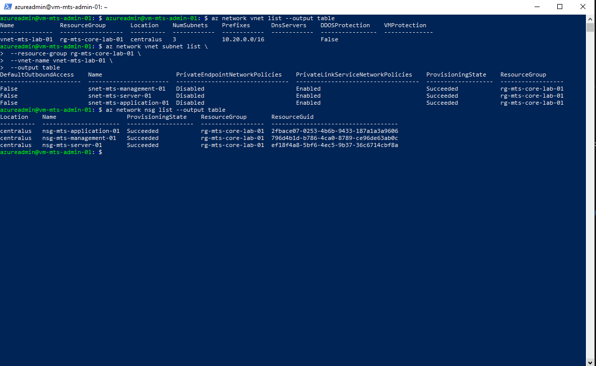

These checks verified that the Phase 2 networking resources remained available after the management VM was deployed.

---

## Management Resource Validation

The management resource group was reviewed after deployment.

The resource inventory included:

- `vm-mts-admin-01`
- `pip-mts-admin-01`
- Management VM network interface
- Management VM operating-system disk
- SSH key resource

The standardized resource tags were also reviewed.

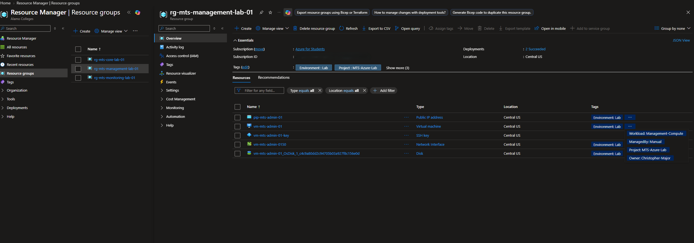

This confirmed that the management VM and supporting resources were organized within the intended resource group.

---

## VM Deallocation

The management VM was manually stopped and deallocated after completing the administrative tests.

Azure reported:

```text
Stopped (deallocated)
```

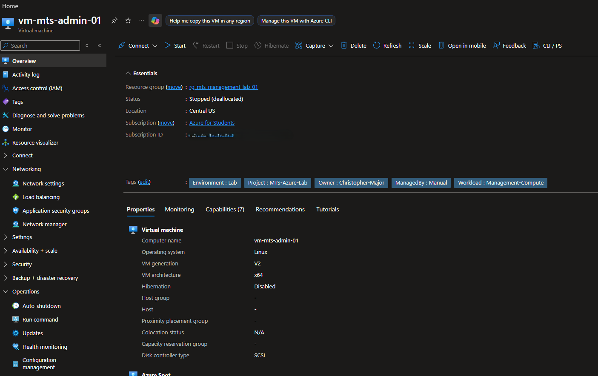

Deallocation releases the VM's compute allocation and stops the associated compute charges.

Managed disks, public IP resources, and other retained services may continue to incur charges while the VM is deallocated.

---

## Cost Validation

Azure Cost Management was reviewed at the conclusion of Phase 3.

| Item | Recorded Value |
|---|---|
| Monthly Budget | $25 |
| Reported Accumulated Cost | $0.00 |
| VM Auto-shutdown | Enabled |
| Final VM State | Stopped (deallocated) |

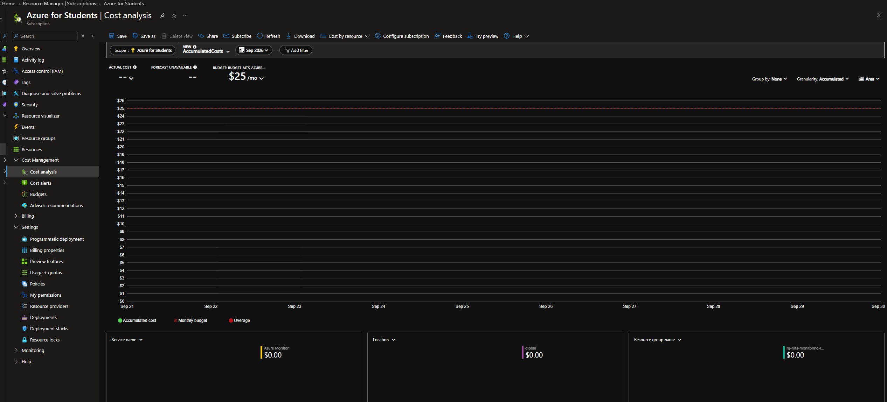

The reported cost represents the Azure Cost Management value at the time of the screenshot.

Azure billing data may lag actual consumption, so the displayed $0.00 does not establish that the deployed resources incurred no charges.

The primary cost controls were Ubuntu operating-system selection, Standard SSD storage, automatic shutdown, manual deallocation, and subscription budget monitoring.

---

## Troubleshooting and Design Decisions

Three issues influenced the Phase 3 implementation.

### VM Size Availability

The preferred B-series VM sizes were unavailable for the selected subscription and deployment configuration.

The VM was deployed using Ubuntu Server 24.04 LTS on `Standard_D2s_v4` instead.

Automatic shutdown and deallocation were used to limit the cost impact of the alternative VM size.

### Administrative Connectivity

The initial private deployment did not provide direct SSH access from the external administrative workstation.

A Standard public IP was added and SSH access was restricted to an approved source address through the management NSG.

### Initial SSH Failure

The first SSH connection attempt was unsuccessful.

The access path was reviewed, including the VM state, public IP, NSG configuration, source address, SSH credentials, and private key.

SSH connectivity succeeded after the required networking configuration was established.

The phase also included an Ubuntu kernel update that required a reboot before the updated kernel could be used.

---

## Phase 3 Verification

Phase 3 established and validated the management compute environment:

- Ubuntu Server 24.04 LTS deployed on `Standard_D2s_v4`
- VM placed in the management subnet
- Private IP `10.20.10.4` confirmed
- Initial deployment completed without a public IP
- Standard SSD operating-system disk configured
- Standardized resource tags applied
- Automatic shutdown enabled
- Standard public IP configured for administration
- Source-restricted SSH rule implemented
- SSH public-key authentication validated
- Ubuntu operating system and network settings reviewed
- System updates applied and reboot completed
- Azure CLI installed and authenticated
- Resource groups, VNet, subnets, and NSGs queried through Azure CLI
- DNS and outbound HTTPS connectivity validated
- Management resources reviewed
- VM manually deallocated
- Azure Cost Management reviewed

The final management VM state was **Stopped (deallocated)**.

**Phase 3 Status: Complete**

---

## Next Phase

**Phase 4 — Compute**

Phase 4 expands the Azure environment by deploying Windows Server and Linux virtual machines into the server subnet.

The next phase will validate compute configurations, network connectivity, administrative access, resource organization, and cost controls while building on the infrastructure established during Phases 1–3.
