# Phase 5 — Identity & RBAC

## Overview

Phase 5 implements and validates Azure Role-Based Access Control (RBAC) using a User-Assigned Managed Identity.

The purpose of this phase is to establish a least-privilege authorization model for the Major Technology Services (MTS) Azure Cloud Infrastructure Lab.

A managed identity was created, assigned the built-in Reader role at the Management resource-group scope, and attached to the existing Ubuntu management VM.

Azure CLI was then used to test successful authentication, authorized resource reads, denied management operations, and denied access to resources outside the assigned scope.

The phase also documents the administrative limitations of the institutional Microsoft Entra tenant.

---

## Existing Environment

The identity configuration uses the Azure infrastructure established during Phases 1–4.

| Resource | Configuration |
|---|---|
| Subscription | Azure for Students |
| Region | Central US |
| Core Resource Group | `rg-mts-core-lab-01` |
| Management Resource Group | `rg-mts-management-lab-01` |
| Monitoring Resource Group | `rg-mts-monitoring-lab-01` |
| Administrative VM | `vm-mts-admin-01` |
| VM Operating System | Ubuntu Server 24.04 LTS |
| Azure Administration | Azure CLI |

The existing management VM provides the environment for testing Azure workload authentication and RBAC permissions.

---

## Microsoft Entra Access Boundary

Microsoft Entra administrative access was reviewed before implementing the RBAC configuration.

The institutional tenant returned an authorization error when directory administration was attempted.

```text
401
Insufficient privileges to complete the operation
```

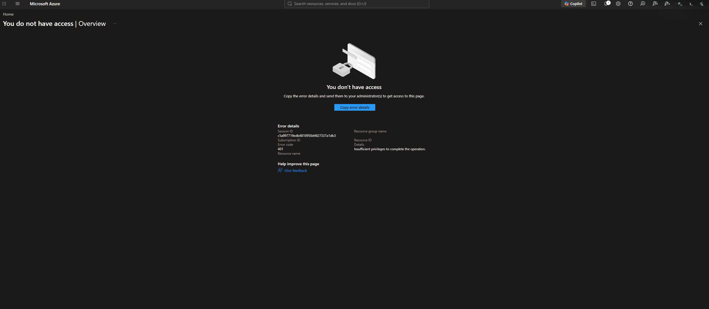

This established a distinction between Microsoft Entra directory administration and Azure resource authorization.

The institutional tenant remained outside the lab's administrative permissions.

Phase 5 therefore focused on the Azure RBAC capabilities available within the Azure for Students subscription rather than attempting to modify institutional directory settings.

---

## Subscription RBAC Baseline

The subscription's Access Control (IAM) configuration was reviewed to identify the existing administrative permissions.

The Azure for Students subscription showed Owner role assignments associated with the administrative account.

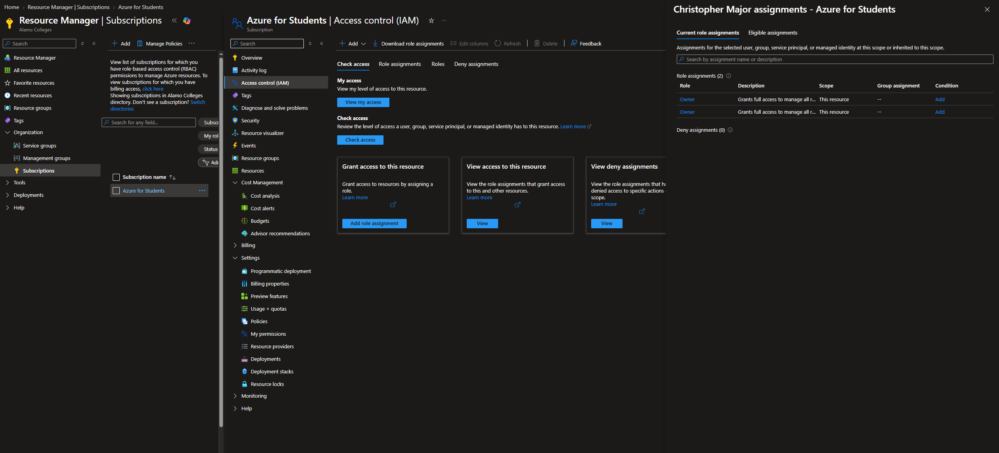

The existing Owner permissions provided the authority needed to configure Azure role assignments within the lab subscription.

Multiple role-assignment records do not necessarily represent multiple distinct administrative identities.

### Resource Group IAM

The Management and Core resource groups were reviewed before creating the new Reader assignment.

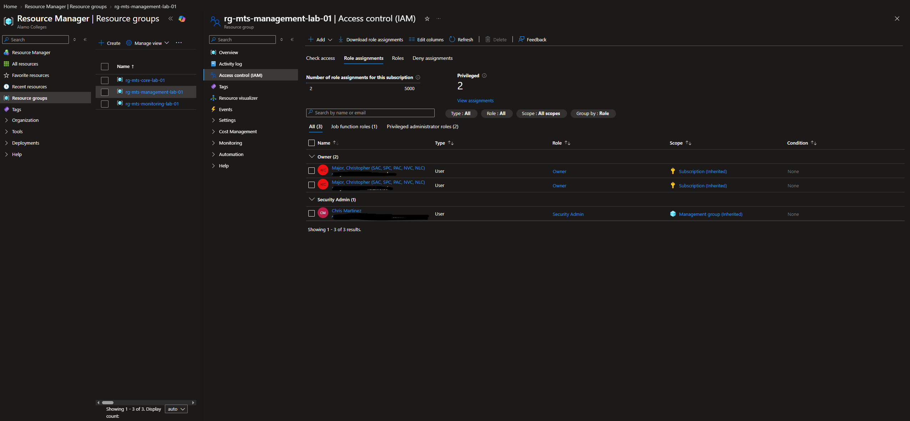

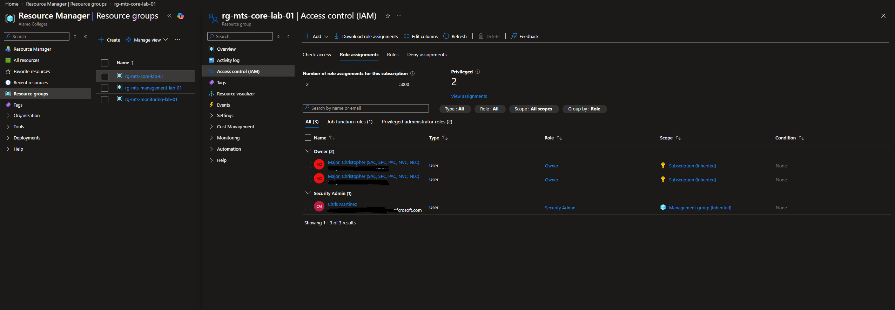

The review confirmed that administrative permissions inherited from higher scopes were present.

These existing administrative assignments were separate from the dedicated managed identity introduced during this phase.

---

## Managed Identity Design

The initial RBAC member-selection workflow allowed institutional users, groups, and service principals to be searched.

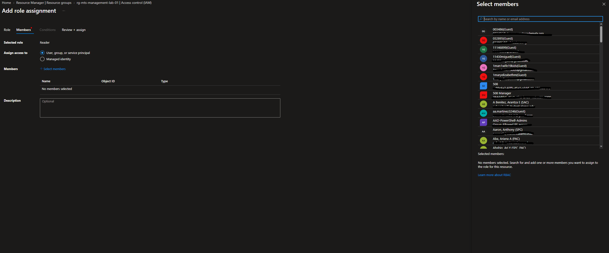

No institutional user was assigned new permissions for the lab.

Instead, a dedicated User-Assigned Managed Identity was selected to support workload authentication without storing an Azure user password or application secret.

### Planned Authorization Model

| Component | Configuration |
|---|---|
| Identity | `id-mts-rbac-reader-01` |
| Identity Type | User-Assigned Managed Identity |
| Resource Group | `rg-mts-management-lab-01` |
| Azure Role | Reader |
| Role Assignment Scope | Management Resource Group |
| Attached Workload | `vm-mts-admin-01` |

The authorization model follows:

```text
User-Assigned Managed Identity
            |
            v
          Reader
            |
            v
rg-mts-management-lab-01
            |
            v
Read-Only Resource Management
```

The Reader assignment was intentionally limited to the Management resource group rather than the entire subscription.

---

## Managed Identity Deployment

A User-Assigned Managed Identity was created with the following configuration.

| Setting | Value |
|---|---|
| Name | `id-mts-rbac-reader-01` |
| Resource Group | `rg-mts-management-lab-01` |
| Region | Central US |
| Identity Type | User-Assigned |

The deployment completed successfully.

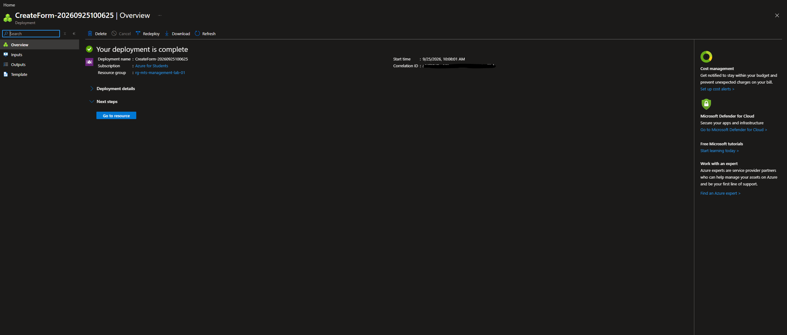

The identity overview confirmed that the resource was created and assigned its Azure identity identifiers, including a client ID and principal ID.

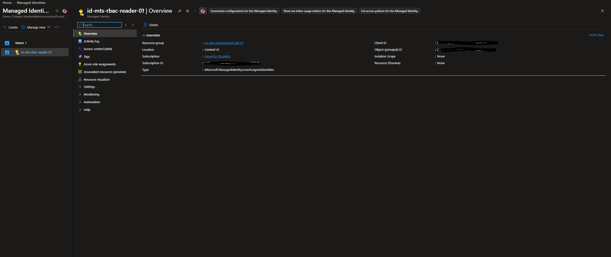

The managed identity can be assigned to supported Azure resources and used to request Azure authentication tokens without maintaining a separate application secret.

---

## Reader Role Assignment

The Azure built-in Reader role was assigned to the managed identity.

| Setting | Configuration |
|---|---|
| Role | Reader |
| Principal Type | Managed Identity |
| Principal | `id-mts-rbac-reader-01` |
| Scope | `rg-mts-management-lab-01` |

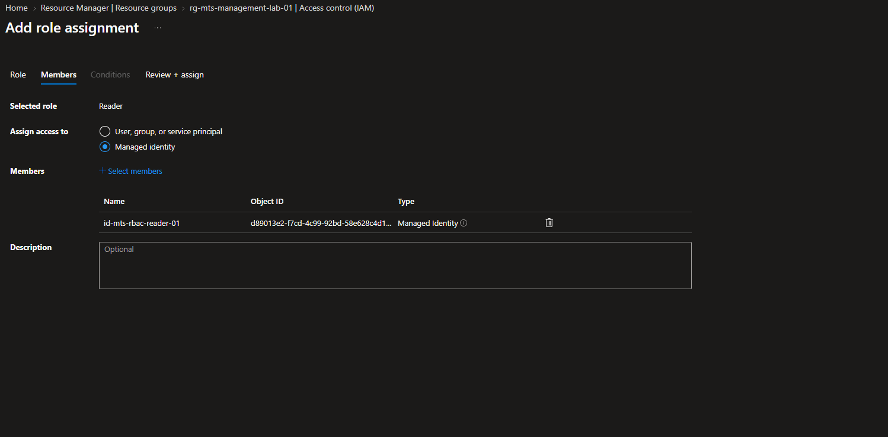

The Reader role permits viewing Azure resource configurations without granting general resource-management permissions.

### Role Assignment Validation

The Management resource group's IAM configuration was reviewed after the assignment.

Azure showed:

```text
Principal: id-mts-rbac-reader-01
Type:      Managed Identity
Role:      Reader
Scope:     This resource
```

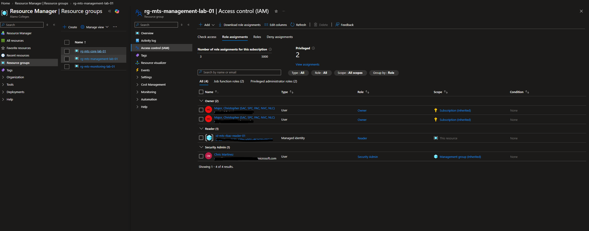

The `This resource` designation confirmed that the assignment was made directly at the Management resource-group scope.

---

## Resource Group Scope Validation

The managed identity's role assignments were reviewed against the other resource groups.

### Core Resource Group

The Core resource-group review showed no role assignment for the managed identity.

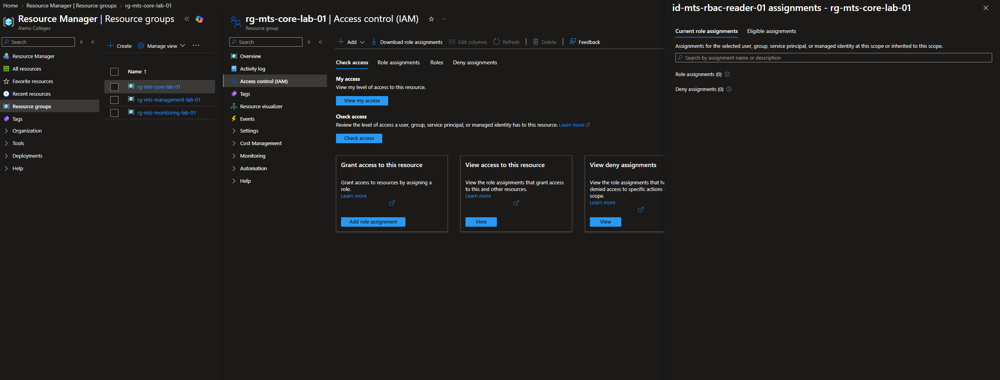

### Monitoring Resource Group

The Monitoring resource-group review also showed no role assignment for the managed identity.

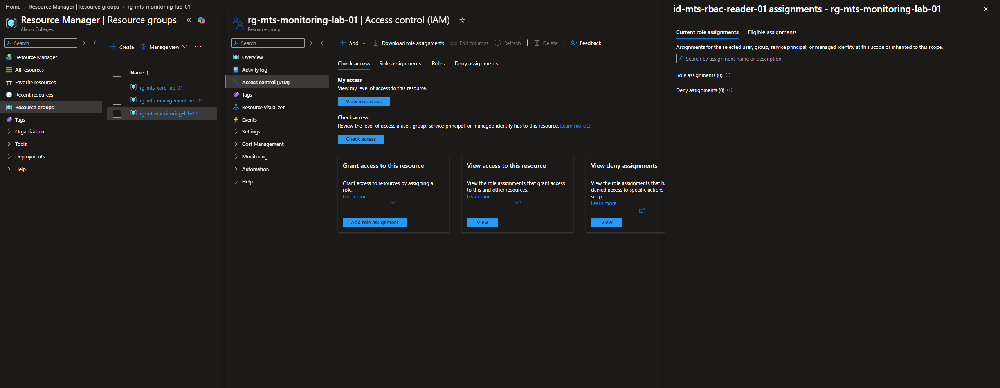

The Reader assignment on the Management resource group did not extend automatically to either sibling resource group.

Runtime authorization tests were performed later in the phase to confirm the effective access boundaries.

---

## Attach Managed Identity to VM

The managed identity was attached to the existing Ubuntu management VM.

```text
Virtual Machine: vm-mts-admin-01
Identity Type:   User-Assigned
Managed Identity: id-mts-rbac-reader-01
```

The configuration was completed through the VM's Identity settings in the Azure portal.

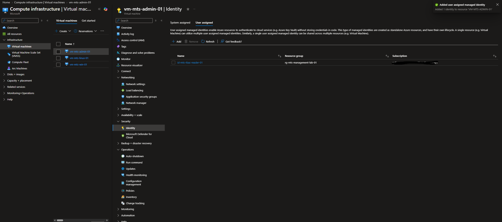

Attaching the identity allows applications and administrative tools running on the VM to request Azure tokens through the managed identity endpoint.

The managed identity's permissions remain governed by its Azure RBAC role assignments.

---

## Azure CLI Authentication

An SSH session was established with `vm-mts-admin-01`.

The Linux environment and Azure CLI installation were checked using:

```bash
hostname
hostname -I
whoami
az version
```

### Managed Identity Login

Azure CLI authentication was performed using the attached User-Assigned Managed Identity.

```bash
az login --identity --client-id <MANAGED-IDENTITY-CLIENT-ID>
```

The Azure account context was reviewed:

```bash
az account show --output table
```

Authentication completed successfully.

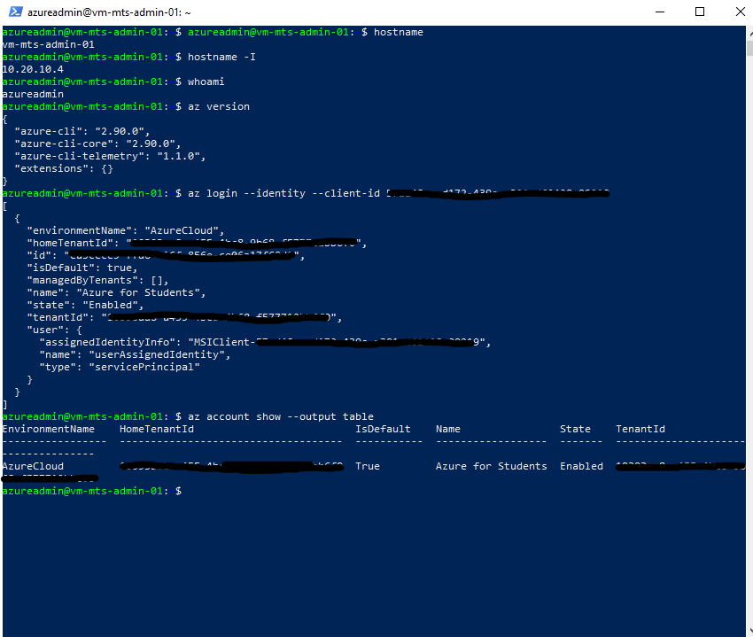

This validated workload authentication without an interactive Azure user password or manually stored service-principal secret.

Authentication alone does not grant resource permissions. Azure RBAC determines which operations the identity can perform.

---

## Authorized Read Validation

The managed identity was used to list resources within the Management resource group.

```bash
az resource list \
  --resource-group rg-mts-management-lab-01 \
  --output table
```

The command completed successfully and returned the resources in the authorized scope.

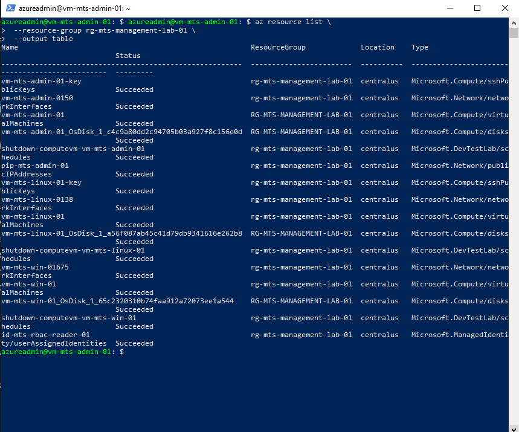

### Individual VM Read

A separate command retrieved information about the management VM.

```bash
az vm show \
  --resource-group rg-mts-management-lab-01 \
  --name vm-mts-admin-01 \
  --output table
```

The request succeeded.

These tests confirmed that the managed identity could read resource information within its assigned Management resource-group scope.

---

## Write Permission Validation

A state-changing VM operation was attempted using the managed identity.

```bash
az vm deallocate \
  --resource-group rg-mts-management-lab-01 \
  --name vm-mts-admin-01
```

Azure rejected the operation.

```text
AuthorizationFailed
```

The denied action was:

```text
Microsoft.Compute/virtualMachines/deallocate/action
```

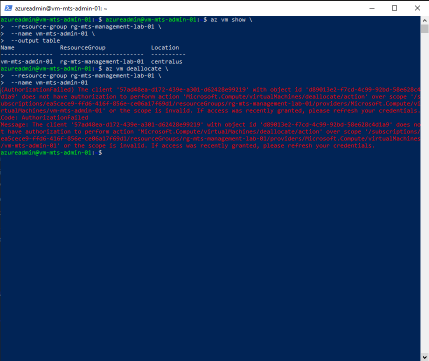

This was the expected result.

The Reader role allowed the identity to inspect the VM but did not authorize changing its operational state.

The failed operation was an intentional negative authorization test, not an unsuccessful phase outcome.

---

## Cross-Resource-Group Authorization

The managed identity was tested against resource groups outside its assigned scope.

### Core Resource Group

```bash
az resource list \
  --resource-group rg-mts-core-lab-01 \
  --output table
```

Result:

```text
AuthorizationFailed
```

### Monitoring Resource Group

```bash
az resource list \
  --resource-group rg-mts-monitoring-lab-01 \
  --output table
```

Result:

```text
AuthorizationFailed
```

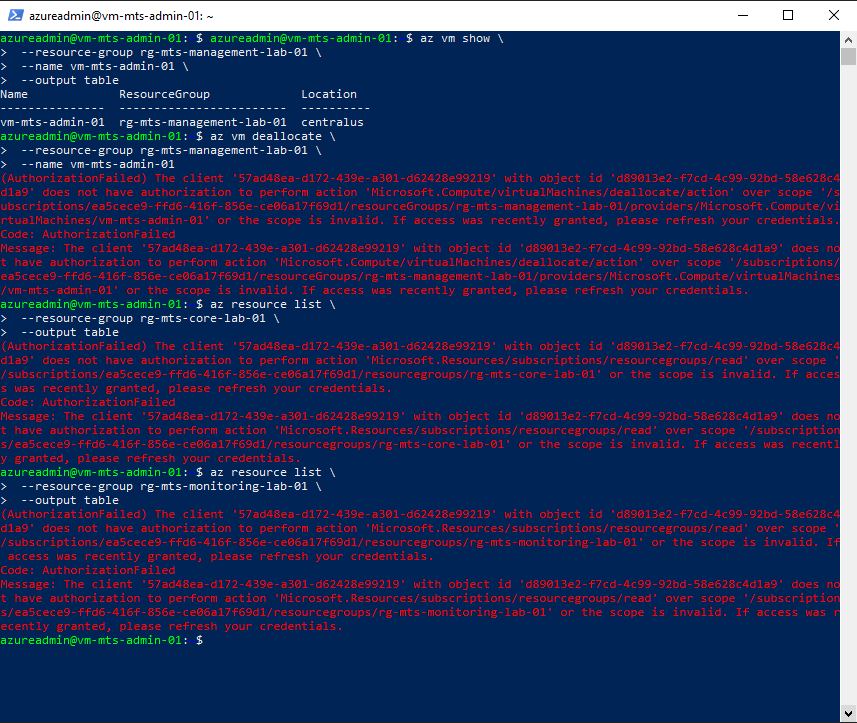

Both requests were denied.

These tests confirmed that the managed identity could not enumerate resources in the Core or Monitoring resource groups using the tested Azure CLI operations.

The results demonstrate the effect of resource-group-scoped RBAC permissions.

---

## CLI Role Assignment Verification

The managed identity's role assignment was independently reviewed using Azure CLI.

```bash
az role assignment list \
  --assignee <MANAGED-IDENTITY-PRINCIPAL-ID> \
  --all \
  --output table
```

The output confirmed:

```text
Role:  Reader
Scope: .../resourceGroups/rg-mts-management-lab-01
```

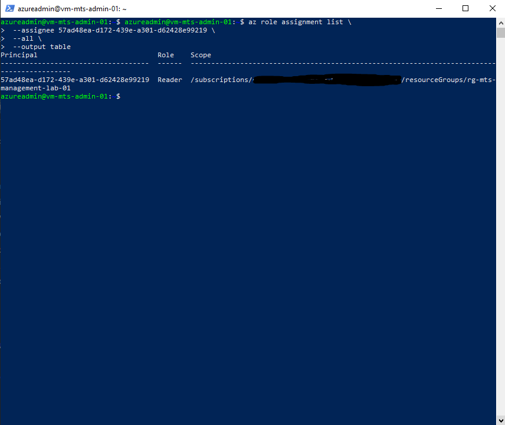

This provided command-line confirmation of the same role assignment previously reviewed in the Azure portal.

---

## Azure Activity Log Review

The Management resource group's Azure Activity Log was reviewed after the identity configuration and authorization tests.

The log contained resource-management operations associated with the lab, including:

- Role assignment creation
- User-assigned identity updates
- Virtual machine configuration changes
- Virtual machine start operations
- Deployment validation

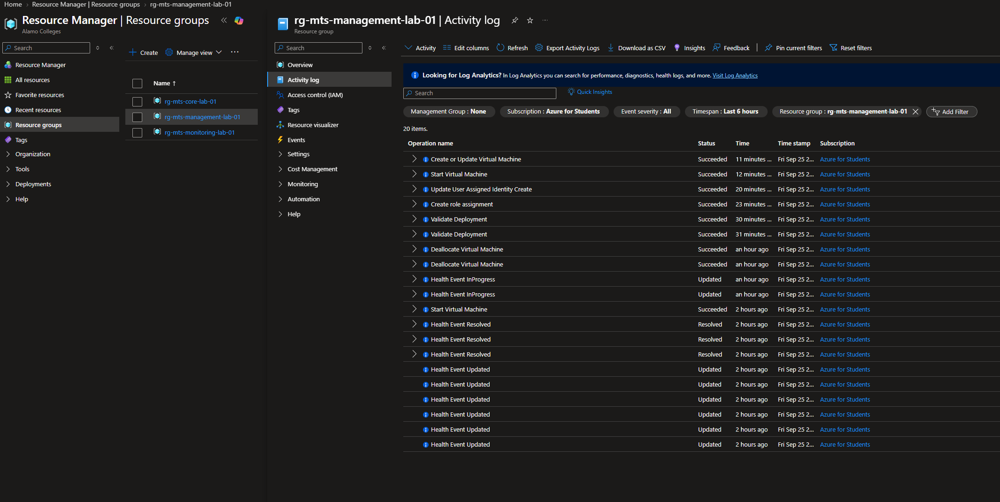

The Activity Log provides an audit record of management-plane operations performed against Azure resources.

Successful VM deallocation events from other administrative sessions should not be confused with the managed identity's denied deallocation test.

---

## Final RBAC Configuration

The Management resource-group IAM configuration was reviewed after completing the tests.

The final assignment remained:

| Setting | Value |
|---|---|
| Principal | `id-mts-rbac-reader-01` |
| Principal Type | Managed Identity |
| Role | Reader |
| Scope | `rg-mts-management-lab-01` |

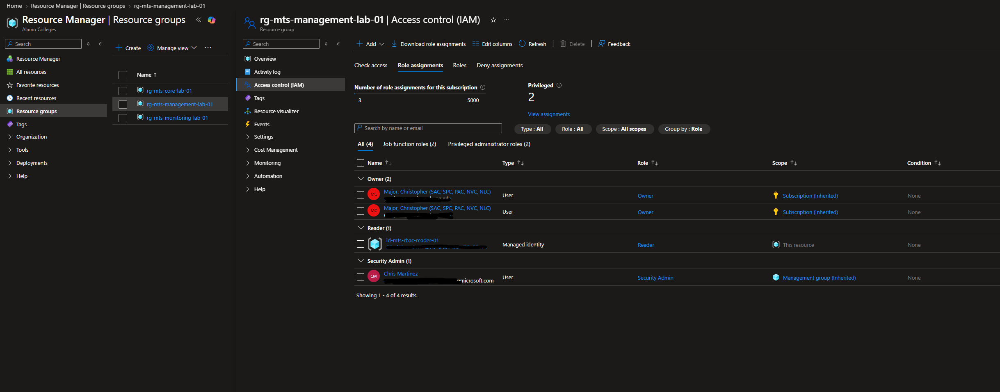

The managed identity remained attached to the administrative VM, with its Reader role assigned directly at the Management resource-group scope.

---

## Authorization Test Results

| Test | Expected Result | Observed Result |
|---|---|---|
| Managed Identity login | Allowed | PASS |
| List Management resources | Allowed | PASS |
| Read Management VM | Allowed | PASS |
| Deallocate Management VM | Denied | PASS |
| List Core resources | Denied | PASS |
| List Monitoring resources | Denied | PASS |
| Portal Reader assignment review | Reader at Management RG | PASS |
| CLI Reader assignment review | Reader at Management RG | PASS |

All tested authorization outcomes matched the intended access model.

The negative tests confirmed that successful authentication did not override the restrictions imposed by Azure RBAC.

---

## Troubleshooting and Design Decisions

### Microsoft Entra Restrictions

The institutional Microsoft Entra tenant did not permit the requested directory administration.

The lab continued using Azure RBAC permissions available within the subscription without attempting to bypass the institutional access restrictions.

### Principal Type Selection

The initial role-assignment workflow used the user, group, or service-principal selection interface.

The final configuration used the Managed Identity principal type to assign the Reader role to `id-mts-rbac-reader-01`.

### Authentication and Authorization

The managed identity successfully authenticated to Azure but was denied operations outside its permissions.

This demonstrated the distinction between authentication and authorization.

### RBAC Scope

Assigning Reader at the Management resource-group level limited the role assignment to that resource group and its contained resources.

The Core and Monitoring resource-group tests confirmed that the managed identity could not enumerate resources in those scopes using the tested commands.

---

## Phase 5 Verification

Phase 5 established and validated the Azure identity and authorization configuration:

- Microsoft Entra administrative restrictions documented
- Subscription RBAC authority reviewed
- Management and Core IAM baselines reviewed
- User-Assigned Managed Identity created
- Reader role assigned at Management resource-group scope
- Core and Monitoring role-assignment boundaries reviewed
- Managed identity attached to the management VM
- Azure CLI authentication using Managed Identity successful
- Authorized Management resource-group reads successful
- Individual management VM read successful
- VM deallocation denied by Azure RBAC
- Core resource-group enumeration denied
- Monitoring resource-group enumeration denied
- Role assignment verified through the Azure portal
- Role assignment verified through Azure CLI
- Azure Activity Log reviewed
- Final Reader assignment confirmed

The tests established a functioning least-privilege workload identity for read-only management operations within the assigned resource group.

**Phase 5 Status: Complete**

---

## Next Phase

**Phase 6 — Storage**

Phase 6 introduces Azure Storage resources and validates their configuration, access controls, and security settings.

The storage implementation will build on the resource organization, networking, and identity controls established during the earlier phases.
