# Phase 8 — Monitoring & Logging

## Overview

Phase 8 implements and validates centralized monitoring, logging, operational analysis, and alerting for the Major Technology Services (MTS) Azure Cloud Infrastructure Lab.

The phase builds on the Log Analytics workspace and diagnostic settings established during earlier phases.

Azure Monitor, Log Analytics, Kusto Query Language (KQL), metric alerts, and Action Groups were used to monitor Azure resource activity and test an end-to-end alerting workflow.

Storage operations were generated, recorded in Log Analytics, and analyzed with KQL. A custom Azure Monitor metric alert was then triggered, an email notification was received, and the alert automatically resolved after the triggering condition cleared.

---

## Existing Environment

Phase 8 uses the monitoring and infrastructure resources established during Phases 1–7.

| Resource | Configuration |
|---|---|
| Subscription | Azure for Students |
| Region | Central US |
| Core Resource Group | `rg-mts-core-lab-01` |
| Log Analytics Workspace | `law-mts-core-lab-01` |
| Storage Account | `stmtslab01` |
| Key Vault | `kv-mts-core-lab-01` |
| Monitoring Platform | Azure Monitor |
| Log Query Language | KQL |

The monitoring configuration includes both Azure management-plane activity and Blob Storage data-plane telemetry.

---

## Azure Monitor Baseline

Azure Monitor was reviewed before configuring the custom alerting components.

The environment provided access to:

- Metrics
- Logs
- Alerts
- Azure Activity Log
- Diagnostic settings
- Action Groups

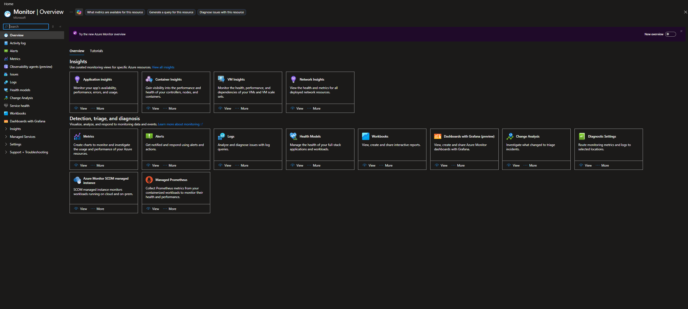

This established the baseline for the Phase 8 monitoring configuration.

---

## Log Analytics Workspace

The existing Log Analytics workspace was reviewed and validated.

| Setting | Configuration |
|---|---|
| Workspace | `law-mts-core-lab-01` |
| Resource Group | `rg-mts-core-lab-01` |
| Region | Central US |
| Pricing Model | Pay-as-you-go |

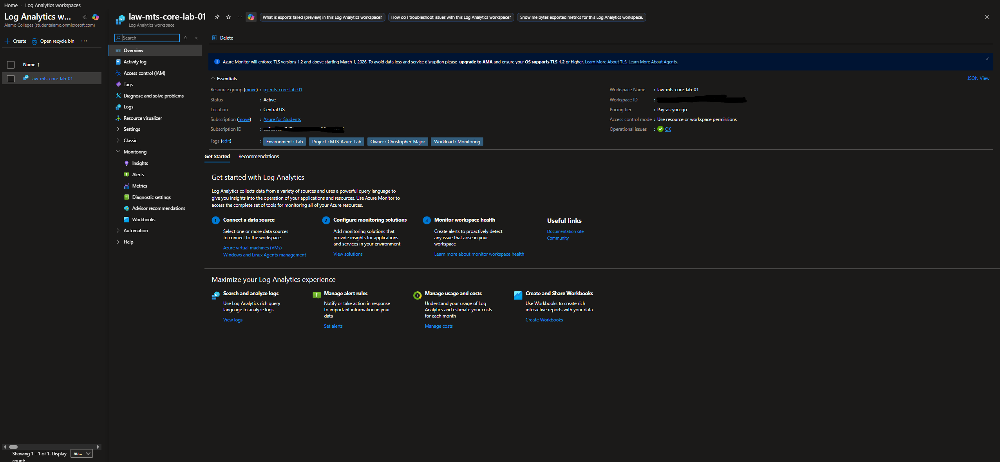

The workspace provides centralized storage and querying of supported Azure diagnostic data.

### Usage and Cost Review

The workspace's usage and estimated costs were reviewed.

The estimated monthly ingestion cost displayed approximately:

```text
$0.00
```

during the validation period.

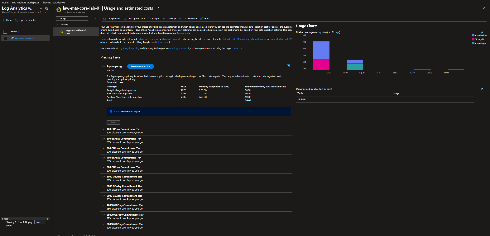

The lab retained the Pay-as-you-go pricing model rather than adopting a higher-volume commitment tier.

The displayed estimate represents the observed monitoring footprint during testing, not a guarantee of zero future charges.

---

## Existing Diagnostic Settings

Diagnostic configurations established during earlier phases were reviewed before additional monitoring tests.

### Storage Diagnostics

The Storage Account's existing diagnostic configuration was inspected.

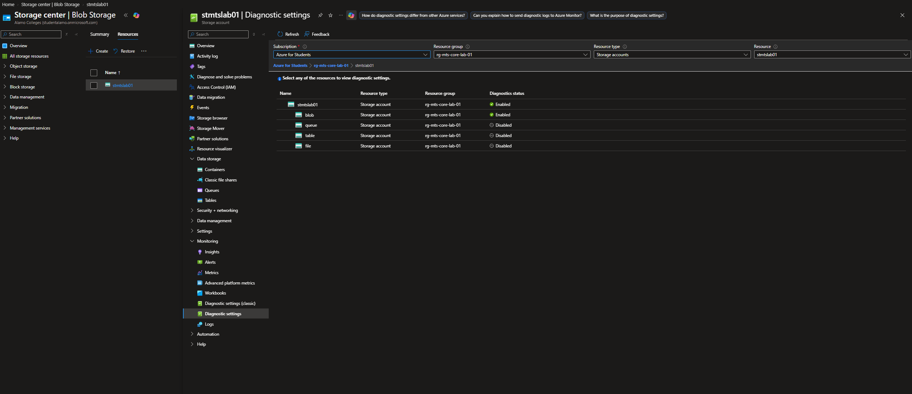

The configuration provided the starting point for Blob resource-log collection.

### Key Vault Diagnostics

The existing Key Vault diagnostic configuration was also reviewed.

| Setting | Configuration |
|---|---|
| Key Vault | `kv-mts-core-lab-01` |
| Diagnostic Setting | `diag-mts-keyvault` |
| Destination | `law-mts-core-lab-01` |

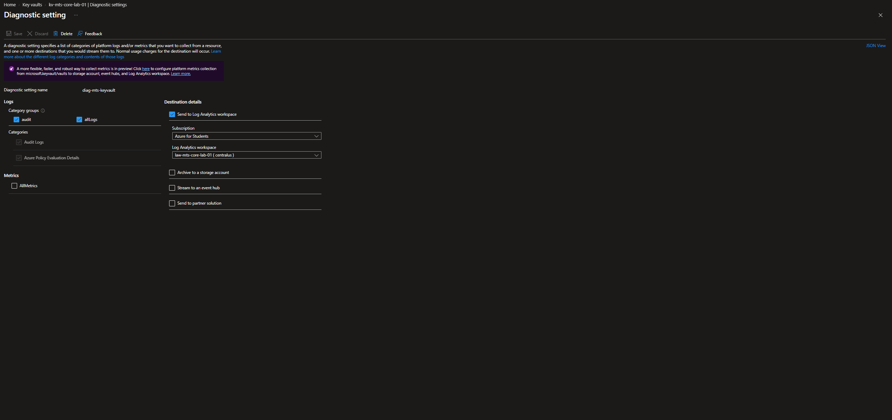

The Key Vault diagnostic destination was configured, although Key Vault audit-log ingestion had not been independently verified during Phase 7.

---

## Azure Activity Log

Azure Activity Log was reviewed to examine administrative operations performed against Azure resources.

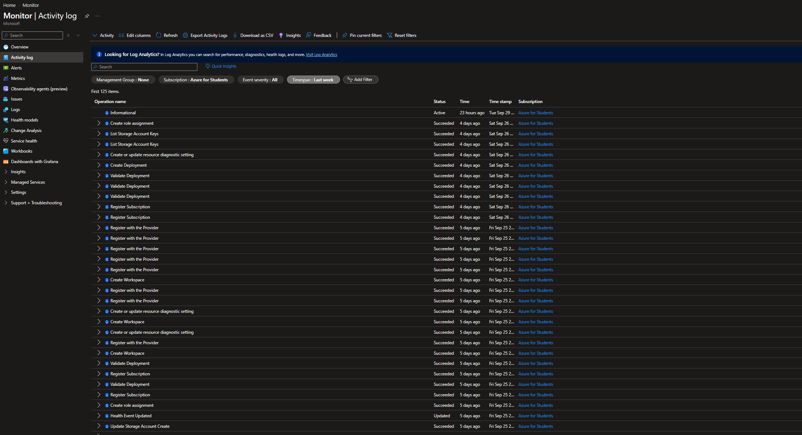

The Activity Log records management-plane events such as:

- Resource creation and deletion
- Configuration changes
- Role assignment operations
- Diagnostic-setting updates
- Administrative actions

### Administrative Activity

The Activity Log was filtered to focus on administrative operations.

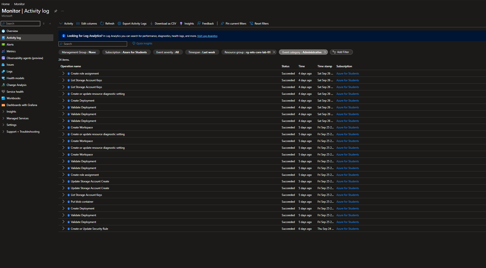

These records are distinct from data-plane operations, such as reading or writing Blob objects.

---

## Activity Log Diagnostic Configuration

A subscription-level Activity Log diagnostic configuration was evaluated and configured to direct administrative telemetry to the existing Log Analytics workspace.

The intended destination was:

```text
law-mts-core-lab-01
```

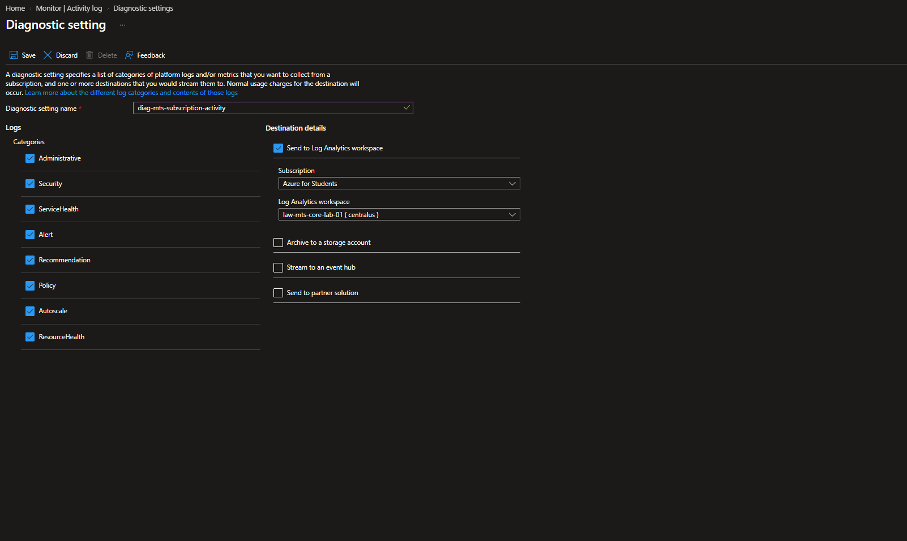

The configuration was subsequently reviewed.

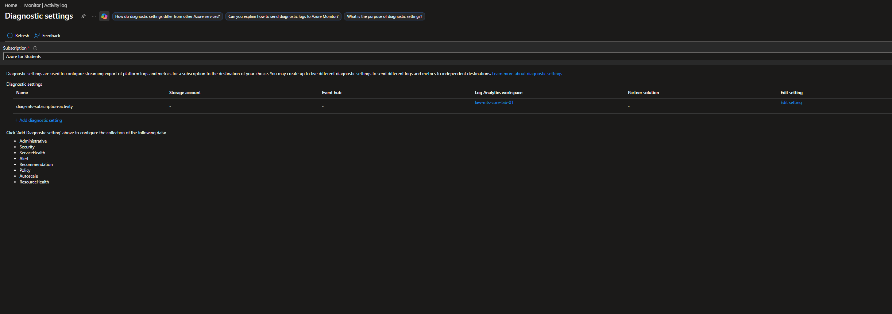

The telemetry path was:

```text
Azure Subscription
        |
        v
Azure Activity Log
        |
        v
Diagnostic Settings
        |
        v
Log Analytics Workspace
law-mts-core-lab-01
```

Successful ingestion was verified through KQL.

---

## AzureActivity Ingestion Validation

The `AzureActivity` table was queried from Log Analytics.

### Initial Query

```kusto
AzureActivity
| where TimeGenerated > ago(24h)
| order by TimeGenerated desc
| take 50
```

The table was not initially available in the workspace schema.

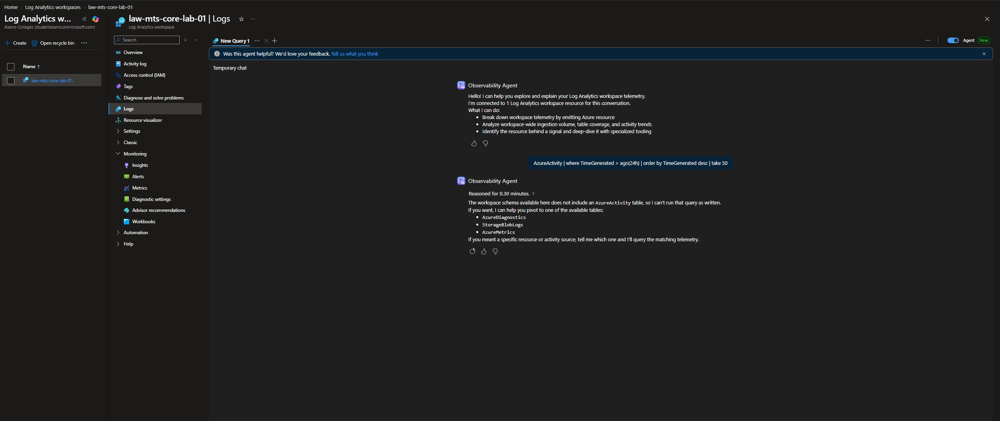

Rather than modifying unrelated monitoring resources, the table availability was investigated.

### Successful Query

After telemetry became available, the same data source was queried successfully.

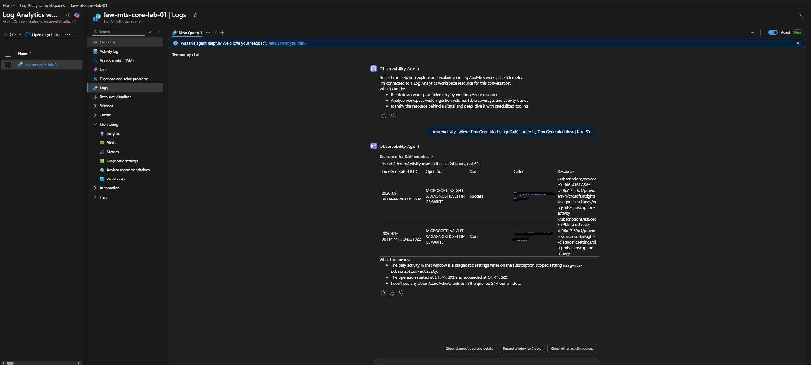

This confirmed that Azure administrative activity was available for analysis through Log Analytics.

The initial delay demonstrated that diagnostic configuration and data availability are separate stages of the monitoring process.

---

## Administrative Activity Analysis

KQL was used to examine administrative events and relevant operational fields.

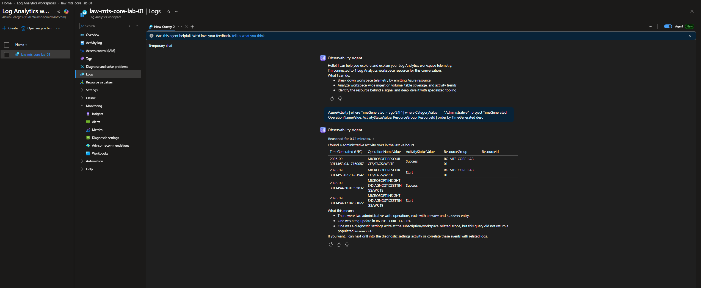

The query reduced the raw Activity Log records into a more focused dataset for reviewing Azure resource-management operations.

### Failed Operations

A separate KQL query was used to investigate failed administrative operations.

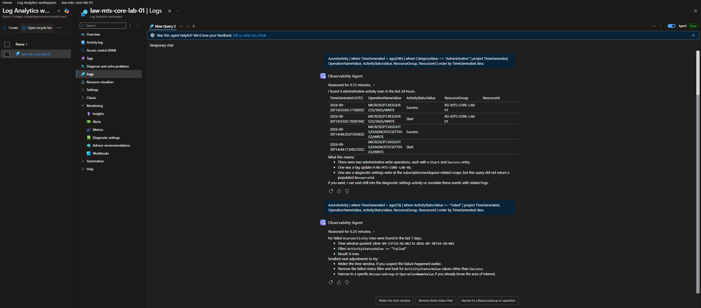

The query returned no matching failures during the selected period.

A zero-result query was retained as a valid observation rather than treated as a monitoring failure.

---

## Storage Operations Analysis

The `StorageBlobLogs` table was queried to examine Blob Storage activity.

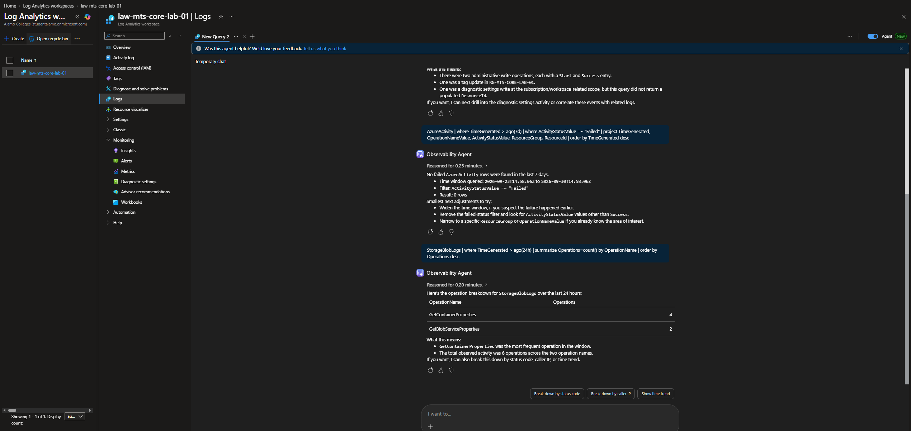

The records provided data-plane visibility into storage operations independently of the Azure Activity Log.

This allowed the monitoring environment to distinguish Azure resource-management activity from operations performed against stored data.

---

## Azure Monitor Metrics

Azure Monitor Metrics was reviewed to examine numerical resource telemetry.

Key Vault metrics were included in the baseline review.

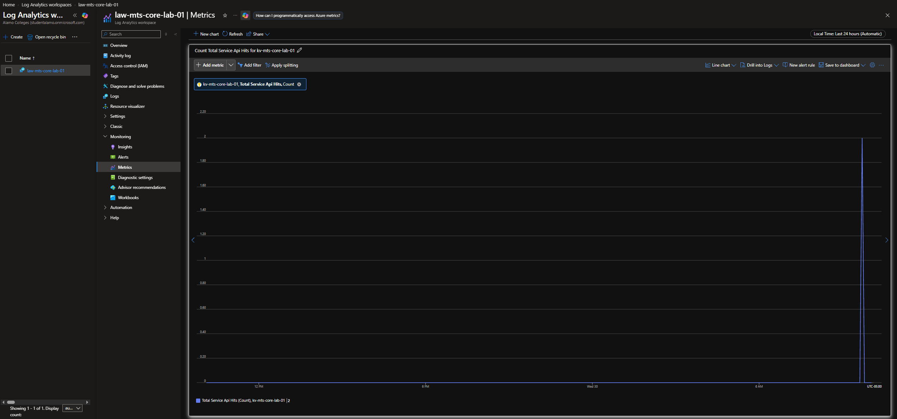

Metrics provide time-series measurements suitable for threshold-based monitoring.

Phase 8 used the Storage Account's Transactions metric to validate alerting.

---

## Azure Monitor Alerts Baseline

The Azure Monitor Alerts interface was reviewed before deploying the custom alert rule.

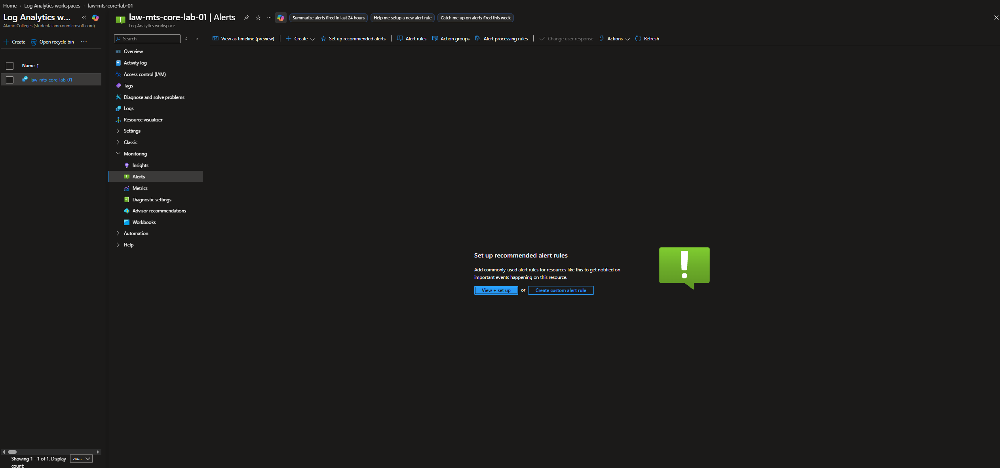

The next steps configured the notification mechanism and metric-based detection rule.

---

## Action Group Deployment

An Azure Monitor Action Group was created to deliver email notifications.

| Setting | Configuration |
|---|---|
| Action Group | `ag-mts-core-lab-01` |
| Notification Method | Email |
| Purpose | Storage metric alert notifications |

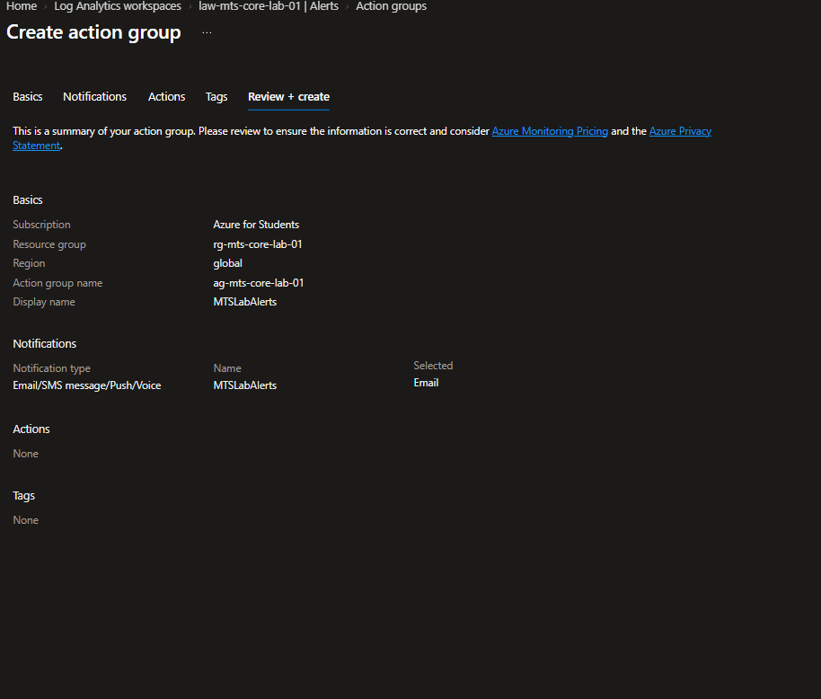

The Action Group was successfully deployed.

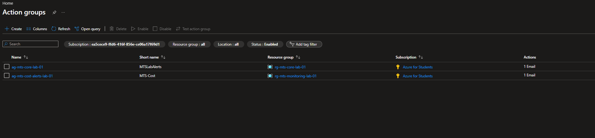

The notification path was:

```text
Azure Monitor Alert
        |
        v
ag-mts-core-lab-01
        |
        v
Email Notification
```

---

## Storage Metric Alert Configuration

A custom metric alert was configured for the lab Storage Account.

### Alert Scope

The individual Storage Account was selected as the alert scope.

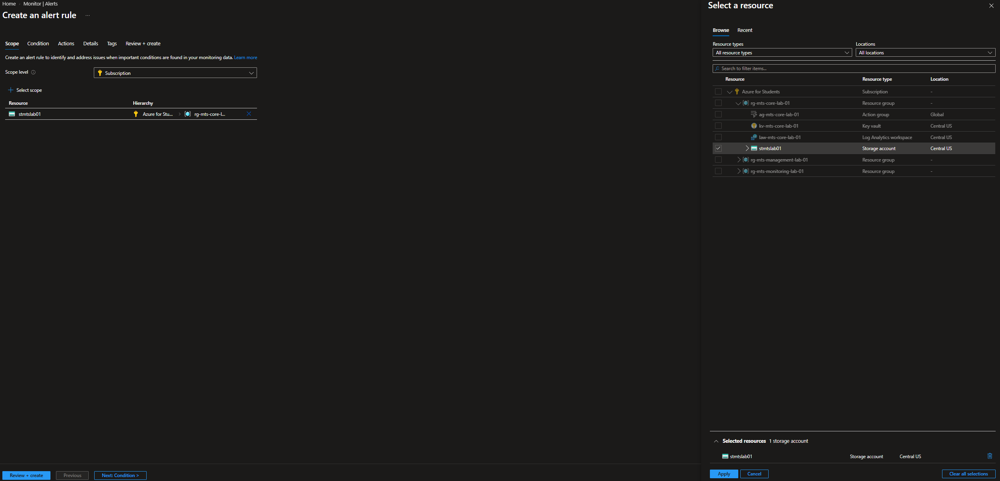

This allowed the alert to evaluate the selected resource's metrics rather than monitoring the entire resource group.

### Metric Selection

The selected signal was:

```text
Transactions
```

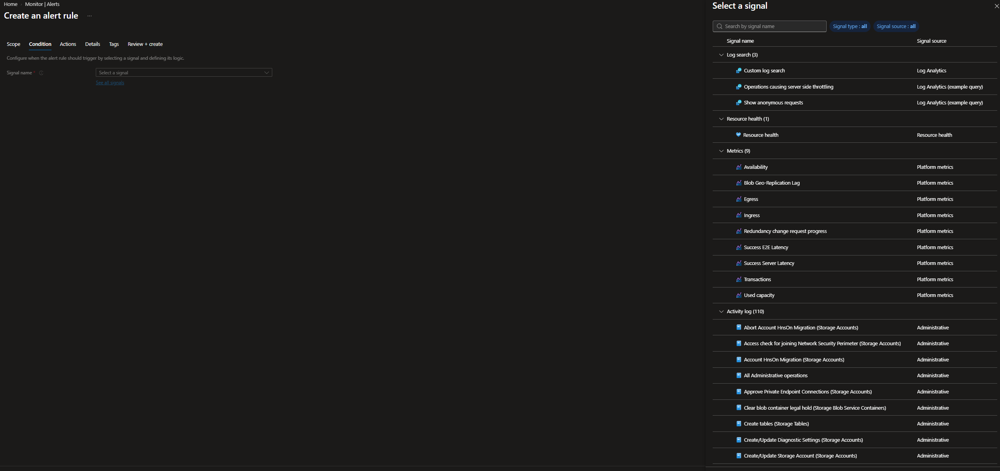

### Alert Condition

The alert was configured with a low threshold to make the test reproducible.

| Setting | Configuration |
|---|---|
| Signal | Transactions |
| Threshold Type | Static |
| Aggregation | Total |
| Operator | Greater than |
| Threshold | 1 |
| Unit | Count |
| Evaluation Frequency | 1 minute |
| Lookback Period | 5 minutes |

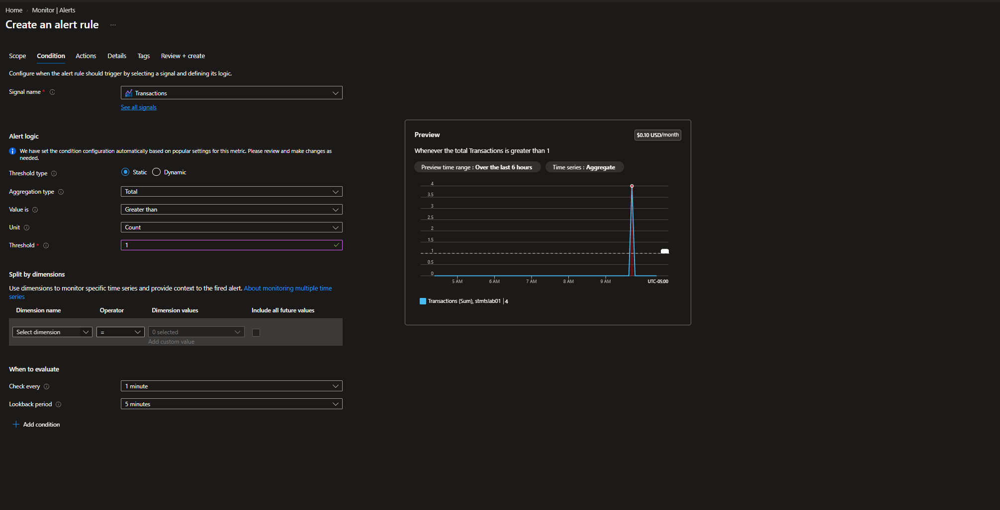

The threshold was intentionally designed for controlled lab testing and is not intended as a production monitoring threshold.

### Action Group Association

The existing Action Group was associated with the alert.

```text
ag-mts-core-lab-01
```

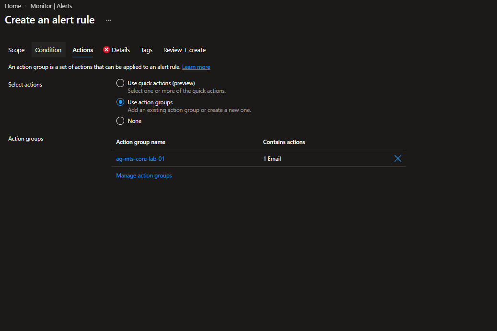

### Alert Rule Details

The rule was named:

```text
alert-mts-storage-transactions
```

Additional settings included:

| Setting | Configuration |
|---|---|
| Severity | 3 — Informational |
| Automatic Resolution | Enabled |
| Notification | `ag-mts-core-lab-01` |

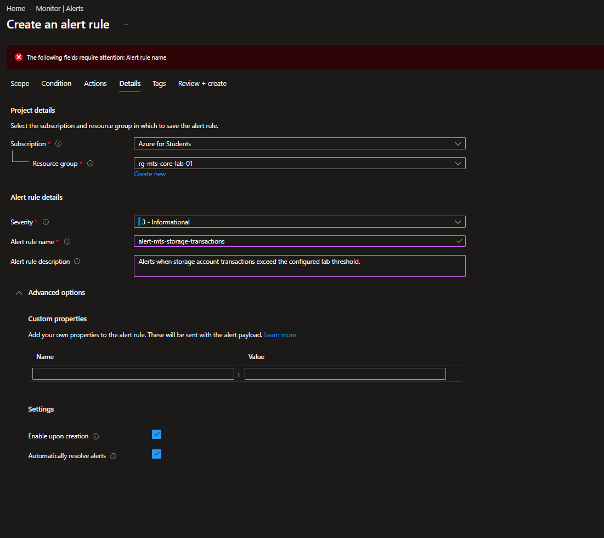

### Configuration Review

The completed configuration was reviewed before deployment.

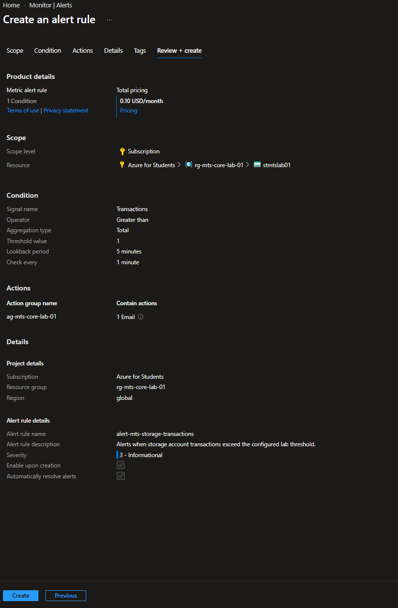

The alert connected the Storage Account's Transactions metric to a static threshold and an email notification Action Group.

### Deployment

The metric alert was successfully created and enabled.

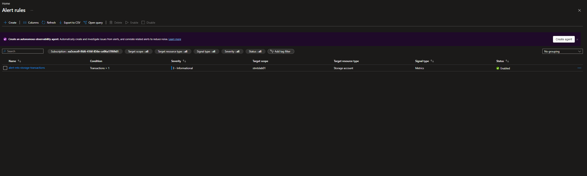

---

## Alert Trigger Validation

Storage activity was generated to exceed the configured threshold.

Azure Monitor evaluated the Transactions metric and changed the alert condition to:

```text
Fired
```

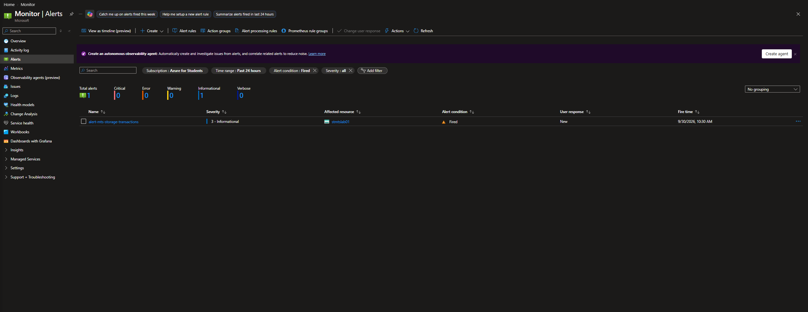

This confirmed that the deployed alert rule was actively evaluating the Storage Account metric.

---

## Email Notification Validation

The Action Group successfully delivered an email notification when the alert fired.

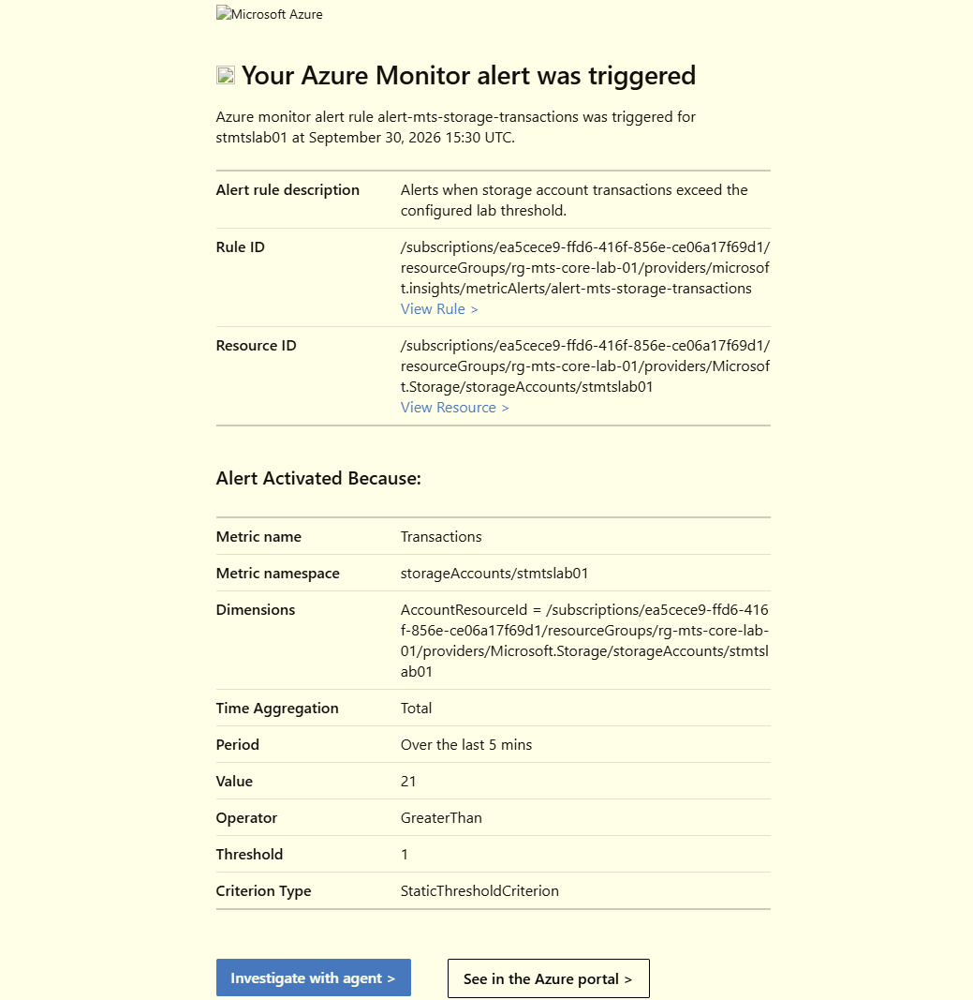

The notification included the following results:

| Property | Observed Result |
|---|---|
| Alert Rule | `alert-mts-storage-transactions` |
| Metric | Transactions |
| Aggregation | Total |
| Evaluation Period | 5 minutes |
| Observed Value | 21 |
| Operator | GreaterThan |
| Threshold | 1 |
| Criterion | StaticThresholdCriterion |

The observed metric value exceeded the configured threshold.

### Alert Investigation

The fired alert was opened in Azure Monitor for investigation.

Azure reported that the total Transactions metric had crossed the threshold of 1 and reached 21.

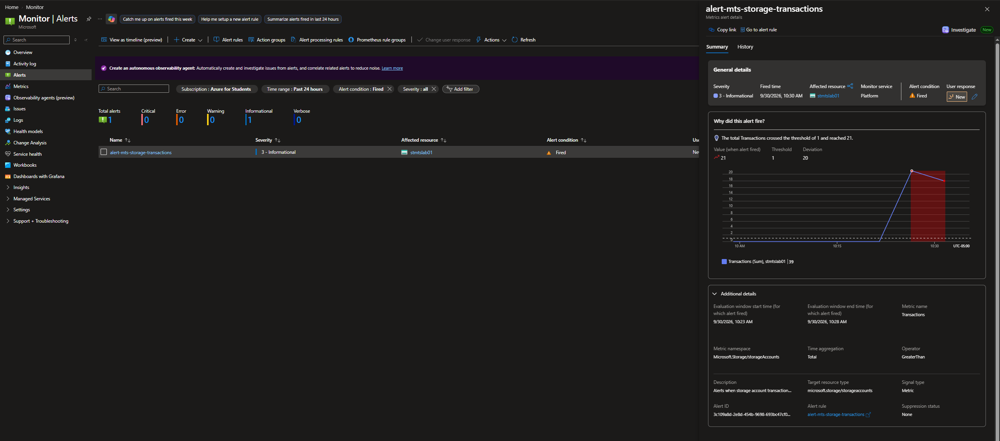

The alert details provided visibility into the affected resource, metric, threshold, severity, and alert condition.

---

## Automatic Alert Resolution

After the triggering transaction activity decreased, the alert condition automatically transitioned from:

```text
Fired
```

to:

```text
Resolved
```

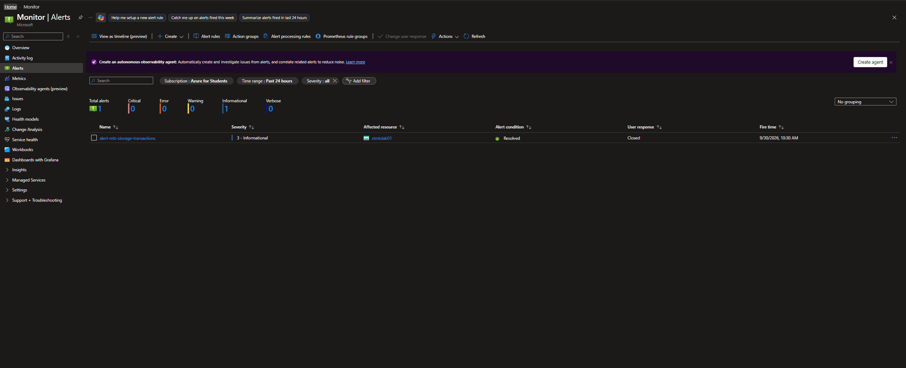

The Azure Monitor interface displayed:

| Property | Result |
|---|---|
| Alert Condition | Resolved |
| User Response | Closed |

This validated the automatic resolution behavior configured for the rule.

### Resolution Email

The Action Group also delivered an email notification confirming that the alert had resolved.

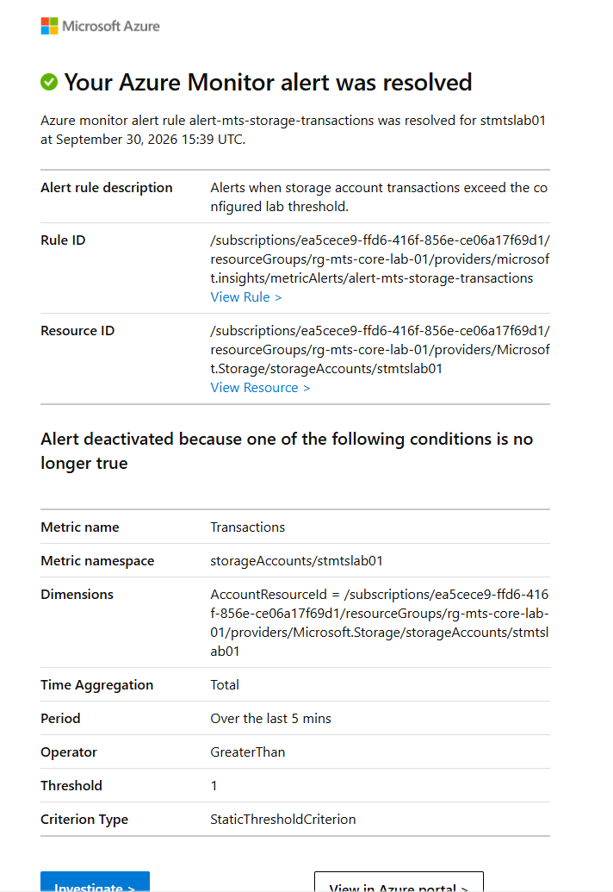

### Validated Alert Lifecycle

```text
Storage Activity
        |
        v
Transactions > 1
        |
        v
Azure Monitor Alert Fired
        |
        v
Action Group Invoked
        |
        v
Alert Email Received
        |
        v
Transaction Activity Decreases
        |
        v
Alert Automatically Resolved
        |
        v
Resolution Email Received
```

The test confirmed detection, notification, investigation, and recovery.

---

## Log Analytics Workspace Validation

The Log Analytics workspace was reviewed again during Blob resource-log validation.

| Setting | Observed Configuration |
|---|---|
| Workspace | `law-mts-core-lab-01` |
| Status | Active |
| Resource Group | `rg-mts-core-lab-01` |
| Region | Central US |

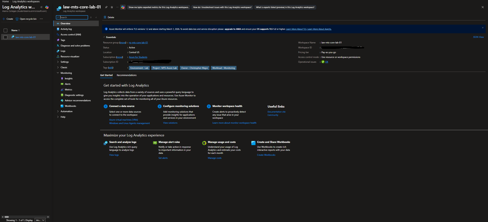

The workspace remained the central analysis destination for the storage monitoring tests.

---

## Blob Diagnostic Settings

Blob-specific diagnostic settings were configured and validated.

| Setting | Configuration |
|---|---|
| Diagnostic Setting | `diag-mts-blob` |
| Resource | Storage Blob Service |
| Log Categories | StorageRead, StorageWrite, StorageDelete |
| Metrics | Transactions |
| Destination | Log Analytics |
| Workspace | `law-mts-core-lab-01` |

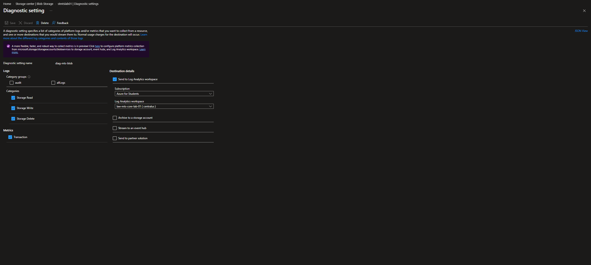

The deployed setting was reviewed after configuration.

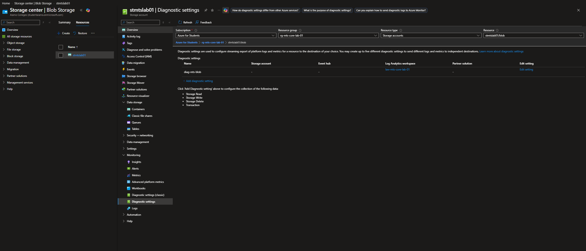

This established the telemetry path for Blob operations.

```text
Azure Blob Storage
        |
        v
diag-mts-blob
        |
        v
law-mts-core-lab-01
        |
        v
StorageBlobLogs
        |
        v
KQL Analysis
```

---

## Blob Log Ingestion Validation

Blob operations were generated and the Log Analytics workspace was queried.

### KQL Query

```kusto
StorageBlobLogs
| where TimeGenerated > ago(30m)
| project
    TimeGenerated,
    OperationName,
    StatusCode,
    StatusText,
    AuthenticationType,
    Uri
| order by TimeGenerated desc
```

The query successfully returned:

```text
82 records
```

during the validation window.

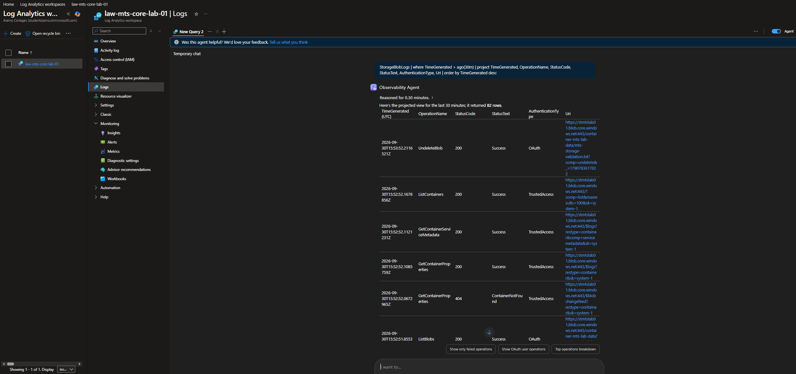

The collected records included:

- Operation timestamps
- Blob operation names
- HTTP status codes
- Status descriptions
- Authentication types
- Resource URIs

Observed operations included:

- `ListBlobs`
- `ListContainers`
- `GetContainerProperties`
- `GetContainerServiceMetadata`
- `GetBlobProperties`
- `PutBlob`
- `DeleteBlob`
- `UndeleteBlob`

This confirmed successful Blob resource-log ingestion into Log Analytics.

---

## Blob Operations KQL Analysis

A second query summarized Blob operations by operation name and HTTP status code.

### KQL Query

```kusto
StorageBlobLogs
| where TimeGenerated > ago(1h)
| summarize
    Operations=count()
    by OperationName, StatusCode
| order by Operations desc
```

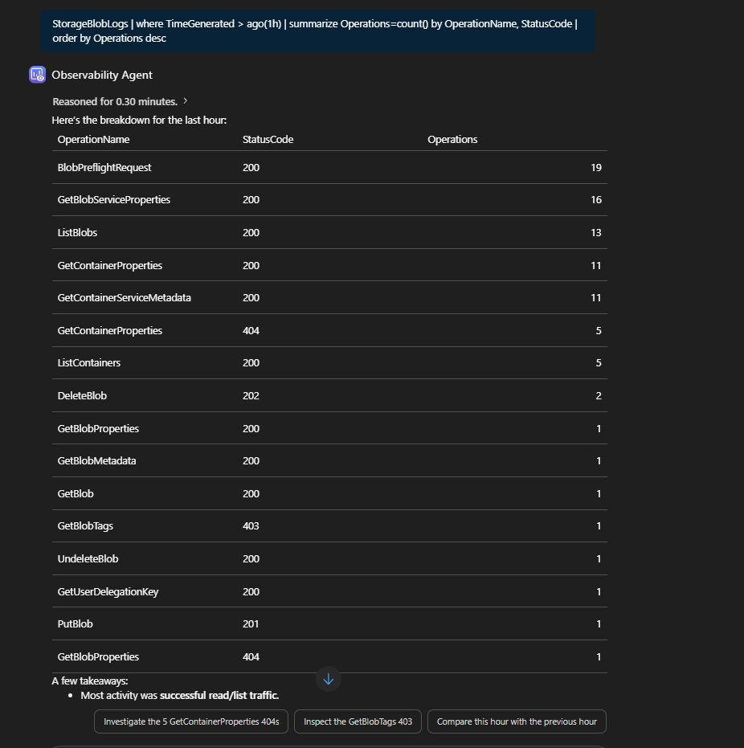

### Observed Status Codes

| HTTP Status | Interpretation |
|---|---|
| 200 | Successful operation |
| 201 | Resource created |
| 202 | Request accepted |
| 403 | Forbidden request |
| 404 | Resource not found |

The records included successful storage operations as well as 403 and 404 responses.

These results demonstrated how KQL can summarize resource activity and identify operations requiring further investigation.

---

## Monitoring Architecture

The completed monitoring configuration used separate sources for administrative activity, resource logs, and metrics.

```text
                   MTS Azure Lab
                         |
          +--------------+--------------+
          |                             |
          v                             v
    Control Plane                  Data Plane
          |                             |
          v                             v
   Azure Activity Log              Blob Storage
          |                             |
          |                             v
          |                       diag-mts-blob
          |                             |
          +--------------+--------------+
                         |
                         v
                Log Analytics
              law-mts-core-lab-01
                         |
                         v
                    KQL Analysis


               Storage Transactions
                         |
                         v
                 Azure Monitor Alert
          alert-mts-storage-transactions
                         |
                         v
                     Action Group
                  ag-mts-core-lab-01
                         |
                         v
                  Email Notification
                         |
                         v
                Automatic Resolution
                         |
                         v
                 Resolution Email
```

The configuration combines logs for investigation with metrics for threshold-based alerting.

---

## Troubleshooting and Observations

### AzureActivity Table Availability

The `AzureActivity` table was not initially available in Log Analytics.

After telemetry became available, the query succeeded.

This demonstrated that diagnostic configuration, ingestion, and table availability should be validated separately.

### Blob Telemetry Validation

The `StorageBlobLogs` table successfully returned 82 records during the validation window.

KQL was used to review individual operations and aggregate results by HTTP status code.

### Alert Notification Testing

The metric alert successfully fired at an observed value of 21 transactions.

The associated Action Group delivered the alert email.

### Alert Recovery

The alert automatically resolved after the triggering condition cleared.

A separate resolution notification was received.

### Azure Portal Access Issue

After the primary monitoring tests were completed, Azure portal access began returning:

```text
HTTP 401 — No access
```

The captured response included:

```text
errorCode: 401
subscriptionId: ""
resourceGroup: ""
resourceName: ""
details: "No access"
```

The response did not identify a specific resource as the cause.

The issue was documented separately from the previously validated monitoring results.

No known-good monitoring resources were deleted or recreated in response to the access issue.

The exact cause of the portal-access failure was not established during Phase 8.

---

## Cost and Security Considerations

### Monitoring Cost

The Log Analytics workspace retained Pay-as-you-go pricing.

The observed ingestion volume was minimal during testing.

Monitoring costs should continue to be reviewed as additional diagnostic sources and workloads are introduced.

### Alert Threshold

The Transactions threshold of greater than 1 was selected specifically for lab validation.

A production alert should use thresholds appropriate to the workload, expected transaction volume, and operational requirements.

### Sensitive Information

Monitoring screenshots and documentation should avoid exposing credentials, authentication tokens, secret values, and unnecessary personal contact information.

### Diagnostic Coverage

The lab demonstrated successful ingestion for `AzureActivity` and `StorageBlobLogs`.

Key Vault audit-log ingestion was not independently established by the Phase 8 evidence and should not be assumed from diagnostic configuration alone.

---

## Phase 8 Verification

Phase 8 established and validated the monitoring environment:

- Azure Monitor baseline reviewed
- Existing Log Analytics workspace validated
- Workspace usage and estimated costs reviewed
- Storage diagnostic baseline reviewed
- Key Vault diagnostic baseline reviewed
- Azure Activity Log inspected
- Administrative Activity Log filtering demonstrated
- Subscription Activity Log diagnostic configuration reviewed
- Initial `AzureActivity` table availability issue investigated
- `AzureActivity` successfully queried
- Administrative activity analyzed with KQL
- Failed administrative operations queried
- Storage operations reviewed through Log Analytics
- Azure Monitor metrics reviewed
- Azure Monitor Alerts baseline reviewed
- Action Group created and deployed
- Email notification configured
- Storage Account selected as metric alert scope
- Transactions metric selected
- Static threshold configured
- Five-minute lookback and one-minute evaluation frequency configured
- Severity 3 selected
- Automatic resolution enabled
- Metric alert deployed
- Storage activity generated to trigger the alert
- Alert entered Fired state
- Observed transaction value of 21 confirmed
- Alert email received
- Fired alert investigated
- Alert automatically transitioned to Resolved
- Resolution email received
- Blob diagnostic settings configured and validated
- StorageRead, StorageWrite, and StorageDelete logging enabled
- Blob telemetry ingested into `StorageBlobLogs`
- 82 Blob log records observed
- Storage operations summarized using KQL
- Successful and unsuccessful HTTP responses identified
- Subsequent Azure portal HTTP 401 documented

The phase demonstrated a complete monitoring workflow from telemetry generation through alert detection, email notification, investigation, and automatic resolution.

**Phase 8 Status: Complete**

---

## Next Phase

**Phase 9 — Infrastructure as Code**

Phase 9 introduces Terraform to provision and manage selected Azure resources using declarative configuration.

The next phase builds on the resource organization, access controls, and operational monitoring established during Phases 1–8.
