# Phase 9 — Infrastructure as Code with Terraform

## Overview

Phase 9 introduces Infrastructure as Code (IaC) to the Major Technology Services (MTS) Azure Cloud Infrastructure Lab using HashiCorp Terraform and Microsoft Azure CLI.

The phase establishes a separate Terraform-managed Azure environment consisting of a resource group, Storage Account, and private Blob container.

Terraform was used to define, plan, deploy, and track the infrastructure. Azure CLI provided independent verification of the deployed resources.

The final configuration was validated through Terraform state inspection and repeated execution plans that returned no changes.

---

## Environment

| Component | Configuration |
|---|---|
| Cloud Platform | Microsoft Azure |
| Subscription | Azure for Students |
| Region | Central US |
| Infrastructure as Code | Terraform v1.16.4 |
| Terraform Provider | AzureRM v4.81.0 |
| Azure CLI | v2.90.0 |
| Administrative Shell | Windows PowerShell |
| Resource Group | `rg-mts-iac-lab-01` |
| Storage Account | `stmtsterraformlab01` |
| Storage Account Type | StorageV2 |
| Replication | Standard LRS |
| Blob Container | `terraform-lab` |
| Container Access | Private |
| Terraform State | Local |

The Terraform-managed resources were deployed separately from the infrastructure created manually during earlier phases.

---

## Infrastructure Architecture

The Terraform configuration manages three Azure resources.

```text
Local Windows Workstation
          |
          +---------------------+
          |                     |
          v                     v
       Terraform             Azure CLI
          |                     |
          v                     |
     AzureRM Provider           |
          |                     |
          +----------+----------+
                     |
                     v
               Microsoft Azure
                     |
                     v
             rg-mts-iac-lab-01
                     |
                     v
            stmtsterraformlab01
              StorageV2 / LRS
                     |
                     v
                terraform-lab
              Private Container
```

Terraform defines and manages the infrastructure, while Azure CLI provides an independent method of confirming that the resources exist in Azure.

The Blob container is a managed lab resource. It is not configured as a Terraform remote-state backend.

---

## Terraform Repository Structure

The Terraform source files are stored in:

`Documents/09-Infrastructure-as-Code/terraform/`

```text
09-Infrastructure-as-Code/
├── README.md
└── terraform/
    ├── .gitignore
    ├── main.tf
    ├── outputs.tf
    ├── providers.tf
    └── variables.tf
```

| File | Purpose |
|---|---|
| `main.tf` | Defines Azure resources |
| `providers.tf` | Defines Terraform and AzureRM requirements |
| `variables.tf` | Defines reusable input values |
| `outputs.tf` | Exposes deployed resource information |
| `.gitignore` | Excludes local Terraform runtime artifacts |

The repository contains the configuration needed to review the deployment.

Local Terraform state, plan files, and runtime directories are not included.

---

## Terraform Installation

HashiCorp Terraform was installed on the Windows workstation and validated through PowerShell.

```powershell
terraform version
Get-Command terraform
```

The version command returned:

```text
Terraform v1.16.4
on windows_amd64
```

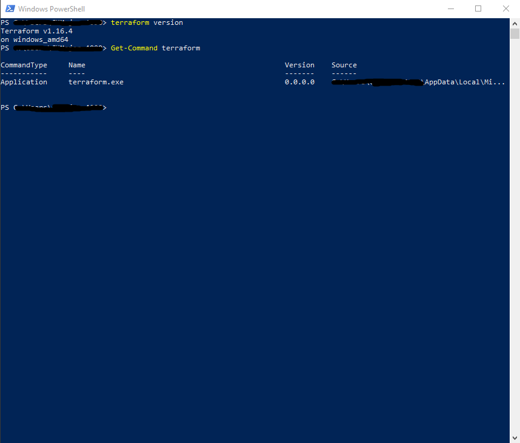

This confirmed that Terraform was installed and available through the command line.

---

## Azure CLI Installation

Microsoft Azure CLI was installed and validated using:

```powershell
az version
Get-Command az
```

The reported Azure CLI version was:

```text
azure-cli: 2.90.0
```

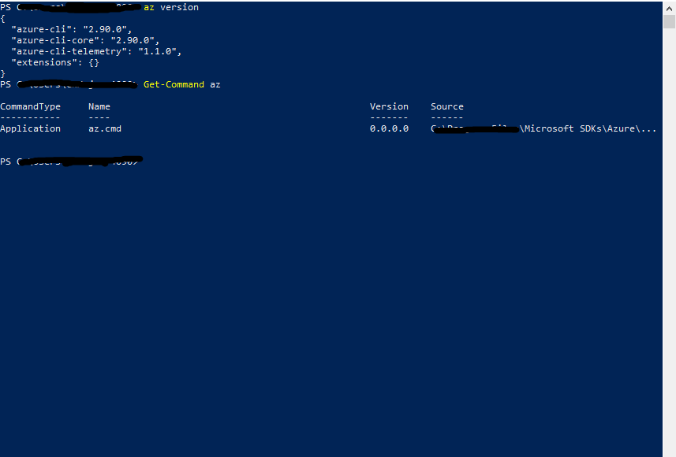

Azure CLI was used throughout the phase for authentication and independent infrastructure verification.

---

## Azure Authentication

The local workstation was authenticated to the Azure for Students subscription.

The active subscription was verified using:

```powershell
az account show --query "{Subscription:name, State:state, User:user.name}" --output table
```

Result:

```text
Subscription          State
--------------------  -------
Azure for Students    Enabled
```

Existing lab resource groups were enumerated using:

```powershell
az group list --query "[].name" --output table
```

The results included:

```text
rg-mts-core-lab-01
rg-mts-management-lab-01
rg-mts-monitoring-lab-01
```

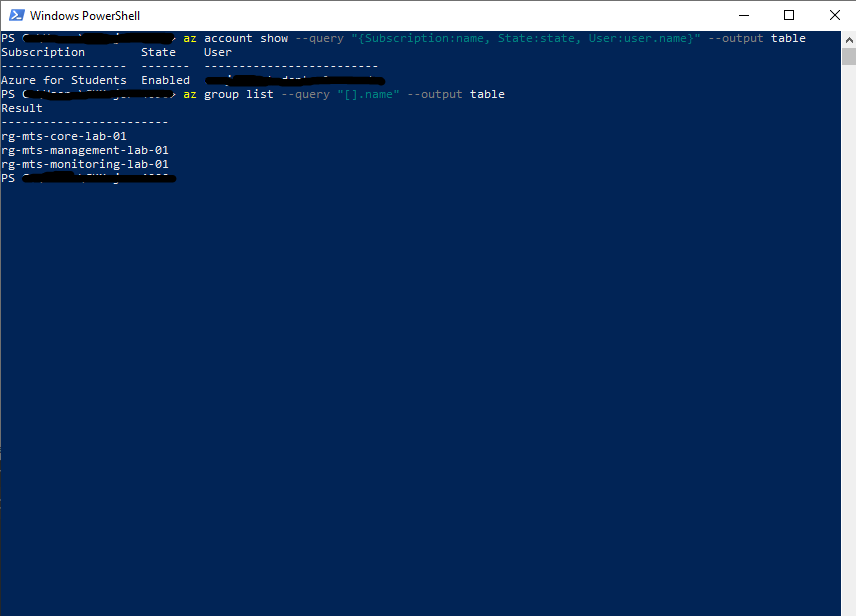

These checks confirmed access to the existing Azure subscription before Terraform deployment.

---

## Terraform Provider Configuration

The AzureRM provider was configured in `providers.tf`.

```hcl
terraform {
  required_version = ">= 1.6.0"

  required_providers {
    azurerm = {
      source  = "hashicorp/azurerm"
      version = "~> 4.0"
    }
  }
}

provider "azurerm" {
  features {}
}
```

The configuration requires Terraform 1.6.0 or later and permits compatible AzureRM 4.x releases.

During Phase 9, the installed provider version was:

```text
registry.terraform.io/hashicorp/azurerm v4.81.0
```

### Initialization

Terraform was initialized using:

```powershell
terraform init
```

The configuration was then validated:

```powershell
terraform validate
```

Result:

```text
Success! The configuration is valid.
```

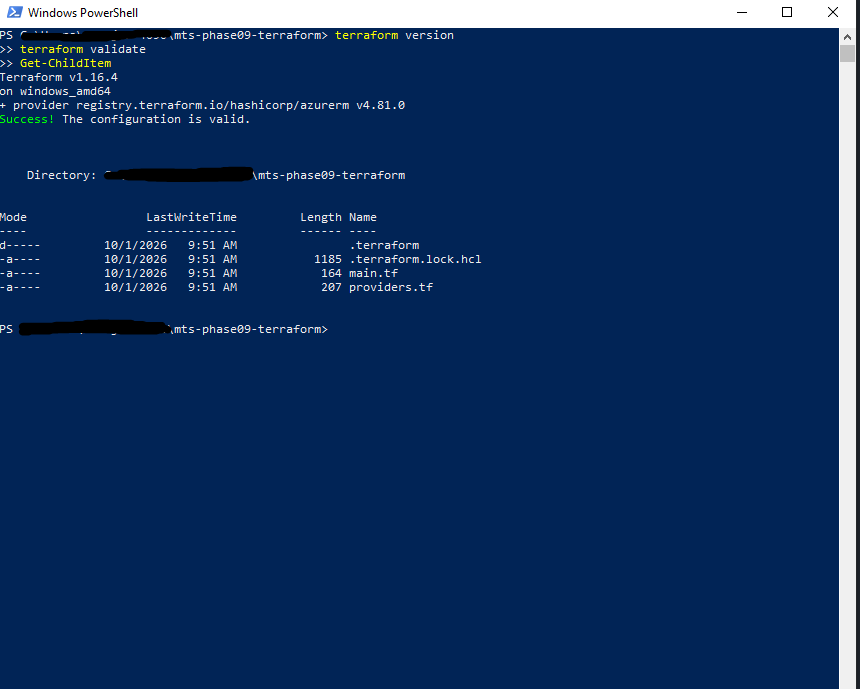

This confirmed that Terraform could initialize the AzureRM provider and validate the configuration.

---

## Terraform Resource Definitions

The completed `main.tf` manages three Azure resources.

### Resource Group

```hcl
resource "azurerm_resource_group" "iac_lab" {
  name     = var.resource_group_name
  location = var.location

  tags = {
    Environment = var.environment
    Project     = var.project_name
    ManagedBy   = "Terraform"
    Phase       = "09"
  }
}
```

### Storage Account

```hcl
resource "azurerm_storage_account" "iac_storage" {
  name                     = var.storage_account_name
  resource_group_name      = azurerm_resource_group.iac_lab.name
  location                 = azurerm_resource_group.iac_lab.location
  account_tier             = "Standard"
  account_replication_type = "LRS"

  tags = {
    Environment = var.environment
    Project     = var.project_name
    ManagedBy   = "Terraform"
    Phase       = "09"
  }
}
```

### Blob Container

```hcl
resource "azurerm_storage_container" "iac_container" {
  name                  = "terraform-lab"
  storage_account_id    = azurerm_storage_account.iac_storage.id
  container_access_type = "private"
}
```

The references between resources establish dependencies.

Terraform uses those references to determine the appropriate resource creation order.

The Blob container is configured for private access, preventing anonymous public access through the container's access-level setting.

---

## Resource Group Deployment

The first Terraform deployment created:

```text
rg-mts-iac-lab-01
```

### Deployment Plan

```powershell
terraform plan
```

Terraform reported:

```text
Plan: 1 to add, 0 to change, 0 to destroy.
```

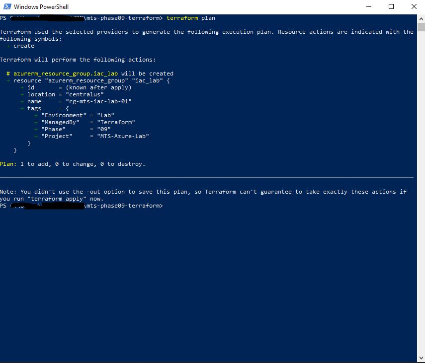

### Apply

The resource group was deployed using:

```powershell
terraform apply
```

Azure CLI was then used to verify the deployment.

```powershell
az group show `
  --name rg-mts-iac-lab-01 `
  --query "{Name:name,Location:location,ProvisioningState:properties.provisioningState}" `
  --output table
```

Result:

```text
Name               Location   ProvisioningState
-----------------  ---------  -----------------
rg-mts-iac-lab-01  centralus  Succeeded
```

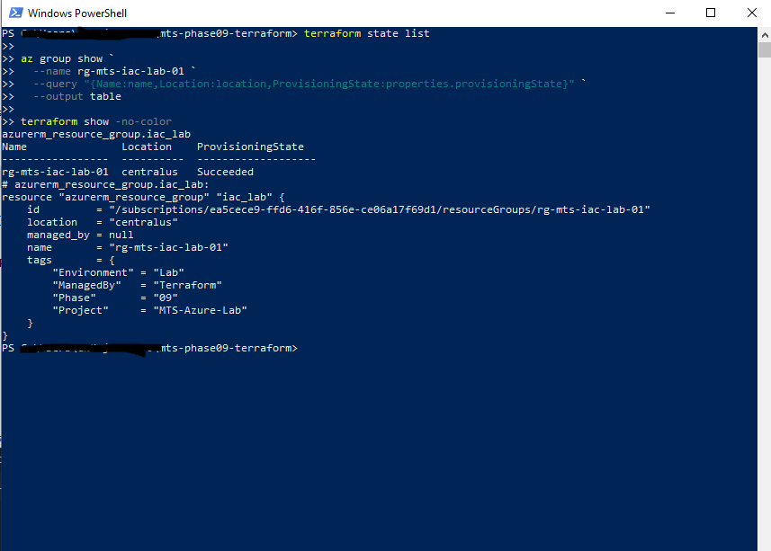

The resource group was successfully created and independently verified.

---

## Terraform Variables and Outputs

The configuration was expanded to separate reusable values from resource definitions.

### Input Variables

The `variables.tf` file defines:

| Variable | Default |
|---|---|
| `resource_group_name` | `rg-mts-iac-lab-01` |
| `location` | `Central US` |
| `environment` | `Lab` |
| `project_name` | `MTS-Azure-Lab` |
| `storage_account_name` | `stmtsterraformlab01` |

These values are referenced from `main.tf`.

### Outputs

The `outputs.tf` file defines:

```text
resource_group_name
resource_group_location
resource_group_id
storage_account_name
storage_account_id
storage_container_name
```

Terraform formatting and validation were performed:

```powershell
terraform fmt
terraform validate
```

The defined outputs were reviewed using:

```powershell
terraform output
```

Example results included:

```text
resource_group_location = "centralus"
resource_group_name     = "rg-mts-iac-lab-01"
```

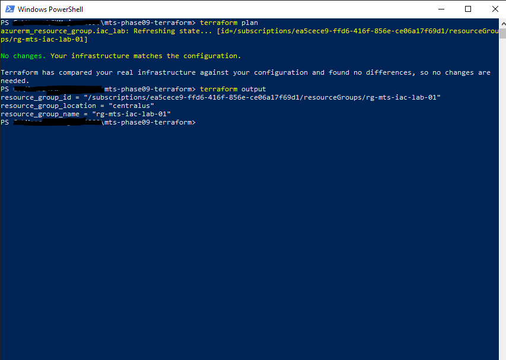

Separating inputs and outputs improves readability and makes the configuration easier to maintain.

---

## Storage Account Deployment

The Terraform configuration was expanded to include:

```text
stmtsterraformlab01
```

### Storage Configuration

| Setting | Value |
|---|---|
| Storage Account | `stmtsterraformlab01` |
| Resource Group | `rg-mts-iac-lab-01` |
| Region | Central US |
| Account Type | StorageV2 |
| Tier | Standard |
| Replication | LRS |

### Deployment Plan

```powershell
terraform fmt
terraform validate
terraform plan
```

Terraform reported:

```text
Plan: 1 to add, 0 to change, 0 to destroy.
```

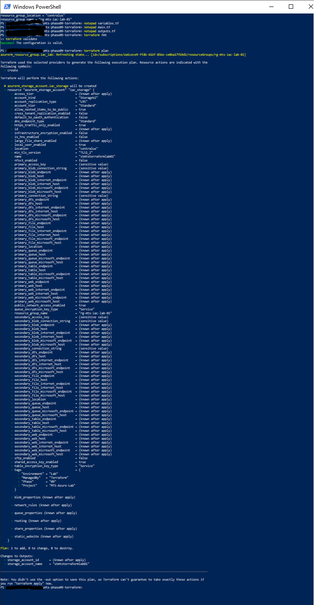

### Apply

```powershell
terraform apply
```

Result:

```text
Apply complete! Resources: 1 added, 0 changed, 0 destroyed.
```

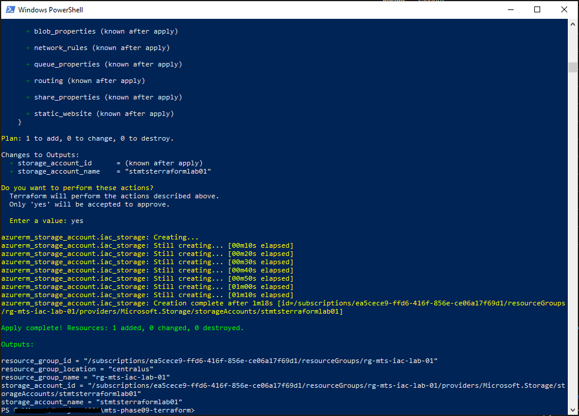

The deployment created the Storage Account within the Terraform-managed resource group.

---

## Independent Storage Validation

Azure CLI was used to verify the Storage Account without relying solely on Terraform output.

```powershell
az storage account show `
  --name stmtsterraformlab01 `
  --resource-group rg-mts-iac-lab-01 `
  --query "{Name:name,ResourceGroup:resourceGroup,Location:location,Kind:kind,SKU:sku.name,ProvisioningState:provisioningState}" `
  --output table
```

The command returned the expected resource properties.

```text
Name                 ResourceGroup      Location   Kind       SKU           ProvisioningState
-------------------  -----------------  ---------  ---------  ------------  -----------------
stmtsterraformlab01  rg-mts-iac-lab-01  centralus  StorageV2  Standard_LRS  Succeeded
```

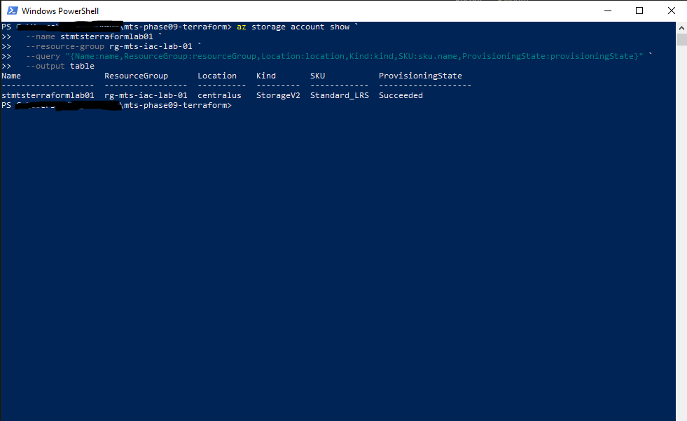

This confirmed that the Storage Account existed in Azure and had completed provisioning.

---

## Terraform State Verification

Terraform state was inspected to confirm that the deployed resources were tracked.

```powershell
terraform state list
```

At this stage, the state included:

```text
azurerm_resource_group.iac_lab
azurerm_storage_account.iac_storage
```

The Storage Account's state was inspected using:

```powershell
terraform state show azurerm_storage_account.iac_storage
```

The recorded configuration included:

```text
account_replication_type = "LRS"
account_tier             = "Standard"
location                 = "centralus"
name                     = "stmtsterraformlab01"
resource_group_name      = "rg-mts-iac-lab-01"
```

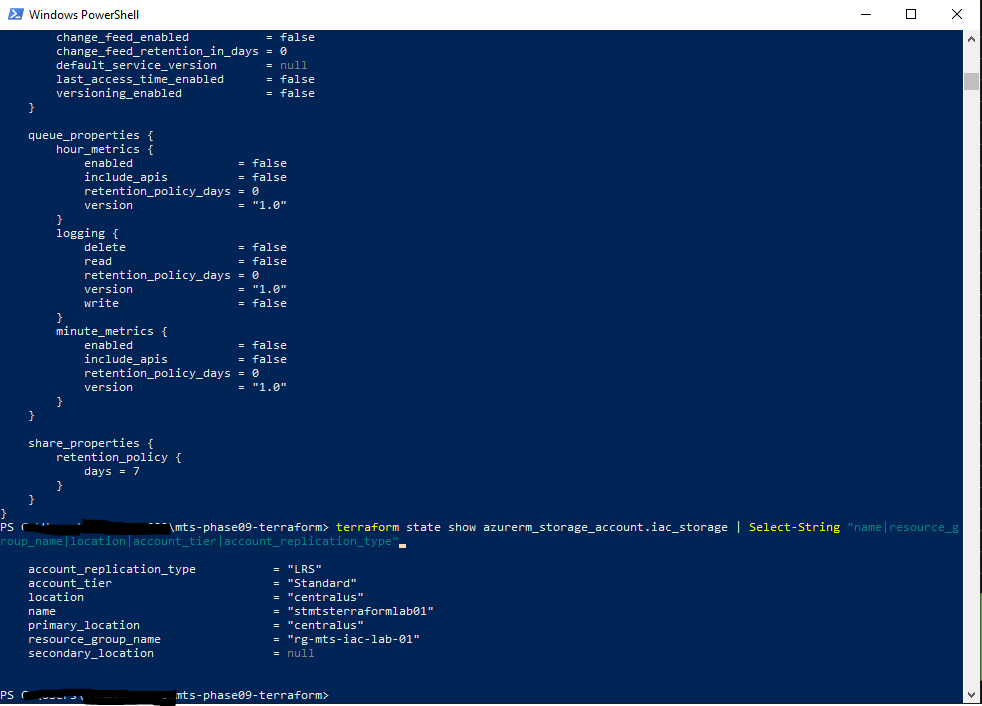

Terraform state maps configuration resources to deployed Azure objects.

### Intermediate Idempotency Test

The configuration was validated again.

```powershell
terraform validate
terraform plan
```

Terraform returned:

```text
Success! The configuration is valid.
```

and:

```text
No changes. Your infrastructure matches the configuration.
```

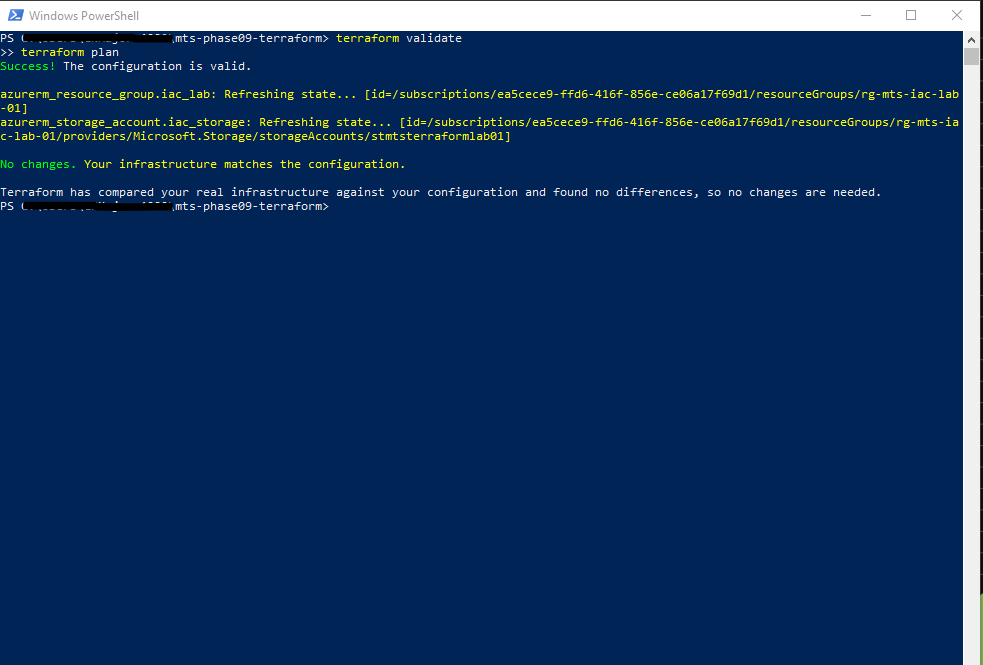

This confirmed that Terraform detected no required changes to the deployed resource group and Storage Account at the time of the test.

---

## Private Blob Container Deployment

A Blob container was added to the Terraform configuration.

| Setting | Configuration |
|---|---|
| Container | `terraform-lab` |
| Storage Account | `stmtsterraformlab01` |
| Access Type | Private |
| Terraform Resource | `azurerm_storage_container.iac_container` |

### Deployment Plan

```powershell
terraform fmt
terraform validate
terraform plan
```

Terraform reported:

```text
Plan: 1 to add, 0 to change, 0 to destroy.
```

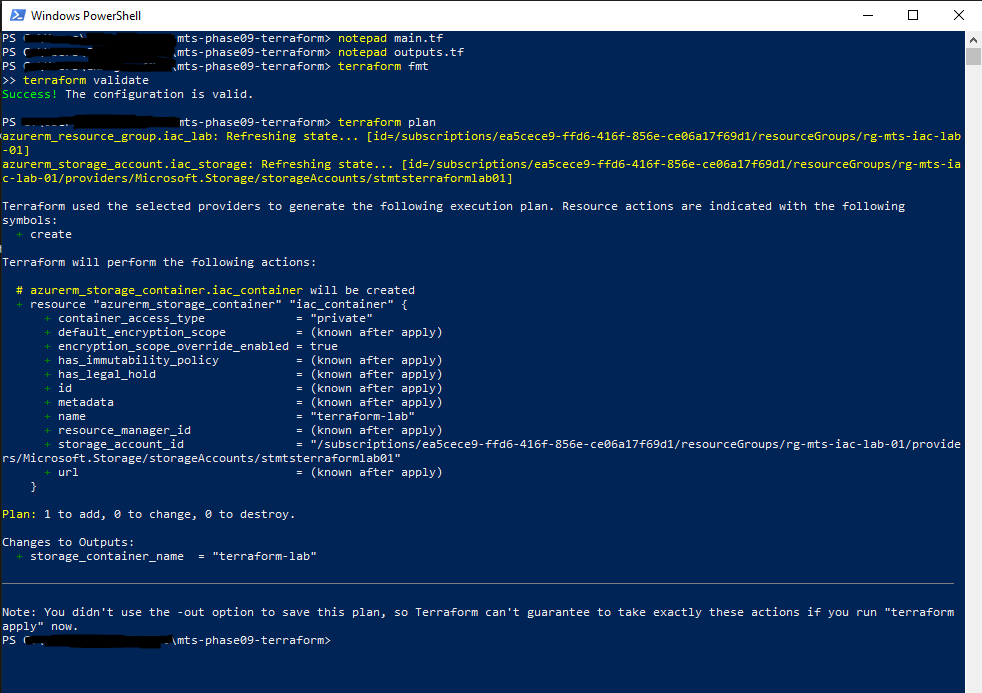

### Apply

```powershell
terraform apply
```

Result:

```text
Apply complete! Resources: 1 added, 0 changed, 0 destroyed.
```

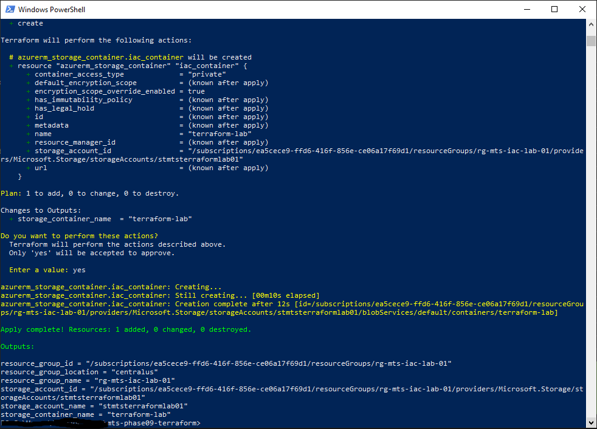

The container was successfully created under Terraform management.

---

## Independent Blob Container Validation

Azure CLI was used to verify the deployed container.

```powershell
az storage container show `
  --name terraform-lab `
  --account-name stmtsterraformlab01 `
  --auth-mode login `
  --query "{Name:name,PublicAccess:properties.publicAccess,LastModified:properties.lastModified}" `
  --output table
```

The command returned:

```text
Name
-------------
terraform-lab
```

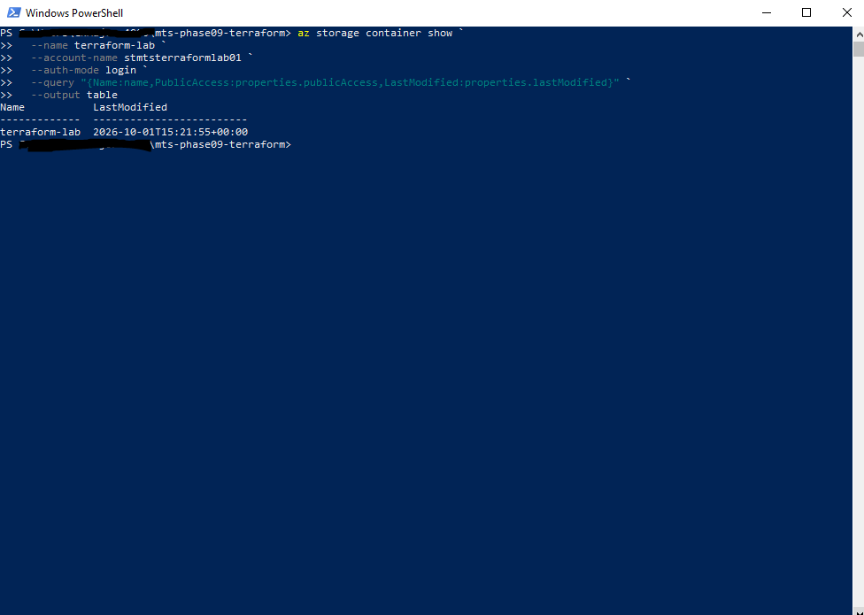

This confirmed that the container existed in the expected Storage Account.

The Terraform configuration specifies private container access. The CLI output shown above independently confirms the container's existence but does not display an explicit private-access value.

---

## Final Terraform Validation

The final Terraform state was reviewed after all three resources were deployed.

```powershell
terraform state list
```

Result:

```text
azurerm_resource_group.iac_lab
azurerm_storage_account.iac_storage
azurerm_storage_container.iac_container
```

The final execution plan was then generated.

```powershell
terraform plan
```

Terraform returned:

```text
No changes. Your infrastructure matches the configuration.
```

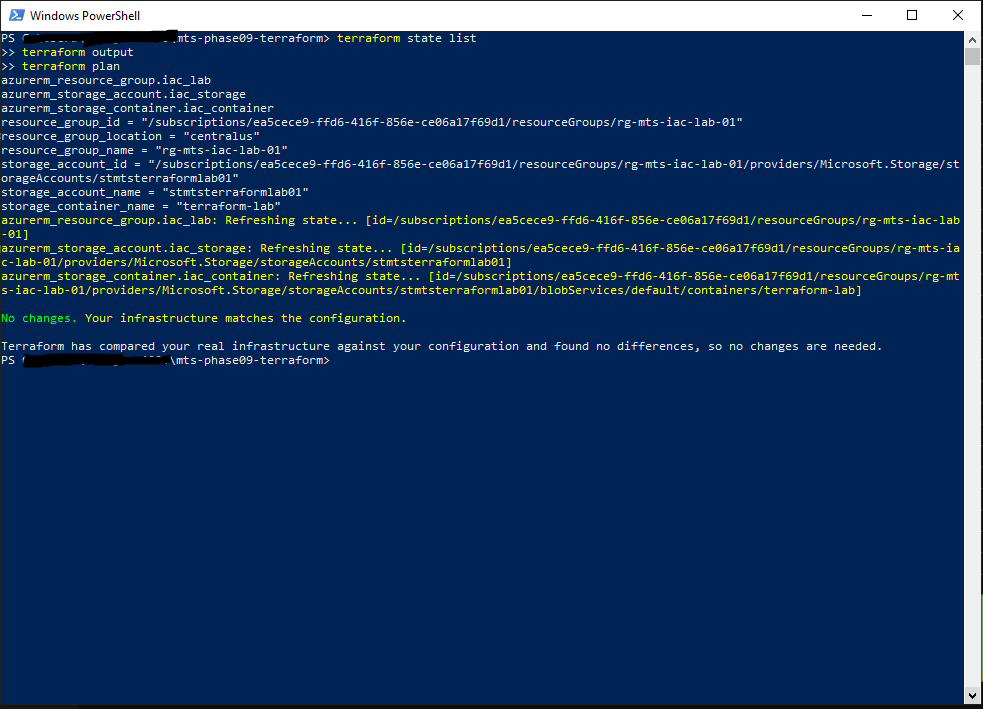

This confirmed that:

- All three resources were tracked in Terraform state.
- The resources had been successfully deployed.
- Terraform detected no required changes at the time of validation.

The result demonstrates the expected no-change behavior of Terraform when the deployed infrastructure matches its declared configuration.

---

## Terraform Workflow

The Phase 9 deployment followed a repeatable Terraform workflow.

```text
Write Terraform Configuration
            |
            v
       terraform fmt
            |
            v
     terraform validate
            |
            v
       terraform plan
            |
            v
    Review Proposed Changes
            |
            v
       terraform apply
            |
            v
      Azure Deployment
            |
            v
    Azure CLI Verification
            |
            v
    Terraform State Review
            |
            v
       terraform plan
            |
            v
        No Changes
```

The workflow separates configuration validation, deployment, independent verification, and final state review.

---

## Terraform State and Repository Security

Phase 9 uses local Terraform state.

The state files are excluded from the public repository.

The `.gitignore` includes:

```gitignore
# Terraform working directory
.terraform/

# Terraform state
*.tfstate
*.tfstate.*

# Terraform plan files
*.tfplan

# Terraform crash logs
crash.log
crash.*.log

# Sensitive variable files
*.tfvars
*.tfvars.json

# Local override files
override.tf
override.tf.json
*_override.tf
*_override.tf.json
```

This prevents common Terraform runtime artifacts and local variable files from being committed unintentionally.

Terraform state can contain infrastructure metadata and sensitive information. It should not be published in a public repository.

### State Management Scope

The Phase 9 implementation uses:

```text
Local Terraform State
```

It does not configure:

- An Azure Storage remote-state backend
- State locking through a remote backend
- Automated deployment pipelines
- Terraform modules
- CI/CD deployment workflows

The `terraform-lab` Blob container is a deployed resource managed by Terraform, not the location of Terraform state.

A secured remote backend would be an appropriate future improvement for shared or production infrastructure management.

---

## Security and Design Observations

### Resource Dependencies

The Storage Account references the Terraform-managed resource group.

The Blob container references the Terraform-managed Storage Account.

These references allow Terraform to infer deployment dependencies.

### Resource Tagging

The resource group and Storage Account use:

```text
Environment = Lab
Project     = MTS-Azure-Lab
ManagedBy   = Terraform
Phase       = 09
```

These tags distinguish Terraform-managed infrastructure from resources created manually during earlier phases.

### Blob Container Access

The Blob container is configured with:

```hcl
container_access_type = "private"
```

This restricts anonymous container access.

It does not, by itself, restrict the Storage Account's public network endpoint.

### Storage Security Hardening

The provided Terraform configuration does not explicitly declare every available Storage Account security setting.

Additional controls such as TLS minimum-version requirements, HTTPS-only enforcement, public network restrictions, and Blob public-access prevention can be evaluated in future iterations.

### Terraform Dependency Locking

The AzureRM provider version used during validation was `4.81.0`.

The provider constraint in `providers.tf` permits compatible 4.x versions.

Committing the generated `.terraform.lock.hcl` file would improve reproducibility by recording the selected provider version and checksums.

The current repository screenshots do not show that file.

---

## Phase 9 Verification

Phase 9 established and validated the Infrastructure-as-Code implementation:

- Terraform v1.16.4 installed and validated
- Azure CLI v2.90.0 installed and validated
- Azure for Students authentication confirmed
- Existing Azure resource groups enumerated
- AzureRM provider configured
- AzureRM provider v4.81.0 initialized
- Terraform configuration validated
- Resource Group deployment planned
- Resource Group deployed
- Resource Group independently verified with Azure CLI
- Terraform input variables implemented
- Terraform outputs implemented
- Storage Account deployment planned
- Storage Account deployed
- Storage Account independently verified with Azure CLI
- Terraform state inspected
- Intermediate no-change plan confirmed
- Private Blob container deployment planned
- Blob container deployed
- Blob container independently verified with Azure CLI
- Final Terraform state contained three resources
- Final `terraform plan` returned no changes
- Terraform runtime and state files excluded through `.gitignore`

### Final Managed Resources

| Terraform Resource | Azure Resource |
|---|---|
| `azurerm_resource_group.iac_lab` | `rg-mts-iac-lab-01` |
| `azurerm_storage_account.iac_storage` | `stmtsterraformlab01` |
| `azurerm_storage_container.iac_container` | `terraform-lab` |

The phase demonstrated declarative Azure provisioning, state-based infrastructure management, independent verification, and no-change execution planning.

**Phase 9 Status: Complete**

---

## Next Phase

**Phase 10 — Administration & Automation**

Phase 10 expands the lab's operational administration capabilities using scripting and Azure command-line tools.

The next phase builds on the existing infrastructure, Azure CLI experience, and repeatable configuration practices introduced during Phase 9.
