# Phase 10 — Administration & Automation

## Overview

Phase 10 extends the MTS Azure Cloud Infrastructure Lab from infrastructure provisioning into operational administration and PowerShell automation.

Previous phases established Azure infrastructure and introduced Terraform-based resource management. This phase focused on developing repeatable administrative workflows for resource discovery, inventory, governance auditing, reporting, and environment validation.

Azure CLI and Azure PowerShell were used to inspect the same subscription through independent administrative interfaces.

Four PowerShell scripts were developed to automate resource inventory, Storage Account inspection, environment validation, and CSV reporting.

The phase concluded with PowerShell syntax validation and a Terraform execution plan confirming that no changes were required to the infrastructure managed during Phase 09.

---

## Environment

| Component | Configuration |
|---|---|
| Cloud Platform | Microsoft Azure |
| Subscription | Azure for Students |
| Primary Region | Central US |
| Administrative Shell | Windows PowerShell |
| Administrative Tools | Azure CLI, Azure PowerShell |
| PowerShell Module | Az |
| Infrastructure as Code | Terraform |
| Resource Groups Discovered | 5 |
| Azure Resources Inventoried | 27 |
| Storage Accounts Identified | 2 |
| PowerShell Scripts | 4 |
| Automated Environment Checks | 7 |

The administrative work was performed against the existing Azure environment rather than a separate deployment.

---

## Administrative Architecture

Phase 10 established multiple methods of inspecting and validating the Azure environment.

```text
                 Azure for Students
                         |
                         v
                 Azure Resource Manager
                         |
            +------------+------------+
            |            |            |
            v            v            v
        Azure CLI   Azure PowerShell  Terraform
            |            |            |
            |            v            |
            |      PowerShell Scripts |
            |            |            |
            v            v            v
        Inventory     Validation    IaC State
        Inspection    Reporting     Drift Check
            |            |            |
            +------------+------------+
                         |
                         v
                Operational Review
```

Terraform remained responsible for the resources provisioned through Phase 09.

Azure CLI and Azure PowerShell were used primarily for read-oriented administrative operations.

---

## PowerShell Repository Structure

The Phase 10 automation scripts are stored in:

`Documents/10-Administration-Automation/PowerShell/`

```text
10-Administration-Automation/
├── README.md
└── PowerShell/
    ├── Export-MTSResourceInventory.ps1
    ├── Get-MTSResourceInventory.ps1
    ├── Get-MTSStorageInventory.ps1
    └── Test-MTSAzureEnvironment.ps1
```

| Script | Purpose |
|---|---|
| `Get-MTSResourceInventory.ps1` | Displays Azure resource inventory |
| `Get-MTSStorageInventory.ps1` | Displays Storage Account configuration |
| `Test-MTSAzureEnvironment.ps1` | Validates selected Azure resources |
| `Export-MTSResourceInventory.ps1` | Exports resource inventory to CSV |

The scripts use the Azure PowerShell Az module and operate against the authenticated Azure context.

---

## Azure CLI Administrative Baseline

Azure CLI was used to verify subscription access before beginning administrative operations.

```powershell
az account show `
  --query "{Subscription:name,State:state,User:user.name}" `
  --output table
```

The subscription was confirmed as:

```text
Subscription          State
--------------------  -------
Azure for Students    Enabled
```

Resource groups were enumerated using:

```powershell
az group list `
  --query "[].{ResourceGroup:name,Location:location}" `
  --output table
```

Five resource groups were identified:

```text
NetworkWatcherRG
rg-mts-core-lab-01
rg-mts-iac-lab-01
rg-mts-management-lab-01
rg-mts-monitoring-lab-01
```

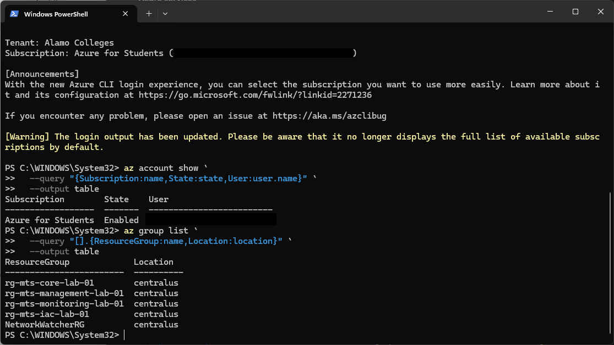

This established an initial administrative baseline for the existing Azure environment.

---

## Azure PowerShell Installation

The Az PowerShell module was validated on the administrative workstation.

```powershell
Get-Module -ListAvailable Az |
    Select-Object Name, Version
```

Availability of the authentication cmdlet was verified using:

```powershell
Get-Command Connect-AzAccount |
    Select-Object Name, CommandType, Source
```

The command confirmed that `Connect-AzAccount` was available through the Azure PowerShell modules.

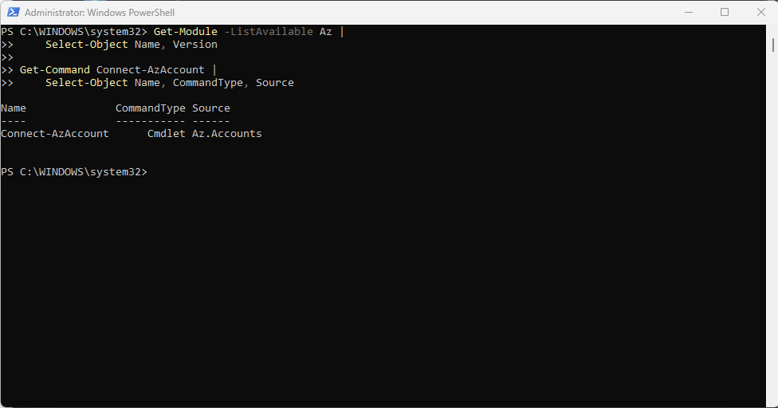

This established Azure PowerShell as a second administrative interface alongside Azure CLI.

---

## Azure PowerShell Authentication

Authentication was established using:

```powershell
Connect-AzAccount
```

The active context was inspected with:

```powershell
Get-AzContext |
    Select-Object Name,
                  Account,
                  Subscription,
                  Tenant |
    Format-List
```

Subscription status was checked independently:

```powershell
Get-AzSubscription |
    Select-Object Name, State |
    Format-Table -AutoSize
```

The Azure for Students subscription returned an enabled state.

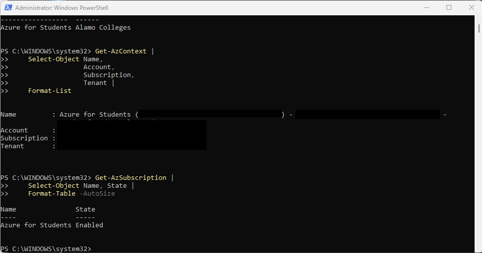

Sensitive subscription, tenant, and authentication information was redacted from the published evidence.

---

## Resource Group Inventory

Azure PowerShell was used to enumerate resource groups.

```powershell
Get-AzResourceGroup |
    Select-Object ResourceGroupName, Location |
    Sort-Object ResourceGroupName |
    Format-Table -AutoSize
```

The query identified the same five resource groups discovered through Azure CLI:

```text
NetworkWatcherRG
rg-mts-core-lab-01
rg-mts-iac-lab-01
rg-mts-management-lab-01
rg-mts-monitoring-lab-01
```

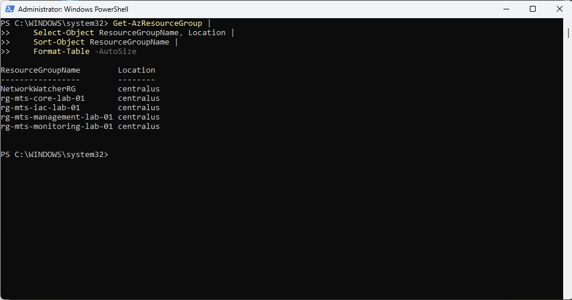

The matching results demonstrated consistent resource-group visibility between the two administrative tools.

---

## Azure Resource Inventory

Azure PowerShell was used to retrieve a subscription-level inventory of Azure Resource Manager resources.

```powershell
Get-AzResource |
    Select-Object Name,
                  ResourceType,
                  ResourceGroupName,
                  Location |
    Sort-Object ResourceGroupName,
                ResourceType,
                Name |
    Format-Table -AutoSize
```

The inventory included resources associated with:

- Virtual machines and managed disks
- Virtual networks and network interfaces
- Network Security Groups and public IP addresses
- Storage Accounts
- Azure Key Vault
- Log Analytics
- Azure Monitor
- Managed identities
- Virtual machine shutdown schedules

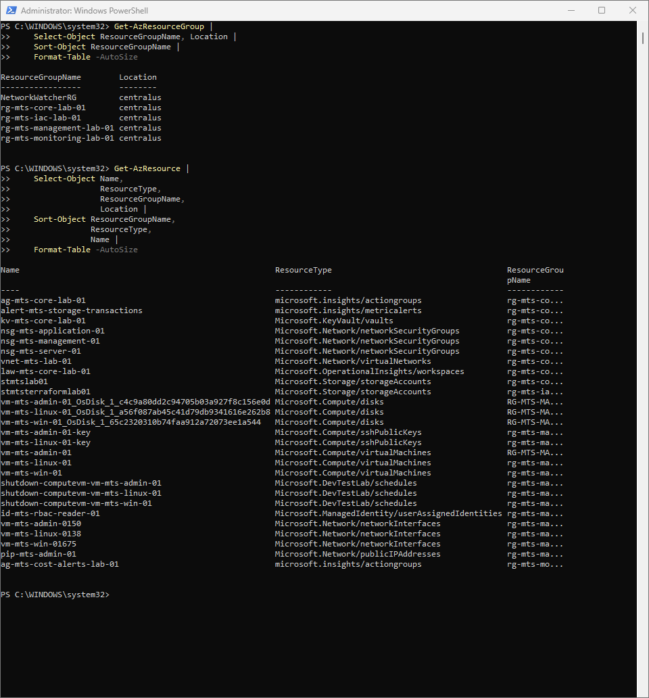

This demonstrated centralized Azure resource discovery without requiring individual resource inspection through the Azure Portal.

---

## Automated Resource Inventory

A reusable PowerShell script was created to automate the resource inventory process.

**Script:** `PowerShell/Get-MTSResourceInventory.ps1`

The script:

1. Checks for an active Azure PowerShell context.
2. Displays the active subscription.
3. Retrieves Azure resources using `Get-AzResource`.
4. Selects resource names, types, resource groups, and locations.
5. Sorts and displays the results.
6. Reports the total resource count.

### Execution

```powershell
.\Get-MTSResourceInventory.ps1
```

### Result

```text
Total Resources: 27
```

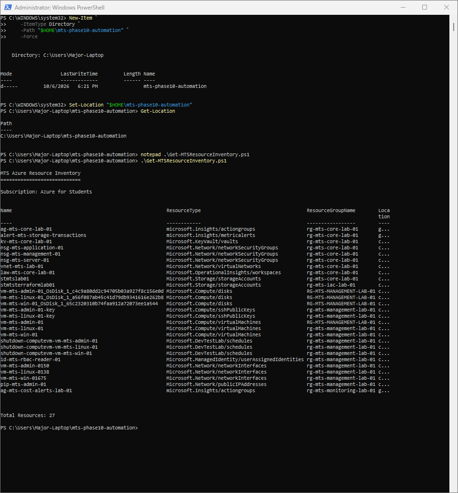

The script converted a manual inventory query into a repeatable administrative operation.

---

## Automated Storage Account Inventory

A second script was developed for targeted Azure Storage administration.

**Script:** `PowerShell/Get-MTSStorageInventory.ps1`

The script uses:

```powershell
Get-AzStorageAccount
```

It retrieves:

| Property | Description |
|---|---|
| Storage Account | Account name |
| Resource Group | Resource ownership location |
| Location | Azure region |
| SKU | Storage replication and performance tier |
| Kind | Storage Account type |
| HTTPSOnly | HTTPS-only traffic configuration |

### Execution

```powershell
.\Get-MTSStorageInventory.ps1
```

### Results

Two Storage Accounts were identified:

```text
stmtslab01
stmtsterraformlab01
```

Both accounts were reported as:

```text
Location:  centralus
Kind:      StorageV2
SKU:       Standard_LRS
HTTPSOnly: True
```

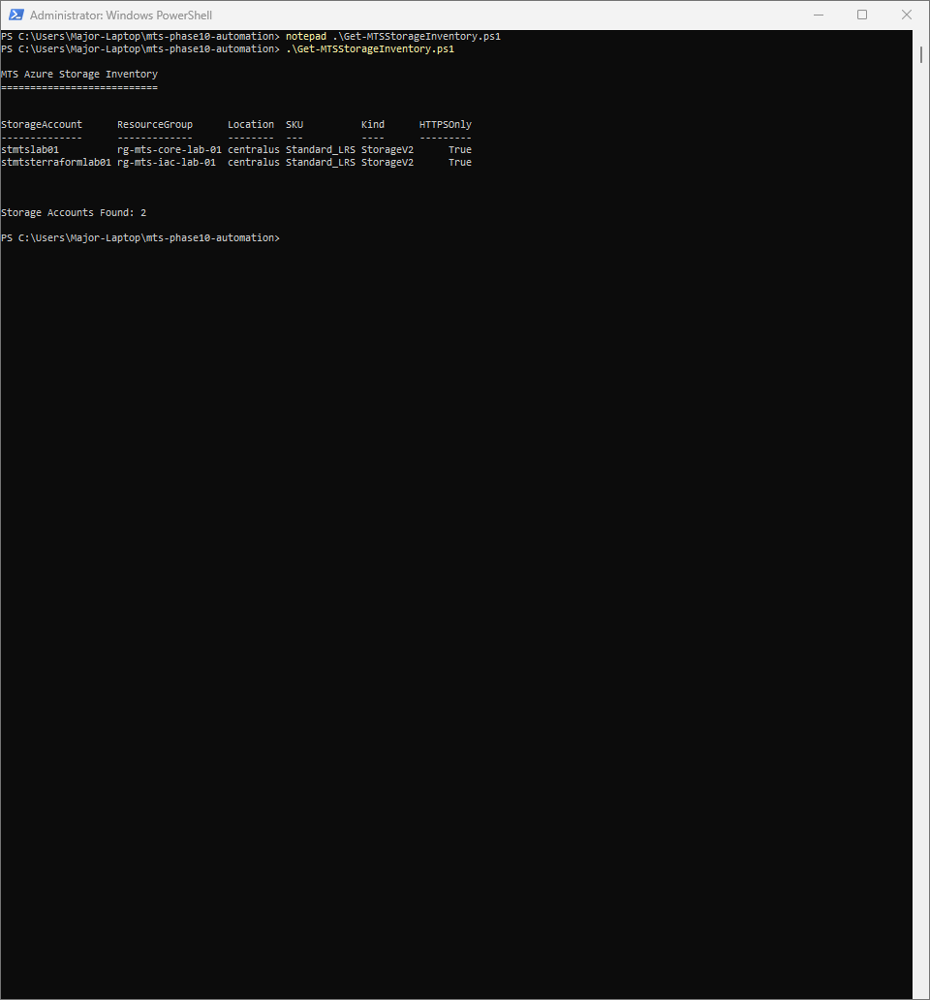

The inventory included the Terraform-managed Storage Account created during Phase 09.

---

## Azure CLI Resource Verification

Azure CLI was used to independently repeat resource inventory operations.

### Resource Inventory

```powershell
az resource list `
  --query "[].{Name:name,Type:type,ResourceGroup:resourceGroup,Location:location}" `
  --output table
```

### Storage Inventory

```powershell
az storage account list `
  --query "[].{Name:name,ResourceGroup:resourceGroup,Location:location,SKU:sku.name,Kind:kind}" `
  --output table
```

The queries identified the existing lab resources and both Storage Accounts.

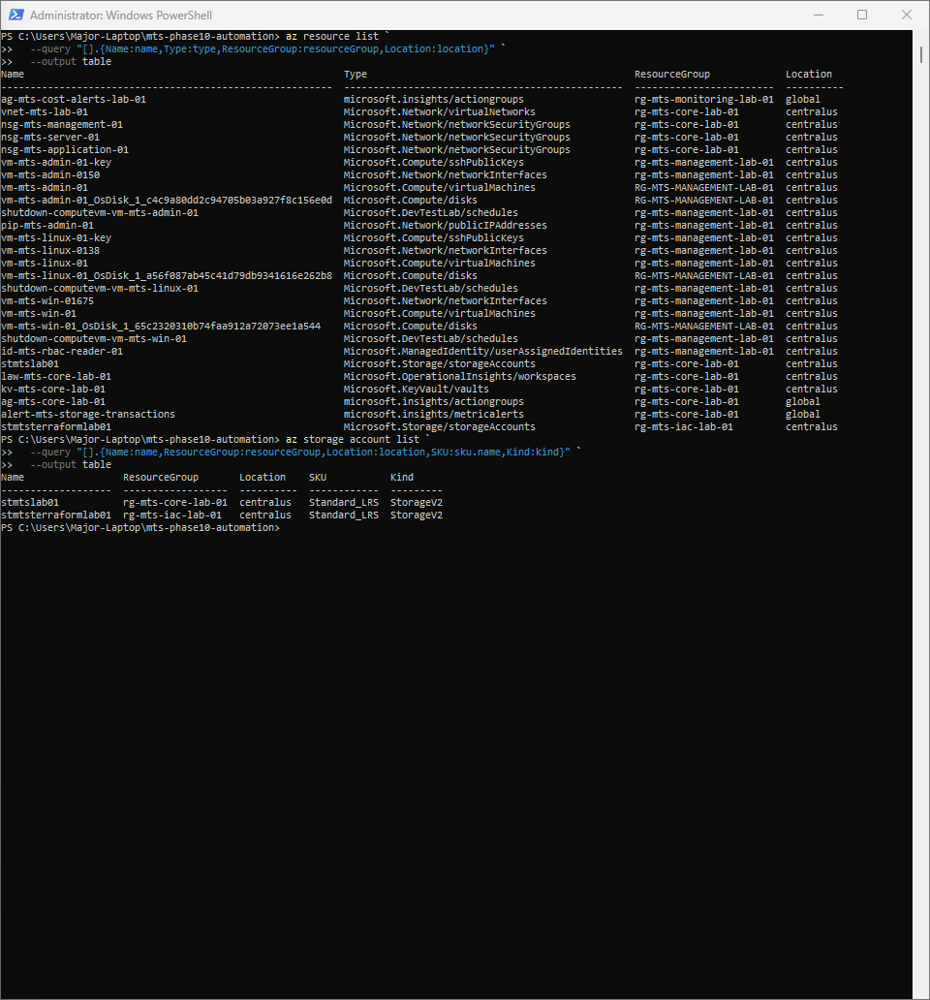

Using both tools provided independent visibility into the Azure Resource Manager environment.

---

## Resource Tag Audit

Azure resource tags were reviewed to evaluate governance metadata and resource-management classifications.

The audit focused on:

```text
Environment
Project
ManagedBy
```

PowerShell query:

```powershell
Get-AzResource |
    Select-Object Name,
                  ResourceGroupName,
                  @{Name="Environment";Expression={$_.Tags["Environment"]}},
                  @{Name="Project";Expression={$_.Tags["Project"]}},
                  @{Name="ManagedBy";Expression={$_.Tags["ManagedBy"]}} |
    Sort-Object ResourceGroupName, Name |
    Format-Table -AutoSize
```

### Management Classifications

Manually administered resources were generally tagged:

```text
Environment = Lab
Project     = MTS-Azure-Lab
ManagedBy   = Manual
```

Terraform-managed resources used:

```text
Environment = Lab
Project     = MTS-Azure-Lab
ManagedBy   = Terraform
```

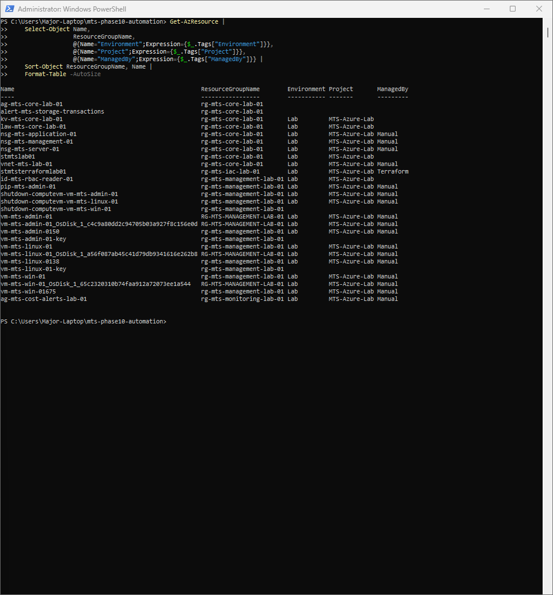

The audit also identified resources with missing governance tags.

These findings were documented without changing resources solely to standardize the audit results.

This preserved the distinction between resource discovery and remediation.

---

## Automated Environment Validation

A PowerShell script was developed to verify the presence of critical Azure lab components.

**Script:** `PowerShell/Test-MTSAzureEnvironment.ps1`

The script checks the Azure PowerShell context and selected infrastructure resources.

### Validation Targets

| Check | Target |
|---|---|
| 1 | Azure PowerShell authentication context |
| 2 | `rg-mts-core-lab-01` |
| 3 | `rg-mts-management-lab-01` |
| 4 | `rg-mts-monitoring-lab-01` |
| 5 | `rg-mts-iac-lab-01` |
| 6 | `stmtsterraformlab01` |
| 7 | `terraform-lab` |

### Execution

```powershell
.\Test-MTSAzureEnvironment.ps1
```

### Results

```text
Azure PowerShell Context    PASS
Core Resource Group         PASS
Management Resource Group   PASS
Monitoring Resource Group   PASS
Terraform Resource Group    PASS
Terraform Storage Account   PASS
Terraform Blob Container    PASS

Passed: 7
Failed: 0

MTS Azure environment validation PASSED.
```

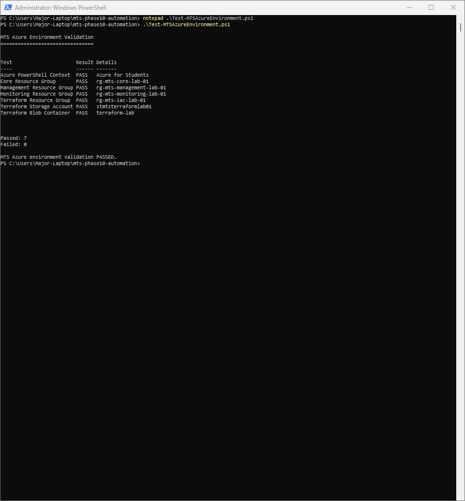

The script provides a repeatable check for selected infrastructure dependencies.

These checks establish authentication and resource availability through management queries. They do not represent a comprehensive security assessment or application-health test.

---

## Automated Resource Inventory Export

A fourth PowerShell script was developed to export Azure resource information to a structured CSV report.

**Script:** `PowerShell/Export-MTSResourceInventory.ps1`

The script uses `Get-AzResource` and exports:

```text
Name
ResourceType
ResourceGroupName
Location
Environment
Project
ManagedBy
```

The output file is:

```text
MTS-Azure-Resource-Inventory.csv
```

### Execution

```powershell
.\Export-MTSResourceInventory.ps1
```

### Result

```text
Resources exported: 27
```

The exported CSV was subsequently imported into PowerShell to verify the report contents.

```powershell
Import-Csv .\MTS-Azure-Resource-Inventory.csv |
    Select-Object -First 10 |
    Format-Table -AutoSize
```

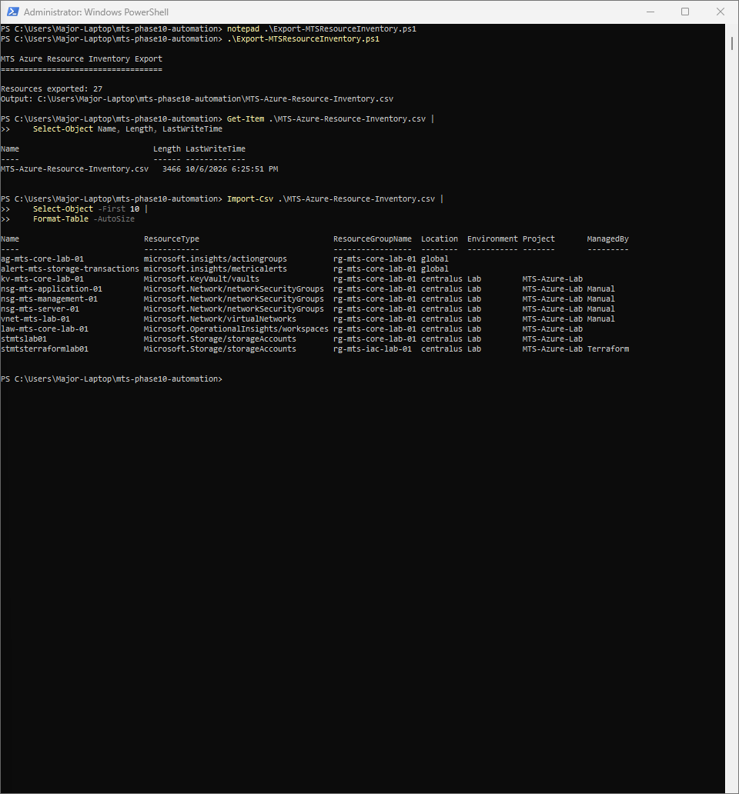

The CSV is a generated operational report. The source script is retained in the repository so the inventory can be recreated when needed.

---

## Azure CLI Operational Validation

Azure CLI was used to inspect the operational configuration of the Terraform-managed Storage Account.

```powershell
az storage account show `
  --name stmtsterraformlab01 `
  --resource-group rg-mts-iac-lab-01 `
  --query "{Name:name,ResourceGroup:resourceGroup,Location:location,Kind:kind,SKU:sku.name,ProvisioningState:provisioningState,HTTPSOnly:enableHttpsTrafficOnly,PublicNetworkAccess:publicNetworkAccess}" `
  --output table
```

The query confirmed:

| Property | Result |
|---|---|
| Name | `stmtsterraformlab01` |
| Resource Group | `rg-mts-iac-lab-01` |
| Location | `centralus` |
| Kind | `StorageV2` |
| SKU | `Standard_LRS` |
| Provisioning State | `Succeeded` |
| HTTPS Only | `True` |
| Public Network Access | `Enabled` |

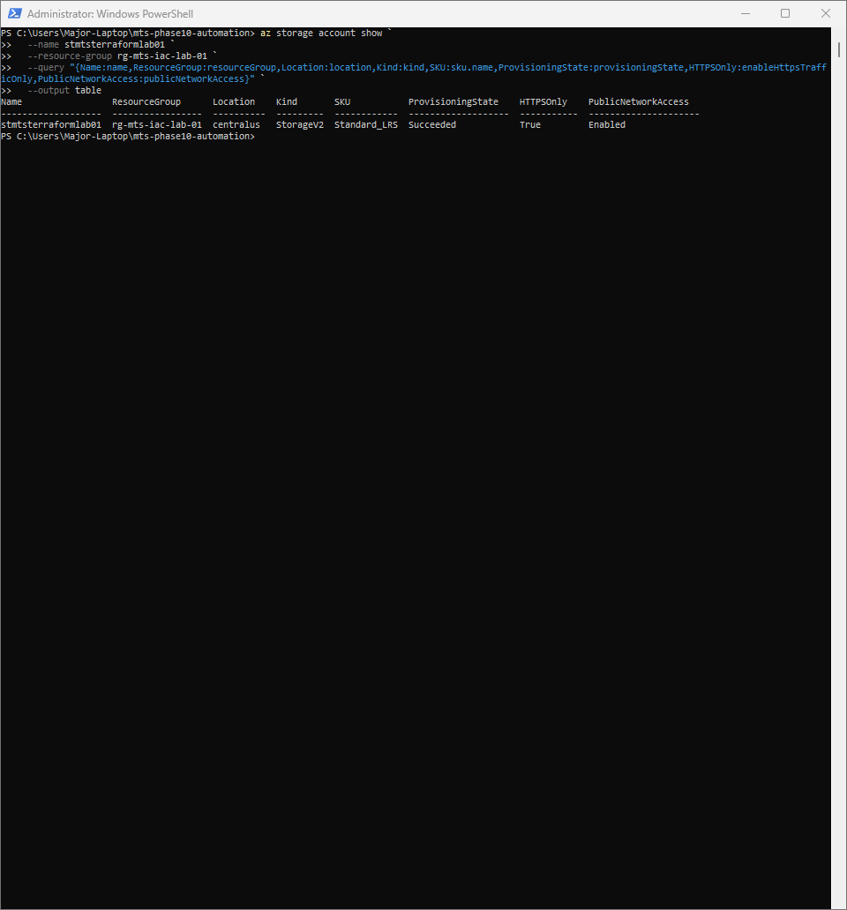

HTTPS-only enforcement was enabled.

Public network access remained enabled, which is a separate configuration consideration for future security hardening.

---

## Cross-Tool Resource Validation

The Terraform-managed Storage Account was queried through both Azure PowerShell and Azure CLI.

### Azure PowerShell

```powershell
Get-AzStorageAccount `
    -ResourceGroupName "rg-mts-iac-lab-01" `
    -Name "stmtsterraformlab01" |
    Select-Object StorageAccountName,
                  ResourceGroupName,
                  Location,
                  Kind,
                  @{Name="SKU";Expression={$_.Sku.Name}} |
    Format-Table -AutoSize
```

### Azure CLI

```powershell
az storage account show `
  --name stmtsterraformlab01 `
  --resource-group rg-mts-iac-lab-01 `
  --query "{Name:name,ResourceGroup:resourceGroup,Location:location,Kind:kind,SKU:sku.name}" `
  --output table
```

Both tools returned matching resource properties:

```text
Name            stmtsterraformlab01
Resource Group  rg-mts-iac-lab-01
Location        centralus
Kind            StorageV2
SKU             Standard_LRS
```

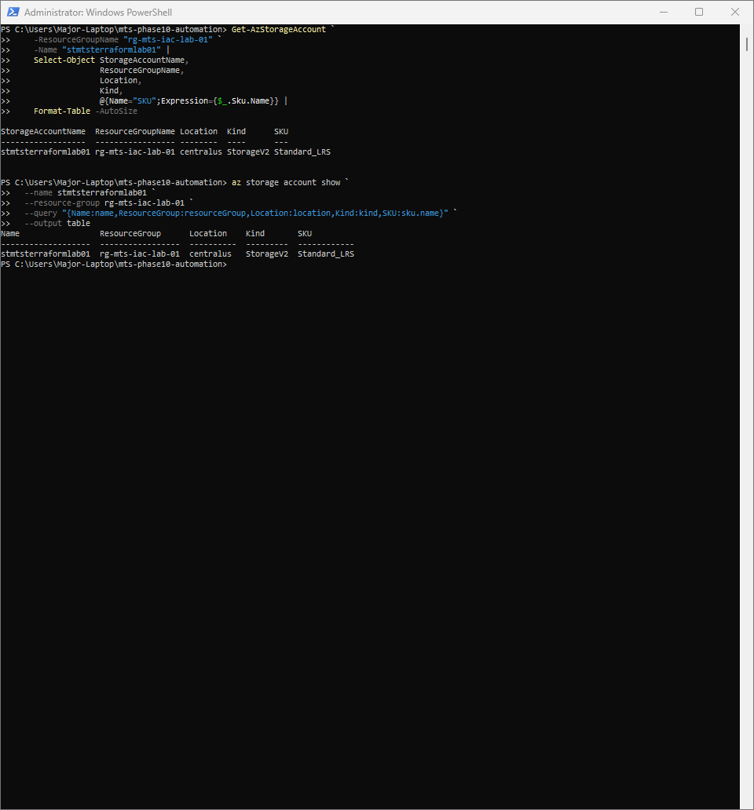

This demonstrated consistent resource information across the Azure administrative interfaces.

---

## Terraform Post-Administration Validation

Phase 09 established Terraform management for three Azure resources.

Phase 10 focused primarily on administrative queries and reporting rather than manually modifying those Terraform-managed resources.

After completing the administrative tasks, the original Terraform working directory and local state were used for validation.

### Configuration Validation

```powershell
terraform validate
```

The configuration validated successfully.

### State Inspection

```powershell
terraform state list
```

The expected resources remained tracked:

```text
azurerm_resource_group.iac_lab
azurerm_storage_account.iac_storage
azurerm_storage_container.iac_container
```

### Drift Check

```powershell
terraform plan
```

Result:

```text
No changes. Your infrastructure matches the configuration.
```

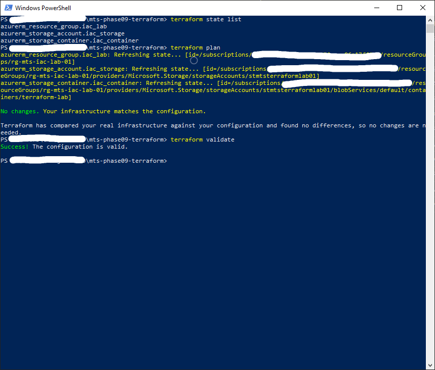

Terraform detected no changes required to the managed infrastructure at the time of validation.

This supported the separation between Terraform-based provisioning and PowerShell-based operational administration.

---

## Final Script and Environment Validation

All four PowerShell scripts were checked using the PowerShell parser.

### Script Syntax Results

| Script | Result |
|---|---|
| `Export-MTSResourceInventory.ps1` | PASS |
| `Get-MTSResourceInventory.ps1` | PASS |
| `Get-MTSStorageInventory.ps1` | PASS |
| `Test-MTSAzureEnvironment.ps1` | PASS |

The environment validation script was then executed again.

### Final Environment Results

```text
Azure PowerShell Context    PASS
Core Resource Group         PASS
Management Resource Group   PASS
Monitoring Resource Group   PASS
Terraform Resource Group    PASS
Terraform Storage Account   PASS
Terraform Blob Container    PASS

Passed: 7
Failed: 0

MTS Azure environment validation PASSED.
```

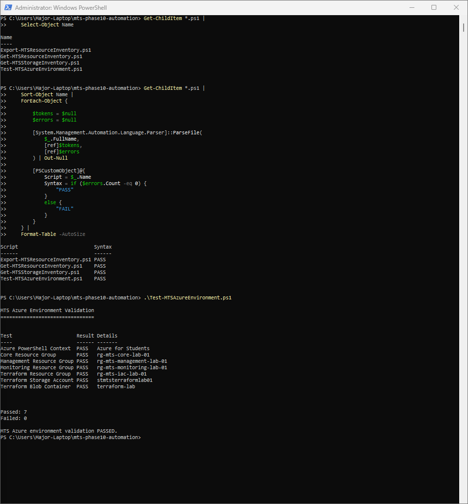

The final results confirmed that all four scripts passed syntax validation and all seven selected infrastructure checks passed.

---

## Operational Practices

### Read-Oriented Administration

Phase 10 emphasized:

```text
Discover
Inventory
Audit
Validate
Report
```

Administrative workflows were primarily read-oriented to reduce the risk of unintended changes.

### Governance Auditing

Resource tags were inspected and missing metadata was documented.

The audit did not automatically modify resources or apply corrective tags.

### Sensitive Information

Published evidence was prepared without exposing credentials, access tokens, Storage Account keys, or connection strings.

Authentication identifiers were redacted where appropriate.

### Terraform State

Terraform state remained local to the Phase 09 environment and was not committed to the public repository.

### Automation Scope

The scripts automate administrative operations when executed.

Scheduled execution, unattended orchestration, Azure Automation Accounts, and CI/CD pipelines were not implemented during this phase.

---

## Phase 10 Verification

The completed phase demonstrated:

- Azure CLI subscription authentication
- Azure PowerShell module availability
- Azure PowerShell authentication
- Discovery of five resource groups
- Inventory of 27 Azure resources
- Identification of two Storage Accounts
- Reusable resource inventory scripting
- Reusable Storage Account inventory scripting
- Governance tag auditing
- Automated validation of seven selected infrastructure checks
- CSV export of 27 resource records
- Independent Azure CLI operational inspection
- Cross-tool verification of Storage Account properties
- Terraform state inspection
- Terraform execution planning with no changes detected
- Syntax validation of four PowerShell scripts
- Final environment validation with seven passing checks

### Final Results

| Validation | Result |
|---|---|
| Azure Resources | 27 |
| Resource Groups | 5 |
| Storage Accounts | 2 |
| PowerShell Scripts | 4 |
| Script Syntax Validation | 4 PASS / 0 FAIL |
| Environment Validation | 7 PASS / 0 FAIL |
| CSV Export | 27 Resources |
| Terraform-Managed Resources | 3 |
| Terraform Plan | No Changes |

**Phase 10 Status: Complete**

---

## Next Phase

**Phase 11 — Cloud Troubleshooting**

Phase 11 applies structured troubleshooting methods to Azure infrastructure and service configuration.

The next phase focuses on identifying issues, investigating resource behavior, implementing corrections, and validating recovery through documented troubleshooting workflows.
