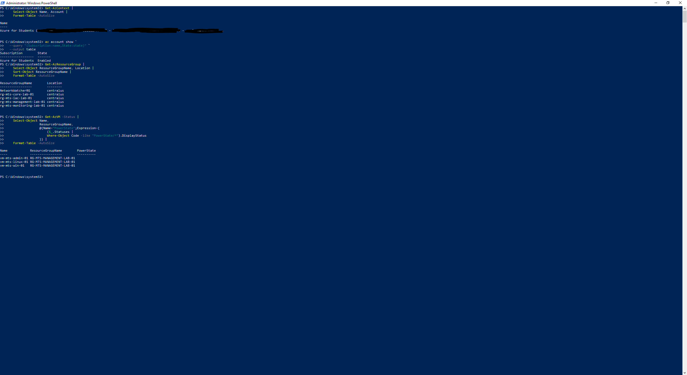
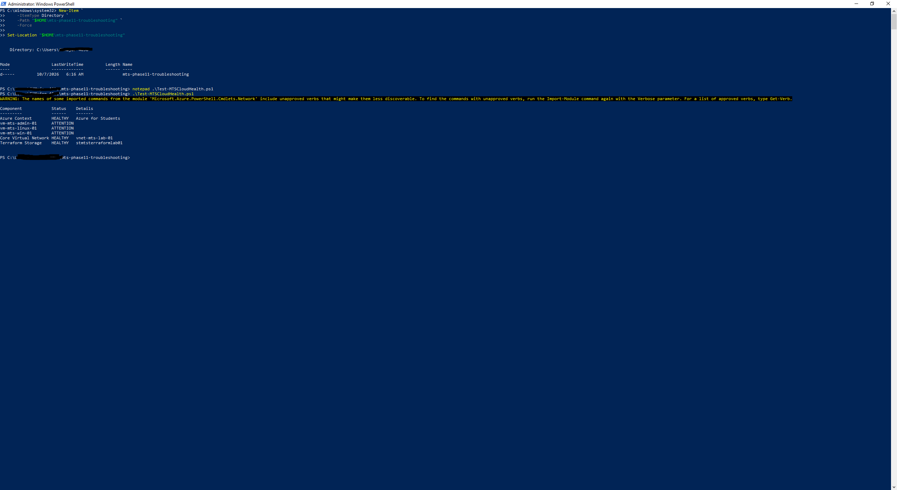
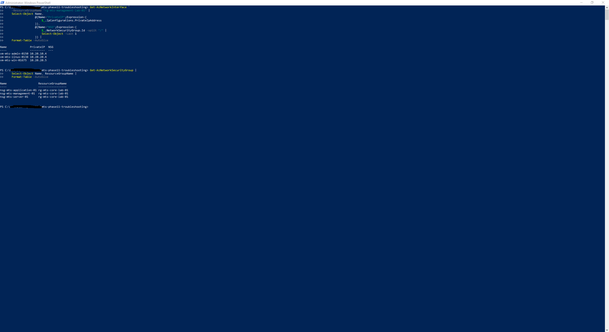
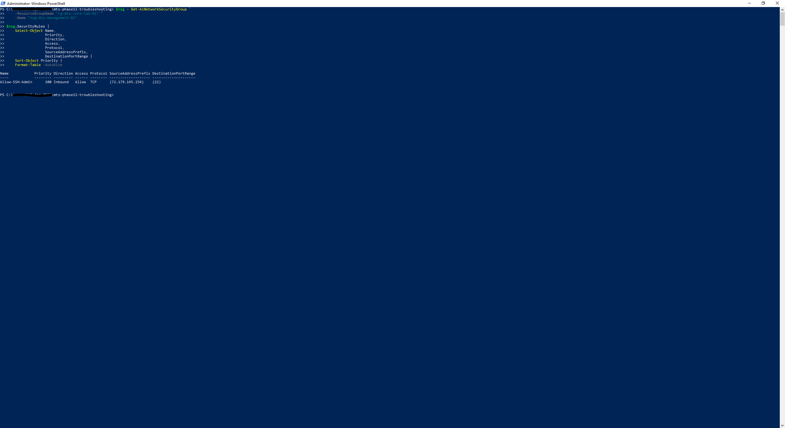

# Phase 11 — Cloud Troubleshooting

## Overview

Phase 11 focused on structured troubleshooting of the existing MTS Azure Cloud Infrastructure Lab.

Rather than deploying new services, this phase used Azure PowerShell and Azure CLI to investigate operational conditions across Azure compute, networking, Network Security Groups, and Storage Accounts.

Three troubleshooting scenarios were documented:

1. Azure Storage security configuration drift
2. Azure VM and network connectivity investigation
3. Network Security Group SSH access-control failure

The work included baseline inspection, resource dependency tracing, controlled configuration changes, targeted remediation, and post-remediation validation.

Two PowerShell diagnostic scripts were developed to make selected infrastructure checks repeatable.

The phase concluded with nine successful environment health checks and syntax validation of both diagnostic scripts.

---

## Environment

| Component | Configuration |
|---|---|
| Cloud Platform | Microsoft Azure |
| Subscription | Azure for Students |
| Primary Region | Central US |
| Administration | Azure PowerShell, Azure CLI |
| Linux VM | `vm-mts-linux-01` |
| VM Resource Group | `rg-mts-management-lab-01` |
| Virtual Network | `vnet-mts-lab-01` |
| Server Subnet | `snet-mts-server-01` |
| Subnet Address Range | `10.20.20.0/24` |
| Server NSG | `nsg-mts-server-01` |
| Terraform Storage Account | `stmtsterraformlab01` |
| Terraform Blob Container | `terraform-lab` |
| Incident Reports | 3 |
| Diagnostic Scripts | 2 |

All troubleshooting activities used existing lab infrastructure.

---

## Troubleshooting Methodology

The phase followed a consistent troubleshooting process:

**Baseline → Detect → Isolate → Diagnose → Remediate → Validate → Document**

| Step | Approach |
|---|---|
| Baseline | Establish expected resource configuration |
| Detect | Identify the operational or security condition |
| Isolate | Trace affected resources and dependencies |
| Diagnose | Inspect configuration using Azure administrative tools |
| Remediate | Apply a targeted correction |
| Validate | Query the environment after the change |
| Document | Record findings, actions, and results |

This approach emphasized identifying the responsible configuration layer before making changes.

---

## Repository Artifacts

Phase 11 contains three incident reports and two PowerShell diagnostic scripts.

```text
Documents/
└── 11-Cloud-Troubleshooting/
    ├── README.md
    ├── Incident-Reports/
    │   ├── Incident-01-Storage-Security-Configuration.md
    │   ├── Incident-02-VM-Network-Connectivity.md
    │   └── Incident-03-SSH-Access-Control.md
    └── PowerShell/
        ├── Test-MTSCloudHealth.ps1
        └── Test-MTSStorageHealth.ps1
```

### Incident Reports

| Incident | Focus |
|---|---|
| [Incident 01 — Storage Security Configuration](Incident-Reports/Incident-01-Storage-Security-Configuration.md) | TLS configuration drift and remediation |
| [Incident 02 — VM Network Connectivity](Incident-Reports/Incident-02-VM-Network-Connectivity.md) | VM recovery and network dependency tracing |
| [Incident 03 — SSH Access Control](Incident-Reports/Incident-03-SSH-Access-Control.md) | Controlled NSG deny rule and cleanup |

### PowerShell Scripts

| Script | Purpose |
|---|---|
| [Test-MTSCloudHealth.ps1](PowerShell/Test-MTSCloudHealth.ps1) | Checks selected Azure compute, networking, and storage resources |
| [Test-MTSStorageHealth.ps1](PowerShell/Test-MTSStorageHealth.ps1) | Validates Storage Account provisioning, TLS, and HTTPS settings |

---

## Cloud Operations Baseline

The phase began with an administrative inspection of the existing Azure environment.

Baseline activities included reviewing:

- Azure PowerShell authentication context
- Virtual machine operational state
- Network interface configuration
- Virtual network and subnet relationships
- Network Security Group associations
- Terraform-managed storage resources



The baseline established the resource relationships needed for subsequent troubleshooting.

---

## PowerShell Cloud Health Baseline

Azure PowerShell was used to inspect selected infrastructure components and identify conditions requiring further investigation.

The baseline assessment covered administrative context, compute, networking, and Terraform-managed storage.



The investigation provided the foundation for the reusable `Test-MTSCloudHealth.ps1` diagnostic script.

---

## Incident 01 — Storage Security Configuration Drift

### Incident Summary

A controlled configuration issue was introduced into the Terraform-managed Storage Account `stmtsterraformlab01`.

The Storage Account's minimum TLS configuration was intentionally changed from the expected `TLS1_2` baseline.

The objective was to identify the configuration difference, restore the expected setting, and independently validate the result.

### Affected Infrastructure

| Property | Value |
|---|---|
| Storage Account | `stmtsterraformlab01` |
| Resource Group | `rg-mts-iac-lab-01` |
| Region | Central US |
| Management Source | Terraform |
| Blob Container | `terraform-lab` |

### Expected Security Baseline

| Setting | Expected |
|---|---|
| Provisioning State | `Succeeded` |
| Minimum TLS | `TLS1_2` |
| HTTPS Only | `True` |
| Blob Container | `terraform-lab` |
| Container Public Access | Disabled |

### Investigation

Azure PowerShell was used to inspect the Storage Account.

```powershell
Get-AzStorageAccount `
    -ResourceGroupName "rg-mts-iac-lab-01" `
    -Name "stmtsterraformlab01" |
    Select-Object StorageAccountName,
                  ResourceGroupName,
                  EnableHttpsTrafficOnly,
                  MinimumTlsVersion,
                  AllowBlobPublicAccess |
    Format-List
```

Azure CLI provided an independent configuration query.

```powershell
az storage account show `
  --name stmtsterraformlab01 `
  --resource-group rg-mts-iac-lab-01 `
  --query "{Name:name,MinimumTLS:minimumTlsVersion,HTTPSOnly:enableHttpsTrafficOnly,ProvisioningState:provisioningState}" `
  --output table
```

The investigation identified the minimum TLS setting as the configuration requiring remediation.

### Remediation

The expected TLS configuration was restored using Azure PowerShell.

```powershell
Set-AzStorageAccount `
    -ResourceGroupName "rg-mts-iac-lab-01" `
    -Name "stmtsterraformlab01" `
    -MinimumTlsVersion TLS1_2
```

### Post-Remediation Validation

The dedicated storage diagnostic script was executed.

```powershell
.\Test-MTSStorageHealth.ps1
```

The diagnostic checked three requirements:

```text
Check                Expected    Actual       Result
-----                --------    ------       ------
Provisioning State   Succeeded   Succeeded    PASS
Minimum TLS          TLS1_2      TLS1_2       PASS
HTTPS Only           True        True         PASS

Storage configuration validation PASSED.
```

Azure CLI independently confirmed the restored configuration.

The `terraform-lab` blob container also remained available.

### Resolution

**Status: Resolved**

The Storage Account returned to its expected TLS and HTTPS configuration.

The diagnostic results verified the selected storage security settings after remediation.

The exercise did not establish that all Storage Account security settings were hardened; public network access and other controls are separate configuration considerations.

**Detailed report:** [Incident 01 — Storage Security Configuration](Incident-Reports/Incident-01-Storage-Security-Configuration.md)

---

## Incident 02 — VM Network Connectivity

### Incident Summary

The second investigation focused on `vm-mts-linux-01` and its Azure network dependencies.

The VM was initially found in a deallocated state.

Before investigating network connectivity, the VM was started and its operational state was verified.

### VM State Investigation

```powershell
Get-AzVM `
    -ResourceGroupName "rg-mts-management-lab-01" `
    -Name "vm-mts-linux-01" `
    -Status
```

The VM was returned to a running state using:

```powershell
Start-AzVM `
    -ResourceGroupName "rg-mts-management-lab-01" `
    -Name "vm-mts-linux-01"
```

Subsequent validation confirmed:

```text
VM:           vm-mts-linux-01
Power State:  VM running
```



### Network Interface Investigation

The VM's attached network interface was identified programmatically.

```powershell
$vm = Get-AzVM `
    -ResourceGroupName "rg-mts-management-lab-01" `
    -Name "vm-mts-linux-01"

$nicId = $vm.NetworkProfile.NetworkInterfaces[0].Id
$nicName = $nicId.Split("/")[-1]

$nic = Get-AzNetworkInterface `
    -ResourceGroupName "rg-mts-management-lab-01" `
    -Name $nicName
```

The investigation confirmed:

```text
Private IP:          10.20.20.4
NIC Provisioning:    Succeeded
```

The network interface did not have a directly associated Network Security Group.

### Subnet and NSG Investigation

The investigation continued to the subnet.

```powershell
$subnetId = $nic.IpConfigurations[0].Subnet.Id
$subnetName = $subnetId.Split("/")[-1]

$vnet = Get-AzVirtualNetwork `
    -ResourceGroupName "rg-mts-core-lab-01" `
    -Name "vnet-mts-lab-01"
```

The resulting network relationship was:

```text
vm-mts-linux-01
       |
       v
Azure Network Interface
       |
       v
Private IP: 10.20.20.4
       |
       v
snet-mts-server-01
10.20.20.0/24
       |
       v
nsg-mts-server-01
```

The investigation established that the applicable NSG was associated with the server subnet rather than directly with the NIC.

### Validation Results

| Component | Validated State |
|---|---|
| VM | Running |
| VM Provisioning | Succeeded |
| NIC Provisioning | Succeeded |
| Private IP | `10.20.20.4` |
| Virtual Network | `vnet-mts-lab-01` |
| Subnet | `snet-mts-server-01` |
| Subnet Prefix | `10.20.20.0/24` |
| Subnet NSG | `nsg-mts-server-01` |

### Resolution

**Status: Resolved — operational state and network dependencies validated**

The VM was returned to a running state.

The network investigation identified the workload's NIC, private IP, subnet, virtual network, and applicable NSG.

No VM, NIC, or subnet provisioning failure was identified.

The investigation did not include evidence of a successful end-to-end SSH session or application-level connectivity test.

**Detailed report:** [Incident 02 — VM Network Connectivity](Incident-Reports/Incident-02-VM-Network-Connectivity.md)

---

## Incident 03 — SSH Access Control

### Incident Summary

A controlled inbound SSH blocking condition was introduced through the server subnet's Network Security Group.

The exercise demonstrated how a custom NSG rule could affect TCP port 22 traffic and how to identify and remove the responsible configuration.

### NSG Baseline

The applicable Network Security Group was:

```text
nsg-mts-server-01
```

Its default security rules were inspected before introducing the temporary configuration.

```powershell
$nsg = Get-AzNetworkSecurityGroup `
    -ResourceGroupName "rg-mts-core-lab-01" `
    -Name "nsg-mts-server-01"

$nsg.DefaultSecurityRules |
    Select-Object Name,
                  Priority,
                  Direction,
                  Access,
                  Protocol |
    Sort-Object Priority |
    Format-Table -AutoSize
```

The baseline included Azure's default inbound and outbound rules.

No custom security rules were initially present.



### Controlled Configuration Change

A temporary rule was created:

```text
TEMP-Deny-SSH-Inbound
```

| Property | Configuration |
|---|---|
| NSG | `nsg-mts-server-01` |
| Rule | `TEMP-Deny-SSH-Inbound` |
| Priority | `100` |
| Direction | Inbound |
| Access | Deny |
| Protocol | TCP |
| Destination Port | 22 |
| Source | Any |

The rule was added using Azure PowerShell.

```powershell
$nsg = Get-AzNetworkSecurityGroup `
    -ResourceGroupName "rg-mts-core-lab-01" `
    -Name "nsg-mts-server-01"

$nsg | Add-AzNetworkSecurityRuleConfig `
    -Name "TEMP-Deny-SSH-Inbound" `
    -Description "Phase 11 controlled troubleshooting scenario" `
    -Access Deny `
    -Protocol Tcp `
    -Direction Inbound `
    -Priority 100 `
    -SourceAddressPrefix "*" `
    -SourcePortRange "*" `
    -DestinationAddressPrefix "*" `
    -DestinationPortRange 22

$nsg | Set-AzNetworkSecurityGroup
```

The resulting configuration explicitly denied inbound TCP/22 traffic matching the rule.

### Investigation

The NSG was queried for custom security rules affecting SSH.

```powershell
(Get-AzNetworkSecurityGroup `
    -ResourceGroupName "rg-mts-core-lab-01" `
    -Name "nsg-mts-server-01").SecurityRules |
    Where-Object {
        $_.DestinationPortRange -eq "22" -or
        $_.DestinationPortRanges -contains "22"
    } |
    Select-Object Name,
                  Priority,
                  Direction,
                  Access,
                  Protocol,
                  DestinationPortRange |
    Sort-Object Priority |
    Format-Table -AutoSize
```

The investigation identified:

```text
Name                   Priority  Direction  Access  Protocol  Port
----                   --------  ---------  ------  --------  ----
TEMP-Deny-SSH-Inbound  100       Inbound    Deny    Tcp       22
```

This confirmed the temporary NSG rule as the configured SSH blocking condition.

### Remediation

The temporary rule was removed.

```powershell
$nsg = Get-AzNetworkSecurityGroup `
    -ResourceGroupName "rg-mts-core-lab-01" `
    -Name "nsg-mts-server-01"

Remove-AzNetworkSecurityRuleConfig `
    -Name "TEMP-Deny-SSH-Inbound" `
    -NetworkSecurityGroup $nsg

$nsg | Set-AzNetworkSecurityGroup
```

### Post-Remediation Validation

The NSG was queried again to verify that the custom SSH deny rule was absent.

The final result was:

```text
NSG                  : nsg-mts-server-01
ProvisioningState    : Succeeded
CustomSSHDenyRules   : 0
SSHBlockingCondition : CLEARED
```

The affected VM and network interface were also revalidated.

```text
VM               : vm-mts-linux-01
PowerState       : VM running
PrivateIP        : 10.20.20.4
NICState         : Succeeded
AssociatedSubnet : snet-mts-server-01
```

### Resolution

**Status: Resolved — temporary SSH deny rule removed**

The controlled NSG configuration was removed and its absence was verified.

The underlying VM and network resources remained operational.

The validation establishes that the temporary blocking rule was cleared; it does not independently demonstrate a successful SSH connection.

**Detailed report:** [Incident 03 — SSH Access Control](Incident-Reports/Incident-03-SSH-Access-Control.md)

---

## Automated Storage Diagnostics

The storage investigation produced a reusable PowerShell script:

[Test-MTSStorageHealth.ps1](PowerShell/Test-MTSStorageHealth.ps1)

The script checks:

- Storage Account provisioning state
- Minimum TLS version
- HTTPS-only configuration

The expected values are:

```text
Provisioning State: Succeeded
Minimum TLS:        TLS1_2
HTTPS Only:         True
```

### Execution

```powershell
.\Test-MTSStorageHealth.ps1
```

### Result

```text
Provisioning State   PASS
Minimum TLS          PASS
HTTPS Only           PASS

Storage configuration validation PASSED.
```

This provides a repeatable method for checking the selected Storage Account configuration requirements.

---

## Automated Cloud Health Diagnostics

A second PowerShell script was developed:

[Test-MTSCloudHealth.ps1](PowerShell/Test-MTSCloudHealth.ps1)

The script checks selected Azure resources and operational conditions.

Its validation scope includes:

- Azure PowerShell context
- Linux VM state
- Network interface state
- Core virtual network
- Server subnet
- Server NSG
- Temporary SSH deny-rule cleanup
- Terraform-managed Storage Account
- Terraform-managed blob container

### Execution

```powershell
.\Test-MTSCloudHealth.ps1
```

### Final Results

```text
Component              Status     Details
---------              ------     -------
Azure Context          HEALTHY    Azure for Students
Linux VM               HEALTHY    VM running
Network Interface      HEALTHY    10.20.20.4
Core Virtual Network   HEALTHY    vnet-mts-lab-01
Server Subnet          HEALTHY    snet-mts-server-01
Server NSG             HEALTHY    nsg-mts-server-01
SSH Incident Cleanup   HEALTHY    Temporary deny rule removed
Terraform Storage      HEALTHY    stmtsterraformlab01 - TLS1_2
Terraform Container    HEALTHY    terraform-lab

Healthy   : 9
Attention : 0
Failed    : 0

PHASE 11 VALIDATION PASSED
```

The diagnostic confirmed that the selected infrastructure checks passed after the troubleshooting exercises.

These are targeted administrative checks rather than comprehensive workload-health or connectivity tests.

---

## PowerShell Script Validation

Both diagnostic scripts were checked using the PowerShell parser.

| Script | Syntax | Errors |
|---|---|---|
| `Test-MTSCloudHealth.ps1` | PASS | 0 |
| `Test-MTSStorageHealth.ps1` | PASS | 0 |

Final results:

```text
Scripts Passed : 2
Scripts Failed : 0
```

Syntax validation confirmed that the scripts could be parsed successfully.

Their operational behavior was separately demonstrated through the recorded diagnostic executions.

---

## Troubleshooting Findings

### Validate Compute State First

The Linux VM was initially deallocated.

Starting the VM before investigating network security prevented an inactive workload from being mistaken for a network configuration failure.

### Trace Network Dependencies

The investigation followed the resource path:

```text
VM
 |
 v
NIC
 |
 v
Private IP
 |
 v
Subnet
 |
 v
Virtual Network
 |
 v
Network Security Group
 |
 v
Security Rules
```

This identified the subnet-level NSG as the relevant security-control point.

### Inspect Rule Priority and Direction

The controlled SSH incident demonstrated the effect of an explicit inbound deny rule at priority `100`.

Inspecting custom NSG rules identified the configured blocking condition.

### Validate Configuration After Remediation

Successful modification commands were followed by new Azure resource queries.

The storage TLS setting and temporary SSH deny-rule removal were verified rather than assumed.

### Keep Diagnostic Checks Repeatable

The two PowerShell scripts converted selected manual inspection steps into reusable validation workflows.

### Preserve Incident Documentation

Each scenario was recorded separately with its affected resources, investigation, remediation, and validation results.

---

## Security and Operational Considerations

### Controlled Fault Injection

The storage TLS change and temporary NSG rule were intentionally introduced for troubleshooting practice.

The exercises were performed against existing lab resources and were followed by configuration restoration.

### Storage Security

The Storage Account's minimum TLS setting was restored to `TLS1_2`.

HTTPS-only traffic remained enabled.

These checks did not cover every Storage Account security control.

### Network Security

The temporary SSH deny rule was removed after testing.

The final NSG inspection reported zero custom SSH deny rules matching the tested condition.

### Resource Availability

The Linux VM was running during the final Phase 11 validation.

VM runtime and deallocation requirements remain relevant to Azure for Students cost management outside the active troubleshooting exercise.

---

## Phase 11 Verification

| Validation Area | Final Result |
|---|---|
| Azure Administrative Context | HEALTHY |
| Linux VM | HEALTHY |
| Network Interface | HEALTHY |
| Core Virtual Network | HEALTHY |
| Server Subnet | HEALTHY |
| Server NSG | HEALTHY |
| SSH Incident Cleanup | HEALTHY |
| Terraform Storage | HEALTHY |
| Terraform Container | HEALTHY |
| Storage TLS | `TLS1_2` |
| Storage HTTPS Only | `True` |
| Temporary SSH Deny Rules | 0 |
| PowerShell Script Syntax | 2 PASS / 0 FAIL |

### Final Cloud Health

```text
Healthy   : 9
Attention : 0
Failed    : 0
```

### Final Automation Validation

```text
Scripts Passed : 2
Scripts Failed : 0
```

**Phase 11 Status: Complete**

---

## Next Phase

**Phase 12 — Azure Environment Validation**

The final phase performs a broader review of the deployed Azure environment, including infrastructure inventory, governance, identity, security, monitoring, operational state, and Terraform configuration.

Phase 12 consolidates the results of the preceding phases into a final environment validation and project closeout.
