# Phase 12 — Azure Environment Validation

## Overview

Phase 12 performed a final infrastructure validation of the MTS Azure Cloud Infrastructure Lab.

The assessment reviewed resources deployed throughout Phases 01–11, focusing on configuration consistency, governance, network architecture, compute state, identity and access management, storage security, monitoring, and Terraform infrastructure integrity.

The objective was to establish a documented Azure infrastructure baseline before beginning a separate hybrid networking and identity integration effort.

The validation was primarily read-only. No Azure infrastructure resources were intentionally deployed, modified, or deleted. The `Az.KeyVault` PowerShell module was installed locally to complete the identity audit.

**Phase Status:** Complete — Technical Validation Passed

**Validation Date:** October 2026

---

## Environment

| Component | Configuration |
|---|---|
| Platform | Microsoft Azure |
| Subscription | Azure for Students |
| Primary Region | Central US |
| Administration Workstation | Windows 11 |
| PowerShell | 7.6.6 |
| Azure CLI | 2.91.0 |
| Azure PowerShell | Az modules |
| Terraform CLI | 1.16.5 |
| AzureRM Provider | 4.81.0 |
| Git | 2.55.0 |
| Core Virtual Network | `vnet-mts-lab-01` |
| Azure Address Space | `10.20.0.0/16` |

### Validation Scope

The assessment covered:

- Azure subscription and resource inventory
- Resource governance and tagging
- Virtual networks, subnets, NSGs, and network interfaces
- Management SSH and public IP configuration
- Virtual machines, managed disks, and shutdown schedules
- Azure RBAC and managed identities
- Key Vault configuration
- Storage security and network accessibility
- Azure Monitor, Log Analytics, and diagnostic settings
- Terraform local state and infrastructure drift
- Cross-service environment health

Hybrid connectivity was outside the scope of this phase.

The on-premises `majorlab.test` environment remained separate from Azure.

---

## Azure Resource Inventory

Azure PowerShell was used to verify the active subscription context, enumerate resource groups, inventory deployed resources, and inspect provisioning states.

### Inventory Results

| Resource Category | Count |
|---|---:|
| Resource Groups | 5 |
| Azure Resources | 27 |
| Unique Resource Types | 14 |
| Virtual Machines | 3 |
| Managed Disks | 3 |
| Network Interfaces | 3 |
| Virtual Networks | 1 |
| Network Security Groups | 3 |
| Storage Accounts | 2 |
| Log Analytics Workspaces | 1 |
| Metric Alerts | 1 |
| Action Groups | 2 |
| Key Vaults | 1 |
| User-Assigned Managed Identities | 1 |
| Automatic Shutdown Schedules | 3 |

All five resource groups reported successful provisioning.

The inventory established the resource baseline used for the remaining audits.

### Evidence

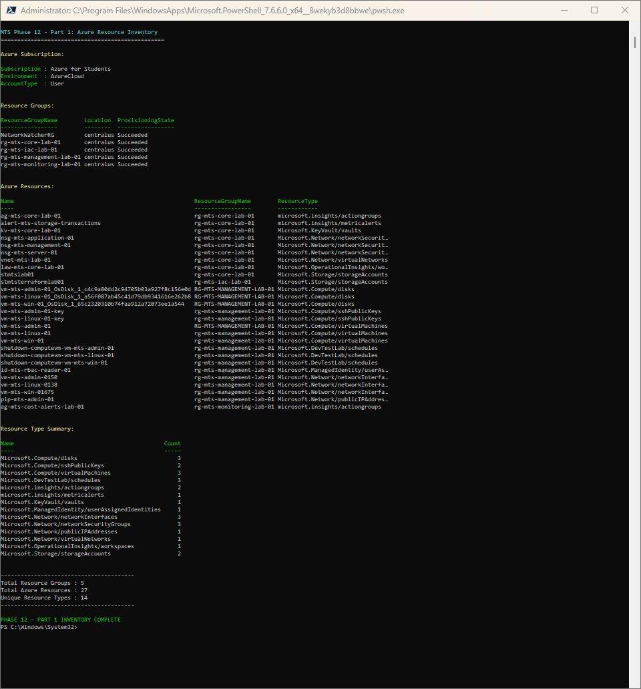

**Result:** PASS — Subscription access and resource inventory verified.

---

## Resource Governance and Tagging

The governance audit reviewed resource organization, naming conventions, and tag coverage.

The assessment included the `Environment`, `Project`, and `ManagedBy` tags.

### Tag Coverage

| Metric | Result |
|---|---:|
| Total Resources | 27 |
| Tagged Resources | 22 |
| Untagged Resources | 5 |
| Tag Coverage | 81.5% |

Five resources were identified without expected governance tags.

| Resource | Resource Type |
|---|---|
| `vm-mts-admin-01_key` | SSH Public Key |
| `vm-mts-linux-01_key` | SSH Public Key |
| `shutdown-computevm-vm-mts-win-01` | Automatic Shutdown Schedule |
| `ag-mts-core-lab-01` | Monitoring Action Group |
| `alert-mts-storage-transactions` | Metric Alert |

The Azure-associated `NetworkWatcherRG` resource group was also identified as untagged and may warrant a platform-resource exception.

The 81.5% coverage figure represents resources containing at least one tag. It does not establish that every tagged resource contains all required governance tags.

No automatic tagging remediation was performed.

### Evidence

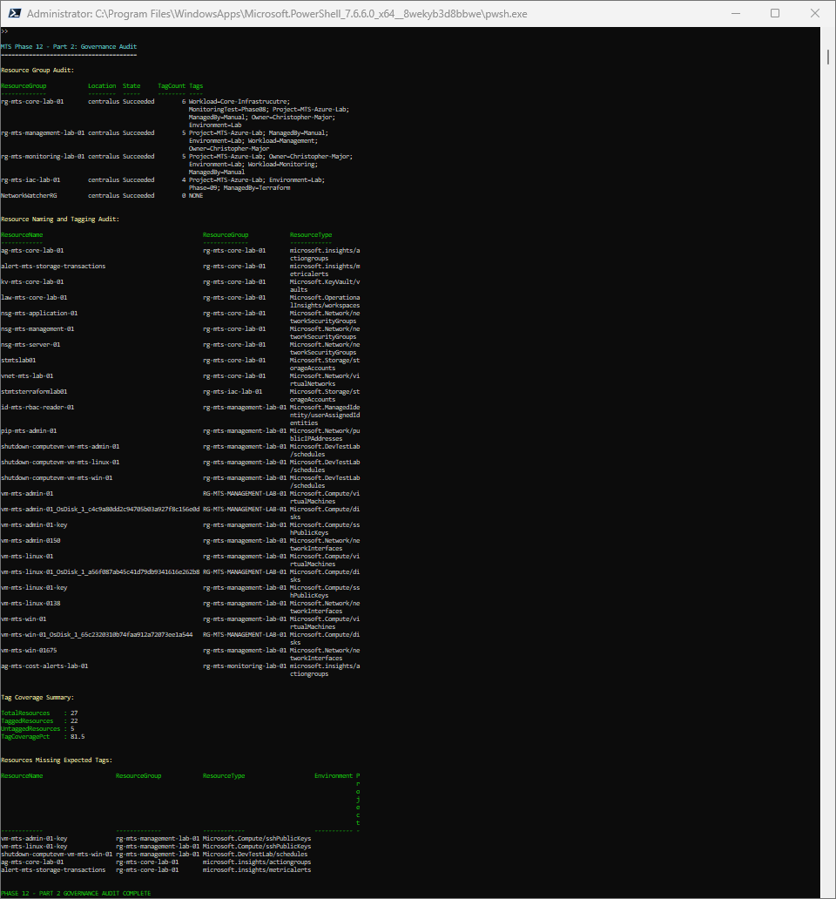

**Result:** AUDIT COMPLETE — Tagging exceptions documented.

---

## Network Infrastructure Validation

The network audit verified the core virtual network, subnet segmentation, NSG associations, network interfaces, and public IP configuration.

### Virtual Network

| Property | Value |
|---|---|
| Virtual Network | `vnet-mts-lab-01` |
| Address Space | `10.20.0.0/16` |
| Region | Central US |
| Provisioning State | Succeeded |

### Subnet Configuration

| Subnet | Address Range | Associated NSG |
|---|---|---|
| `snet-mts-management-01` | `10.20.10.0/24` | `nsg-mts-management-01` |
| `snet-mts-server-01` | `10.20.20.0/24` | `nsg-mts-server-01` |
| `snet-mts-application-01` | `10.20.30.0/24` | `nsg-mts-application-01` |

All three subnets matched the planned Azure network segmentation.

### NSG Inventory

| Network Security Group | Custom Rules | Provisioning |
|---|---:|---|
| `nsg-mts-management-01` | 1 | Succeeded |
| `nsg-mts-server-01` | 0 | Succeeded |
| `nsg-mts-application-01` | 0 | Succeeded |

The management NSG retained the `Allow-SSH-Admin` rule.

The server NSG no longer contained the temporary SSH deny rule introduced during Phase 11.

### Network Interfaces

| Network Interface | Private IP | Subnet |
|---|---|---|
| `vm-mts-admin-0150` | `10.20.10.4` | Management |
| `vm-mts-linux-0138` | `10.20.20.4` | Server |
| `vm-mts-win-01675` | `10.20.20.5` | Server |

All three NICs reported successful provisioning.

NSGs were associated with the subnets rather than directly with the NICs.

The audit did not identify NAT Gateways, VPN Gateways, Azure Bastion, Azure Firewall, or Load Balancers.

### Evidence

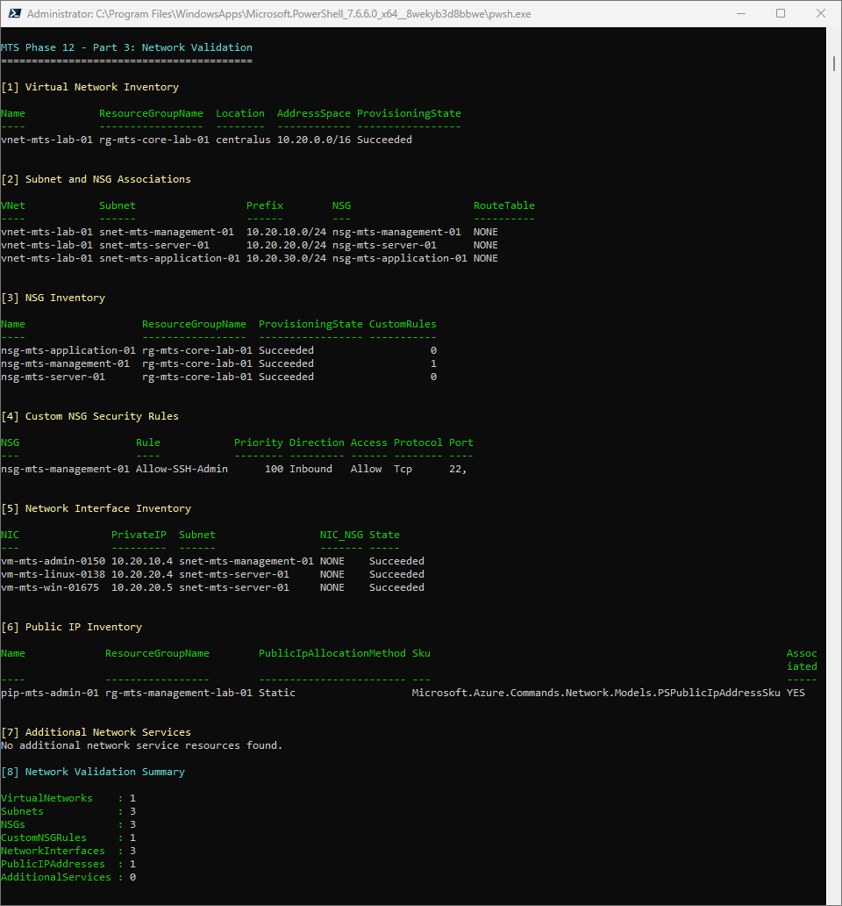

**Result:** PASS — Network architecture and configuration verified.

---

## Management SSH and Public IP Security

The management subnet's SSH configuration was reviewed separately from the general network inventory.

### Management SSH Rule

| Property | Configuration |
|---|---|
| NSG | `nsg-mts-management-01` |
| Rule | `Allow-SSH-Admin` |
| Priority | 100 |
| Direction | Inbound |
| Access | Allow |
| Protocol | TCP |
| Destination Port | 22 |
| Source | Single IPv4 address |
| Destination | Any |

The rule restricted SSH access to one configured source IPv4 address rather than allowing all internet sources.

This verified the configured restriction, not current source-address suitability or live SSH connectivity.

### Management Public IP

| Property | Configuration |
|---|---|
| Resource | `pip-mts-admin-01` |
| Allocation | Static |
| SKU | Standard |
| IP Version | IPv4 |
| Associated | True |
| Provisioning | Succeeded |

The public IP remained allocated for future administration.

Because an allocated Standard public IPv4 address can incur charges, it was identified as an ongoing cost consideration.

### Phase 11 Cleanup Verification

| Check | Result |
|---|---|
| Server NSG | `nsg-mts-server-01` |
| Temporary SSH Deny Rules | 0 |
| Cleanup Status | PASS |

The Phase 11 temporary SSH blocking rule remained absent.

### Evidence

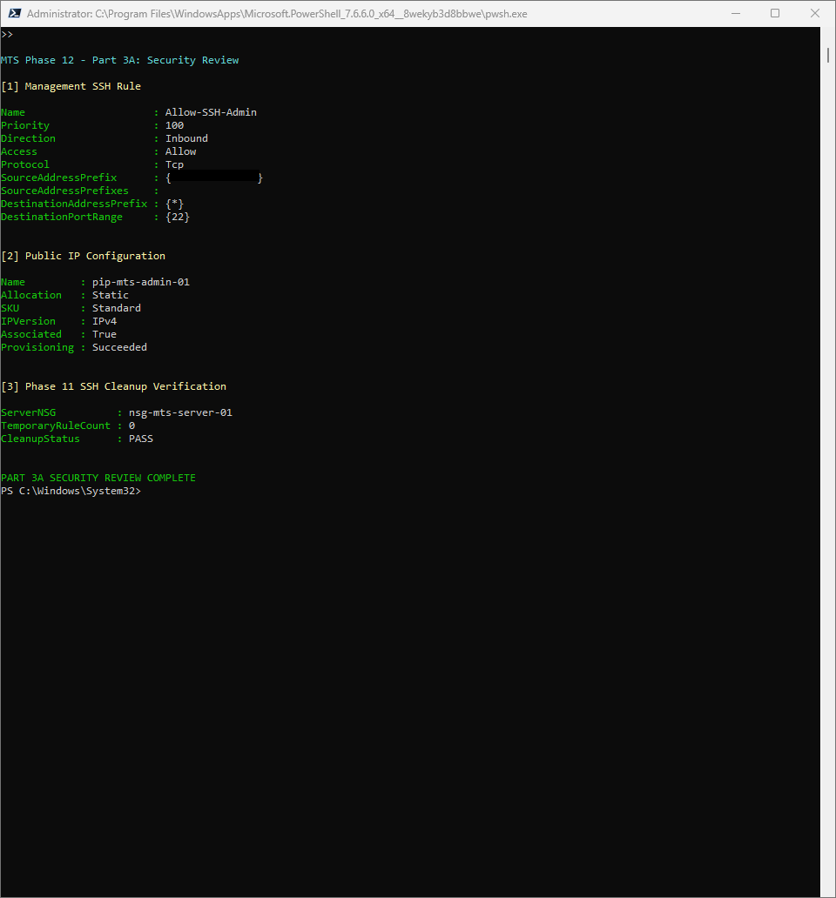

**Result:** PASS — Management SSH restriction and incident cleanup verified.

---

## Compute Infrastructure Validation

The compute audit reviewed virtual machine configuration, provisioning state, managed disks, power state, and automatic shutdown schedules.

### Virtual Machines

| Virtual Machine | Operating System | Size | Power State |
|---|---|---|---|
| `vm-mts-admin-01` | Linux | Standard_D2s_v4 | Deallocated |
| `vm-mts-linux-01` | Linux | Standard_D2s_v4 | Deallocated |
| `vm-mts-win-01` | Windows | Standard_D2ds_v4 | Deallocated |

All three VMs reported successful provisioning.

### Managed Disks

| Virtual Machine | OS Disk Size | Storage Tier | Disk State |
|---|---:|---|---|
| Admin VM | 30 GB | Standard SSD LRS | Reserved |
| Linux VM | 30 GB | Standard SSD LRS | Reserved |
| Windows VM | 127 GB | Standard SSD LRS | Reserved |

The managed disks remained allocated to preserve the virtual machines.

### Automatic Shutdown

| Setting | Result |
|---|---|
| Shutdown Schedules | 3 |
| Enabled Schedules | 3 |
| Configured Time | 15:00 |
| Configured Time Zone | Central Standard Time |
| Task Type | ComputeVmShutdownTask |

### Power-State Summary

```text
Total VMs       : 3
Running         : 0
Deallocated     : 3
Other States    : 0
```

All three VMs were deallocated during the final validation.

This prevented ongoing VM compute charges while retaining their configurations and disks.

Managed disks and other allocated Azure services may still incur charges.

### Evidence

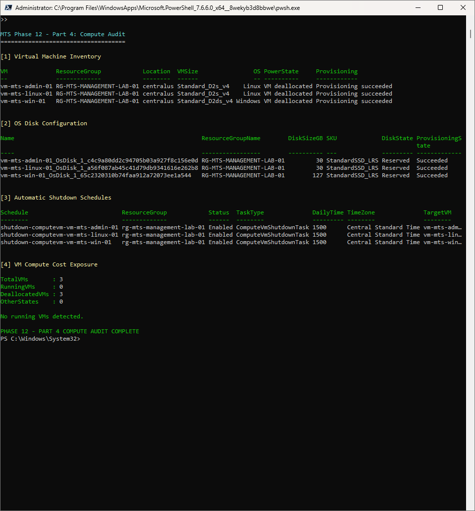

**Result:** PASS — VM configuration validated and active compute usage minimized.

---

## Microsoft Entra ID and Azure RBAC

The identity audit reviewed Azure authentication context, role assignments, managed identities, and Key Vault inventory.

### Subscription RBAC

| Role | Assignment Count |
|---|---:|
| Owner | 2 |

Both Owner assignments displayed the same account name.

A subsequent comparison confirmed:

```text
Owner Assignments       : 2
Unique Owner Principals : 1
```

The two assignments referenced one unique principal ID.

They did not represent two distinct Owner principals.

### Resource Group RBAC

A direct Reader assignment was identified for a service principal in:

`rg-mts-management-lab-01`

### User-Assigned Managed Identity

| Property | Value |
|---|---|
| Identity | `id-mts-rbac-reader-01` |
| Resource Group | `rg-mts-management-lab-01` |
| Region | Central US |
| Assigned Role | Reader |
| Assignment Scope | Resource group or resource |

The role assignment was consistent with the intended read-only access design from Phase 05.

### Initial Key Vault Tooling Issue

The initial Key Vault audit could not execute because the `Az.KeyVault` module was unavailable in the PowerShell session.

The module was installed and imported before the follow-up audit.

This was a local administration tooling issue, not evidence of a Key Vault infrastructure failure.

### Evidence

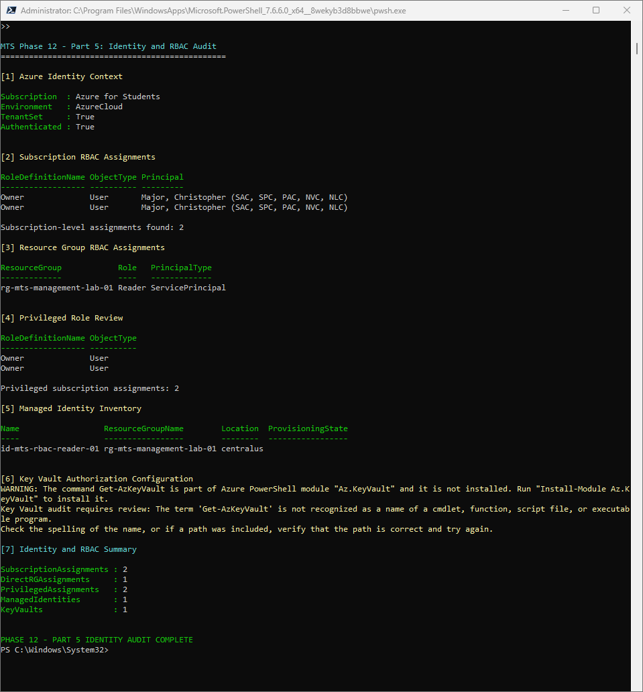

**Result:** PARTIAL PASS — RBAC and managed identity verified; Key Vault reviewed separately.

---

## Key Vault Authorization Review

After the missing PowerShell module was installed, the Key Vault inventory query completed successfully.

### Key Vault Inventory

| Property | Value |
|---|---|
| Key Vault | `kv-mts-core-lab-01` |
| Resource Group | `rg-mts-core-lab-01` |
| Region | Central US |
| Key Vaults Returned | 1 |
| Access Policies Reported | 1 |

The audit confirmed that the expected Key Vault was present.

One access policy was reported.

The displayed output did not conclusively establish the Key Vault's current RBAC authorization mode.

This remains a configuration detail for future verification.

### Evidence

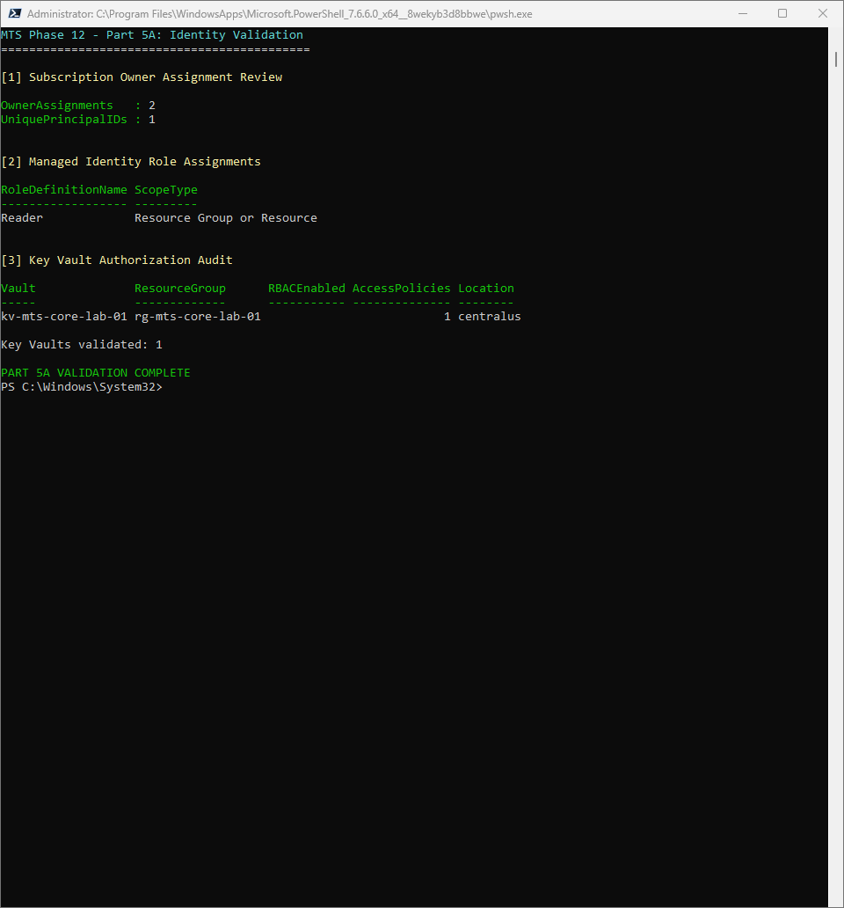

**Result:** PASS — Key Vault inventory validated; authorization-mode verification remains open.

---

## Azure Storage Security Audit

The storage audit reviewed provisioning, TLS configuration, HTTPS enforcement, anonymous blob access capability, and network accessibility.

### Storage Configuration

| Setting | `stmtslab01` | `stmtsterraformlab01` |
|---|---|---|
| Resource Group | `rg-mts-core-lab-01` | `rg-mts-iac-lab-01` |
| Region | Central US | Central US |
| SKU | Standard_LRS | Standard_LRS |
| Minimum TLS | TLS1_2 | TLS1_2 |
| HTTPS Only | True | True |
| Allow Public Blob Access | False | True |
| Provisioning | Succeeded | Succeeded |

Both storage accounts met the tested TLS 1.2 and HTTPS-only baseline.

### Network Access

| Setting | Core Storage | Terraform Storage |
|---|---|---|
| Public Network Access | Enabled | Enabled |
| Default Network Action | Allow | Allow |
| Network Bypass | AzureServices | AzureServices |

### Finding 1 — Anonymous Blob Access Capability

The Terraform-managed Storage Account allowed containers to be configured for anonymous blob access.

This did not establish that the `terraform-lab` container was publicly accessible.

The container had previously been verified as private during Phase 11.

Disabling account-level anonymous blob access remains a potential hardening improvement.

### Finding 2 — Public Network Access

Both Storage Accounts allowed public network endpoint access with a default network action of `Allow`.

Authentication and authorization requirements remained applicable.

However, these network settings are more permissive than a restricted-network or private-endpoint design.

No storage configuration changes were made during Phase 12.

### Evidence

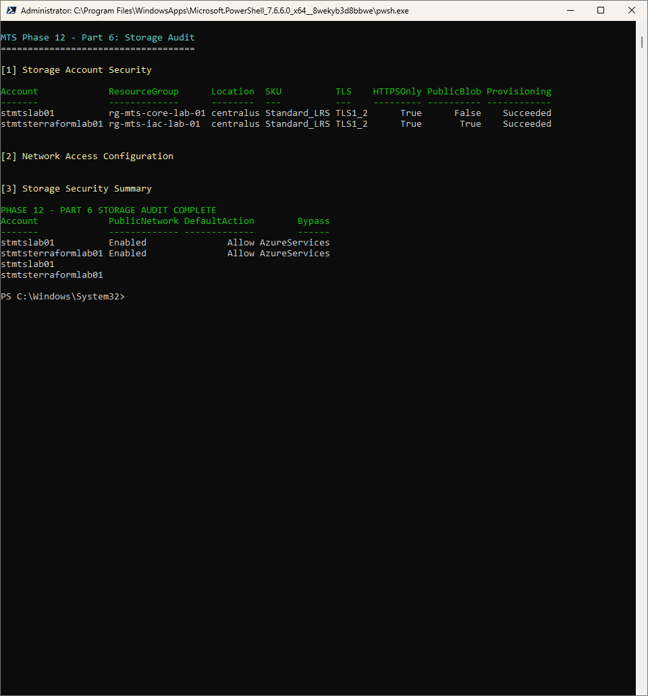

**Result:** AUDIT COMPLETE — TLS/HTTPS baseline passed; network-access findings documented.

---

## Monitoring and Logging Validation

The monitoring audit reviewed resources deployed during Phase 08.

### Log Analytics

| Property | Value |
|---|---|
| Workspace | `law-mts-core-lab-01` |
| Resource Group | `rg-mts-core-lab-01` |
| Region | Central US |
| Provisioning | Succeeded |
| Retention | 30 Days |

### Metric Alert

| Property | Value |
|---|---|
| Alert | `alert-mts-storage-transactions` |
| Enabled | True |
| Severity | 3 |
| Monitored Scopes | 1 |

### Action Groups

Two action groups were present:

- `ag-mts-core-lab-01`
- `ag-mts-cost-alerts-lab-01`

### Blob Diagnostics

| Property | Value |
|---|---|
| Diagnostic Setting | `diag-mts-blob` |
| Log Analytics Destination | Configured |
| Storage Account Destination | Not configured |

The diagnostic setting retained its Log Analytics destination.

The query completed despite a PowerShell warning concerning upcoming diagnostic-setting output changes.

### Validation Scope

This audit verified monitoring configuration and resource availability.

It did not independently verify:

- Current log ingestion
- Enabled diagnostic categories
- Live alert generation
- Current notification delivery

Earlier Phase 08 testing had demonstrated the storage metric alert firing, resolving, and delivering an email notification.

### Evidence

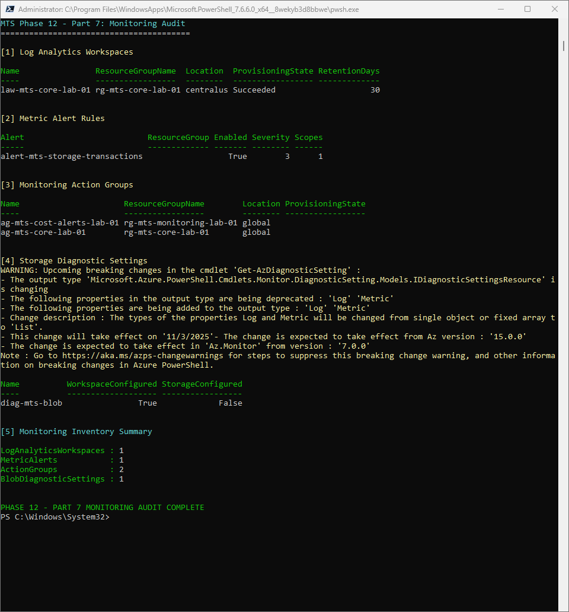

**Result:** PASS — Monitoring resources and configuration verified.

---

## Terraform State Readiness

The Terraform audit began by verifying that the original Phase 09 configuration and local state were available.

### Tooling

| Component | Version |
|---|---|
| Terraform CLI | 1.16.5 |
| AzureRM Provider | 4.81.0 |

### Local Working Directory

```text
C:\Users\Major-Laptop\mts-phase09-terraform
```

### Files and Directories Verified

| Artifact | Status |
|---|---|
| `main.tf` | Present |
| `providers.tf` | Present |
| `variables.tf` | Present |
| `outputs.tf` | Present |
| `terraform.tfstate` | Present |
| `terraform.tfstate.backup` | Present |
| `.terraform.lock.hcl` | Present |
| `.terraform/` | Present |

Phase 09 used local Terraform state rather than an Azure remote backend.

The local state, state backup, provider cache, and other local Terraform artifacts were retained outside the public GitHub repository.

### Evidence

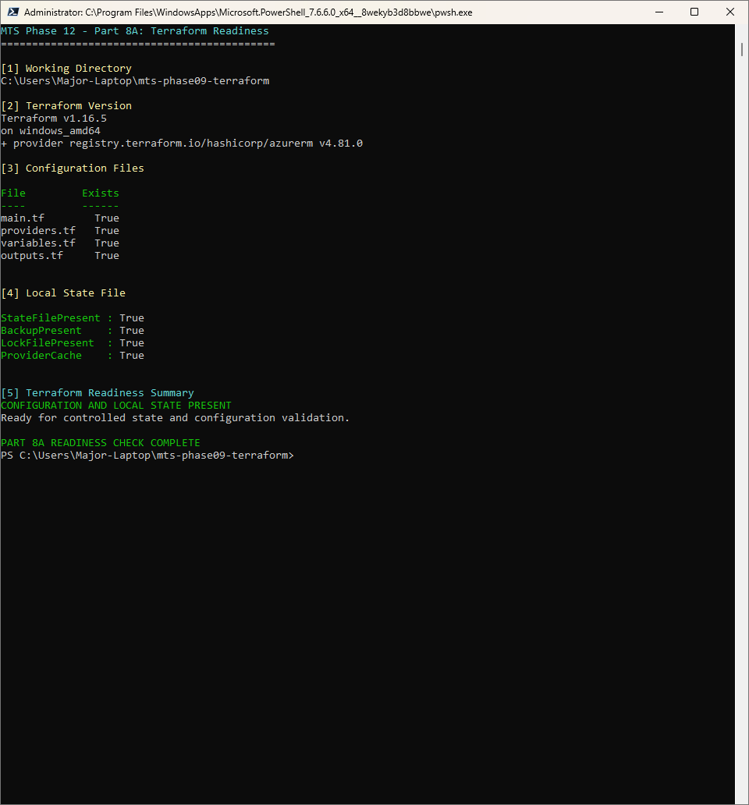

**Result:** PASS — Terraform configuration and local state available.

---

## Terraform State and Drift Validation

Terraform was used to validate the configuration and compare the managed infrastructure against the deployed Azure resources.

### State Metadata

| Property | Value |
|---|---|
| State Format Version | 4 |
| State Terraform Version | 1.16.4 |
| State Serial | 6 |
| Managed Resources | 3 |

The state metadata recorded Terraform version 1.16.4, while the workstation was running Terraform 1.16.5 during Phase 12.

### Terraform-Managed Resources

```text
azurerm_resource_group.iac_lab
azurerm_storage_account.iac_storage
azurerm_storage_container.iac_container
```

These corresponded to:

| Terraform Resource | Azure Resource |
|---|---|
| Resource Group | `rg-mts-iac-lab-01` |
| Storage Account | `stmtsterraformlab01` |
| Blob Container | `terraform-lab` |

### Configuration Validation

```powershell
terraform validate
```

Result:

```text
Success! The configuration is valid.
```

### Infrastructure Drift Detection

A Terraform plan was executed against the existing configuration and state.

```powershell
terraform plan -detailed-exitcode
```

The plan reported:

```text
No changes. Your infrastructure matches the configuration.
```

No infrastructure changes were proposed.

No Terraform apply or destroy operations were performed.

The validation established that the three Terraform-managed resources matched the configuration at the time of the audit.

This result does not apply to Azure resources outside the Phase 09 Terraform configuration.

### Evidence

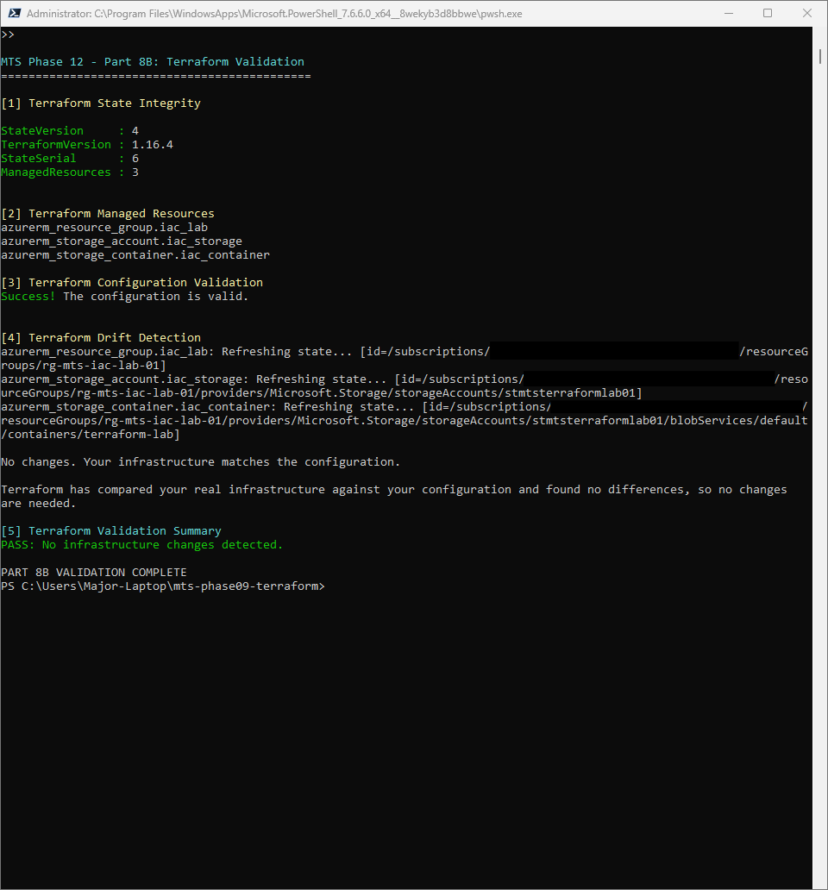

**Result:** PASS — Terraform configuration valid; no managed infrastructure drift detected.

---

## Final Cross-Service Validation

A read-only PowerShell validation script consolidated the infrastructure checks into a final environment assessment.

### Validation Results

| Component | Status | Details |
|---|---|---|
| Azure Context | PASS | Azure for Students |
| Resource Groups | PASS | 5 groups; 0 unhealthy |
| Core Virtual Network | PASS | `vnet-mts-lab-01` |
| NSG and SSH Cleanup | PASS | 3 NSGs; 0 temporary deny rules |
| Virtual Machines | PASS | 3 VMs; 0 running; 3 deallocated |
| Storage TLS and HTTPS | PASS | 2/2 meet baseline |
| Log Analytics | PASS | 1 workspace |
| Metric Alerts | PASS | Storage transaction alert enabled |
| Managed Identity | PASS | 1 user-assigned identity |
| Terraform Azure Resources | PASS | Resource group and storage account |

### Final Results

```text
Total Checks : 10
Passed       : 10
Review Flags : 0
Failed       : 0

PHASE 12 CROSS-SERVICE VALIDATION PASSED
```

The final validation confirmed that all ten selected operational and configuration checks passed.

The result does not indicate that every governance, security, or cost consideration was resolved.

Those findings remain documented below.

### Evidence

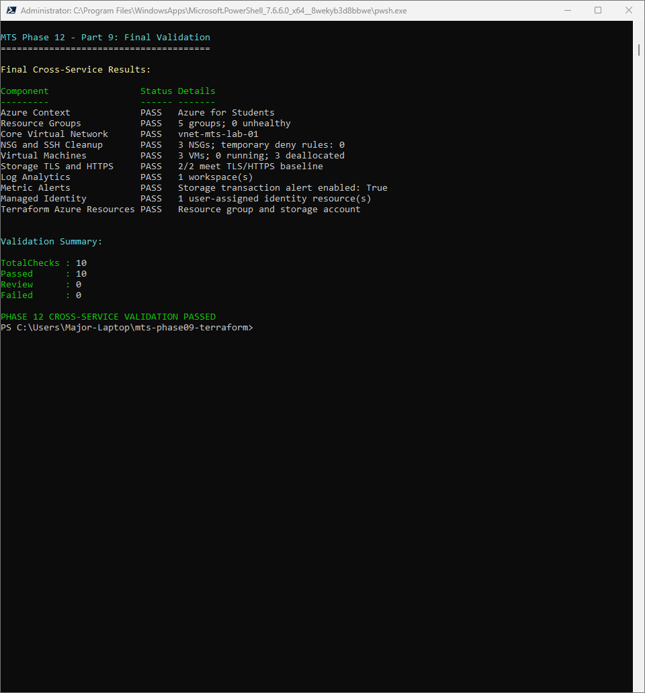

**Result:** PASS — 10/10 cross-service checks passed.

---

## Consolidated Findings

The Phase 12 audits identified several items for future governance improvement, security hardening, and cost review.

| ID | Finding | Recommended Follow-Up |
|---|---|---|
| GOV-01 | Five resources missing expected tags | Review and apply appropriate tags |
| GOV-02 | `NetworkWatcherRG` untagged | Determine whether a platform-resource exception applies |
| SEC-01 | Terraform storage permits anonymous blob access configuration | Consider disabling account-level anonymous access |
| SEC-02 | Both storage accounts allow public network access | Evaluate network restrictions or private connectivity |
| SEC-03 | Management SSH allows one source IPv4 address | Revalidate the authorized administrative source |
| IAM-01 | Two Owner assignments reference one principal ID | Review assignment records if required |
| IAM-02 | Key Vault authorization mode not conclusively established | Confirm the intended authorization model |
| COST-01 | Standard static public IPv4 address remains allocated | Review continued need and cost |
| COST-02 | Managed disks remain allocated | Retain while the virtual machines are needed |

These findings were documented rather than automatically remediated.

No additional changes were required to complete the defined Phase 12 validation scope.

---

## Validation Limitations

Phase 12 was primarily an Azure control-plane and infrastructure configuration assessment.

The following activities were outside the validation scope:

- Live VM operating system or application testing
- New SSH connectivity testing
- Live storage data-plane access testing
- New monitoring alert or notification tests
- Complete Microsoft Entra directory-role enumeration
- Comprehensive effective-permissions analysis
- Network penetration testing
- Deployment of additional Azure infrastructure
- Azure-to-on-premises hybrid connectivity

The three virtual machines remained deallocated during the final validation.

These limitations supported the goal of reviewing the environment without unnecessary cloud resource consumption.

---

## Cost and Operational Readiness

The environment retained three enabled automatic shutdown schedules.

At the time of final validation:

```text
Virtual Machines      : 3
Running               : 0
Deallocated           : 3
Automatic Shutdown    : 3 enabled
```

Deallocation prevented ongoing VM compute charges.

Other allocated services may still incur charges, including:

- Managed disks
- Standard public IPv4 address
- Storage Accounts
- Monitoring and logging services

No resources were deleted solely for cost reduction.

The environment was preserved for future lab activities.

---

## Final Phase Verification

| Validation Area | Result |
|---|---|
| Subscription and Resource Inventory | PASS |
| Governance and Tagging Audit | Completed; findings documented |
| Network Architecture | PASS |
| Management SSH Configuration | PASS |
| VM and Managed Disk Inventory | PASS |
| VM Deallocation | 3/3 |
| Automatic Shutdown Schedules | 3 enabled |
| Azure RBAC and Managed Identity | Validated |
| Key Vault Inventory | Validated; authorization-mode review open |
| Storage TLS and HTTPS | 2/2 PASS |
| Storage Network Access | Reviewed; hardening findings documented |
| Monitoring Configuration | PASS |
| Terraform Configuration | VALID |
| Terraform Drift Detection | No changes |
| Cross-Service Health Checks | 10/10 PASS |

### Final Validation Summary

```text
Azure Resource Groups       : 5
Azure Resources             : 27
Unique Resource Types       : 14

Tagged Resources            : 22
Untagged Resources          : 5
Tag Coverage                : 81.5%

Virtual Machines            : 3
Running VMs                 : 0
Deallocated VMs             : 3

Terraform Managed Resources : 3
Terraform Drift             : None detected

Cross-Service Checks        : 10
Passed                      : 10
Review Flags                : 0
Failed                      : 0
```

**Phase 12 Status: Complete — Azure Environment Validated**

The technical validation passed within the defined assessment scope.

Governance exceptions, security-hardening opportunities, and ongoing cost considerations remain documented for future review.

---

## Skills Demonstrated

- Azure PowerShell and Azure CLI administration
- Azure subscription and resource inventory
- Cloud governance and tagging audits
- Azure VNet, subnet, and NSG validation
- Network interface and private IP verification
- Azure VM lifecycle and cost management
- Microsoft Entra ID and Azure RBAC inspection
- Managed identity validation
- Azure Key Vault inventory and authorization review
- Azure Storage security assessment
- TLS and HTTPS configuration validation
- Azure Monitor and Log Analytics inspection
- Terraform local state validation
- Terraform configuration and drift detection
- Cross-service infrastructure health reporting
- Technical audit documentation

---

## Project Outcome

Phase 12 completes the planned Azure infrastructure validation work across Phases 01–12.

The environment contains a documented foundation of Azure networking, compute, identity, storage, security, monitoring, Infrastructure as Code, automation, and troubleshooting activities.

The final assessment established:

- A verified inventory of 27 Azure resources
- A documented governance and security baseline
- Three deallocated virtual machines
- Validated subnet-level NSG associations
- Two storage accounts meeting the tested TLS/HTTPS requirements
- Available monitoring infrastructure
- Three Terraform-managed resources with no detected drift
- Ten successful cross-service validation checks

The Azure environment is preserved for future expansion, subject to additional design, security, and cost decisions.

---

## Future Project — Hybrid Networking and Identity

The next planned project will extend the Azure infrastructure toward integration with the existing on-premises Windows Server lab.

### Planned Scope

- Review Azure and on-premises network addressing
- Evaluate hybrid connectivity options and cost
- Design routing and network security controls
- Establish connectivity when technically and financially appropriate
- Validate cross-environment communication
- Review DNS and identity integration requirements
- Document hybrid troubleshooting and operational procedures

### Network Environments

| Environment | Address Space |
|---|---|
| On-Premises MTS Lab | `10.10.10.0/24` |
| Azure MTS Lab | `10.20.0.0/16` |

No hybrid connectivity was established during Phase 12.

**Final Result: Phase 12 Complete — Azure Infrastructure Validation Passed.**
